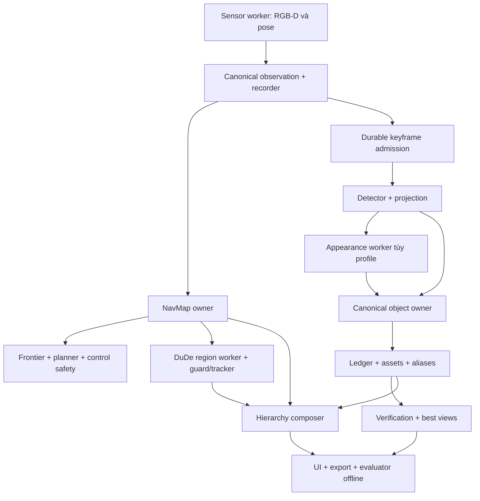

# Thiết kế NeuSymNav đề xuất

Ngày: 2026-10-27. Cơ sở: người dùng đồng ý phân tích tuyển chọn của hai folder và yêu cầu kế hoạch gộp. Các lựa chọn cụ thể trong tài liệu này do agent đề xuất để review; chưa có implementation hoặc benchmark mới.

## 1. Mục tiêu và lựa chọn kiến trúc

Đầu ra là một pipeline online single-floor: quan sát RGB-D/pose simulator, khám phá frontier, dựng object memory có ID và evidence, dựng region/room bằng hình học, xuất hierarchy thống nhất và giải thích được nguồn của node/edge. Có replay để kiểm tra correctness và ablation để đo lợi ích từng phần.

Ba hướng đã cân nhắc:

| Hướng | Đánh đổi | Quyết định đề xuất |
| --- | --- | --- |
| Chép nguyên hai runtime rồi nối JSON cuối | Khởi đầu nhanh nhưng giữ hai identity engine, hai vòng điều phối và graph không thống nhất | Chỉ dùng adapter đọc kết quả cũ cho đối chứng |
| Viết lại toàn bộ | Interface sạch nhưng mất nhiều logic và test đã có, rủi ro thay thuật toán âm thầm | Không chọn |
| Port chọn lọc vào package mới, một object owner, worker ở seam thật | Cần chuẩn hóa contract nhưng tận dụng tài sản tốt và kiểm tra parity từng phần | Chọn cho kế hoạch |

## 2. Tài sản được chọn và nguồn

Mọi đường dẫn nguồn ở bảng tương đối với workspace cha của `NeuSymNav/`.

| Tài sản | Nguồn chính | Cách dùng |
| --- | --- | --- |
| Observation, source frame, projection | `NewOH3DSG/core/`, `perception/base.py`, `mapping/projection.py` | Port contract/validation, adapter hệ tọa độ |
| Canonical ID, Hungarian, ambiguity/cannot-link, voxel fusion | `NewOH3DSG/association/` | Một identity owner; giữ các gate hình học |
| GraphStore, WAL ledger, assets, alias | `NewOH3DSG/scene_graph/{store,event_ledger,assets}.py` | Port object state/evidence, version schema mới |
| Verification, best view, negative evidence | `NewOH3DSG/runtime/online_verification.py`, `perception/{verification,best_view}.py`, `association/negative_evidence.py` | Consume committed evidence; không đồng nhất verified với GT-correct |
| TTL, health, worker isolation | `NewOH3DSG/runtime/` | Runtime mới có fast/graph lanes rõ |
| Sparse tiles, floor/height evidence | `NewOH3DSG/mapping/{occupancy,grid,tile_archive}.py` | NavMap mặc định đề xuất; không claim full 3D occupancy |
| CLIP feature extraction và aggregation | `3DSG/projects/Fusion_Concept_OccuSG/integration_v2/perception_feature_sessions.py`, reference `conceptgraph/slam/{mapping,utils}.py` | Appearance worker, feature space pin; không mang greedy merge thành owner thứ hai |
| DuDe guard/tracker, membership | `3DSG/projects/Fusion_Concept_OccuSG/src/standalone_sg/regions/`, `integration_v2/unified_scene_graph.py` | Region backend và footprint membership online mới |
| Keyframe/store/provider | `3DSG/projects/3DSG/exploration/{keyframe_policy,keyframe_scheduler,keyframe_store,scene_graph_provider,graph_bridge}.py` | Durable graph lane, ordered publication |
| Planner nhiều goal, frontier/controller | `3DSG/projects/3DSG/exploration/{planner,frontier,policy,controller,depth_safety}.py` | Chọn algorithms; adapter tới NavMap chung |
| Place/hierarchy, UI evidence | `NewOH3DSG/scene_graph/{places,hierarchy,relations}.py`, `visualization/` | Canonical hierarchy view; port logic, không copy renderer thứ hai |
| Desktop và live freshness | `3DSG/projects/3DSG/exploration/{desktop,live_dashboard}.py` | PyQt UI process đề xuất; thêm best-view/hierarchy từ New |
| Replay/evaluation/provenance | `NewOH3DSG/recording/`, `evaluation/`; `3DSG/tools/` | Chọn tests, exporter, manifest và rebuild |

Lưu ý source resolution: worker hiện tại của bộ 3DSG ưu tiên Python `Fusion_Concept_OccuSG/src/standalone_sg`; native occupancy/DuDe được build từ `Rebuild_3DScene_OccuSG`. Không chép đè hai package cùng tên. P00 ghi hashes và dependency closure của bản thực dùng.

## 3. Luồng và quyền sở hữu



Object owner quyết định identity và commit. Region owner quyết định geometry/lineage; nhãn phòng không được đổi ID. Hierarchy composer xuất snapshot theo cặp object/map/region revisions đã xác định; không giả transaction chung giữa các owner. Composer dùng đúng NavSnapshot đã tạo ra accepted RegionSnapshot, không yêu cầu bằng latest navigation revision. Region worker pin một input snapshot đang xử lý và một accepted snapshot gần nhất; consumer nhận immutable publication, không giữ lịch sử map vô hạn. Object revision được ghi riêng; membership là quan hệ đối với geometry của source_map_revision, không claim toàn graph đồng thời với control. Publication ghi latest_nav_revision và map lag/age để người dùng thấy độ trễ. Khi worker reject/timeout, giữ geometry cũ với stale=true và không tạo membership mới từ geometry đó (status unavailable). Kết quả accepted trở lại cho phép compose theo map nguồn đã pin; không dùng exact equality với latest nav để làm graph đói cập nhật.

Room input (2026-10-31): nhánh region dựng raster tích lũy ở resolution gốc từ
immutable measured occupancy tiles, tách khỏi NavSnapshot cục bộ của control.
Không dùng MapOverview đã coarsen. Tile history giữ phân loại FREE chỉ sau các
gate planar/height/floor; room NavSnapshot tái dựng floor support và lower-bound
clearance cho riêng các ô FREE với đúng robot geometry của mapper. Đây là bằng
chứng lịch sử, không phải depth mới ở mọi ô. Head source/frame/clock/calibration
và revision được giữ; geometry input scope và extent được công bố riêng.

Dense room input tối đa 1 triệu ô, raw history giữ budget4096tiles/16MiB hiện hành.
Thiếu, không đầy đủ, sai source hoặc vượt extent thì region stale/unavailable,
không crop/coarsen để giả complete. Native DuDe reset khi origin/resolution/shape
đổi, canonical tracker Python vẫn giữ và match với toàn bộ hình học tích lũy.
Place admission vẫn dựa local source-bound pose; published structural place paths
có thể được revalidate trên phân loại lịch sử, luôn motion_certificate=false.
Full accumulated room map không bao giờ trở thành map đầu vào MotionGuard/control.

Navigation mặc định frontier-only. Graph không điều khiển trực tiếp motion trong core. Điều này cho phép xác minh graph mà không trộn tác động của ObjectNav policy vào chất lượng perception.

Navigation movement revision (2026-11-04): live launcher enables discrete
heading control and gain/heading-aware frontier selection. For this simulator's
serial action executor, a command is either translation or yaw, with 12°/6°
heading hysteresis. Hard source TTL300ms, command horizon100ms, cylinder/clearance
checks, collision-filtered actuation and speed caps remain. Speed is not softly
derated solely by source age in this mode; actual command lifetime is still
bounded by the ORIGINAL depth and map captures. The guard issues the command
after geometry validation, so validation time does not consume a newly issued
100ms horizon. It rechecks the original evidence expiry at that point.

Bootstrap validates only the forward centerline distance reachable within the
remaining command horizon and source TTL, with the robot radius/margin and
curved-pulse expansion applied to the swept capsule. It does not impose an
extra fixed forward distance. Fresh measured depth must still certify those
bootstrap cells; the NavSnapshot separately checks FREE state, floor support and
height clearance over the actual swept footprint and intended path. Unknown or
occupied cells in either required sweep continue to stop the command.

Gain-aware selection offers up to8 spatially separated views per boundary
component (64 total), uses bounded boundary-size gain and first-path heading
cost, and prefers new goals at least0.6m away when a farther reachable goal
exists. Close reachable goals remain a fallback. A committed target is replanned
against every current map; boundary extraction resumes when choosing the next
target. Origin-only rolling does not restart velocity acceleration. Missing map
output does not count as fresh geometric-failure evidence or erase a short
existing failure window; pause/error and evidence gaps still reset that window.

Experimental `allow_fresh_map_lag` remains OFF by default: it allows a map from
an older frame of the same sensor only while both captures are within300ms and
the current depth/pose independently certifies the whole swept footprint.
Map source/revision and command depth source remain distinct; no retimestamping.
Local bootstrap uses a conservative ray subset with the unchanged measured-vote
kernel, never historical/no-return floor evidence. Native throughput regression
in this experiment prevents promoting it to the normal demo path. Rebuild M5
geometry, source pins, guards and membership ownership are unchanged.

## 4. Contract bắt buộc cho core

Tên và chữ ký dưới đây là đích triển khai, chưa phải module có sẵn. P01 tạo dataclasses frozen với array read-only hoặc copy sở hữu riêng, serialization versioned và validation. Các kiểu phụ nội bộ do implementer quyết định.

### Geometry và nguồn quan sát

- Canonical world **Z-up**, right-handed, mặt bằng XY, mét/radian; camera optical +X phải, +Y xuống, +Z trước; depth metric axial. Yaw dương theo right-hand quanh +Z.
- Adapter New Y-up dùng `p_new = R @ p_old`, `R=[[1,0,0],[0,0,-1],[0,1,0]]`: `(x,y,z)→(x,-z,y)`. Camera-to-world pose nhân trái homogeneous R; không nhân phải để đổi world. Đổi camera Habitat→optical là phép riêng. Covariance đổi `R C R.T`, AABB tính lại từ tám đỉnh, polygon/heading/velocity đổi cùng quy ước.
- `FrameKey(episode_id: str, sensor_id: str, frame_index: int)` duy nhất theo episode+sensor; `Observation(key: FrameKey, capture_monotonic_ns: int, clock_domain: str, sim_time_s: float, rgb: ndarray, depth_m: ndarray, valid_depth: ndarray, K: ndarray, T_world_camera: ndarray, calibration_id: str, pose_version: int, modality: str)`.
- No-return/far-plane là trường optional có chứng nhận range riêng; invalid depth không được suy thành free. Core hỗ trợ depth camera nhìn xuống phục vụ navigation/bootstrap, có K/pose/sensor_id riêng; không dùng mask RGB chính lên depth phụ. Depth phụ có thể bọc Observation với RGB placeholder được đánh dấu modality=depth_only; không được gửi detector. P01 validate modality=rgbd|depth_only và đường tiêu thụ tương ứng. Multi-sensor OctoMap vẫn thuộc E1.
- `DetectionBatch(source: FrameKey, geometry_hash: str, vocabulary_id: str, detections: tuple[Detection,...], completion: str, cap_reached: bool)`; `Detection(detection_id: str, raw_label: str, category: str | None, score: float, mask: ndarray)` mask bool H×W ảnh gốc. completion thuộc complete/partial/failed/unknown; cap_reached=true hoặc completion khác complete cấm negative evidence. Batch rỗng complete là dữ liệu hợp lệ, phải được commit như batch event. Canonical taxonomy versioned, giữ raw label và unknown; không sinh vocab từ GT active scene.
- `ObjectObservation(source: FrameKey, detection_id: str, geometry_hash: str, points_world: ndarray, camera_position: tuple[float,float,float], raw_label: str, category: str | None, score: float, evidence_kind: str, appearance: AppearanceFeature | None)`; `AppearanceBatch(source: FrameKey, geometry_hash: str, features: dict[str, AppearanceFeature])` và `AppearanceFeature(space_id: str, vector: ndarray)` chứa checkpoint/preprocessing identity qua space_id. Khác space hoặc dimension phải reject/disable có lý do, không so cosine tùy tiện.

### State và các interface

- `NavSnapshot(episode_id, revision, source, capture_monotonic_ns, clock_domain, resolution_m, origin_xy, states, floor_support, clearance, robot_geometry_id)`; states=unknown/free/occupied. Core không seed free từ semantic/navmesh GT. Floor datum là `floor_z_m` cấu hình theo scene calibration single-floor, kèm `floor_datum_source` và calibration hash; chuyển datum từ source Y-up trước sử dụng, không lấy mặc định 0 cho mọi scene. Đây là scalar calibration được khai báo, không phải bản đồ/semantic GT. Bootstrap có depth camera riêng nhìn thẳng xuống (optical axis canonical -Z), calibrated height/FOV phải phủ starting footprint và forward corridor đầu tiên; quay yaw tại chỗ bổ sung depth trước. Gate hình học kiểm coverage bằng ray-ground intersections và measured valid depth, không giả downward camera luôn đủ. Nếu fixture/native không quan sát đủ floor+clearance cho bước đầu, báo bootstrap_blocked; không seed free hoặc mở nới footprint. P03 phải kiểm gate này trước campaign.
- `ObjectSnapshot(episode_id, revision, source, objects, aliases)`; mỗi object giữ UUID, geometry, lifecycle, evidence refs và revision. `CommitResult(snapshot: ObjectSnapshot, committed_event_ids: tuple[str,...])`.
- `RegionSnapshot(episode_id, revision, source_map_revision, floor_id, regions, stale)`; `RegionGrid(episode_id, source_map_revision, resolution_m, origin_xy, values, preprocessing_policy)` là raster riêng cho DuDe, row-major [y,x], int8 -1 unknown/0 free/100 occupied, không suy z_floor/z_ceiling. Core pin `preprocessing_policy=extended_unknown_boundary` và ghi policy trong provenance; không claim parity với MapConversion hoặc preprocessing source khác policy; region có ID, polygon, predecessor IDs, adjacency. `HierarchySnapshot(episode_id, revision, object_revision, map_revision, region_revision, nodes, edges, statuses, latest_nav_revision, source_map_age_ns)`; mỗi membership có assigned/ambiguous/unassigned/unavailable và provenance.
- `PoseSource.capture() -> Observation` trả primary RGB-D; `PoseSource.capture_navigation() -> Observation` trả depth_only độc lập có pose/time/calibration thực; `Detector.infer(observation: Observation) -> DetectionBatch`; `Projector.project(observation: Observation, batch: DetectionBatch) -> tuple[ObjectObservation,...]`.
- `AppearanceEncoder.encode(observation: Observation, batch: DetectionBatch) -> AppearanceBatch` features keyed detection_id, source/geometry_hash phải khớp trước attach; feature không tự tạo detection mới.
- `NavMapper.update(observation: Observation) -> NavSnapshot`; `RegionBackend.update(nav: NavSnapshot) -> RegionSnapshot`; adapter NavSnapshot→RegionGrid giữ raster observed-free và unknown, không inflation lần hai. Port narrow DuDe wire (values/origin/resolution/revision), không tạo FreeSpaceGrid2D giả có floor/ceiling. Parity test dùng cùng raster và extended_unknown_boundary; kiểm output/preprocessing không biến unknown thành free. Region geometry là phân vùng raster này, không tự là functional room hoặc robot path.
- `ObjectOwner.commit(source: Observation, batch: DetectionBatch, observations: tuple[ObjectObservation,...]) -> CommitResult`; deduplicate bởi `(FrameKey,detection_id,evidence_kind)`, một writer; validate batch/projected observations cùng source và geometry hash. Batch event key là (FrameKey, detector_profile_id, vocabulary_id); profile ID được owner cấu hình và pin theo episode. Lưu batch completeness, source timestamps, source image/depth refs, masks/crops, committed views và negative-visibility evidence trong cùng transaction, kể cả batch không có object. Negative visibility tính với pre-commit object geometry của đúng source context; chỉ complete/non-saturated batch được dùng. Unique event không làm last_seen đi ngược; replay restart phải restore dispatch watermark. Core object lane chỉ primary RGB-D sensor, navigation depth phụ không được gửi vào object lane; tích hợp nhiều depth vào OctoMap thuộc E1.
- `HierarchyComposer.compose(objects: ObjectSnapshot, nav: NavSnapshot, regions: RegionSnapshot, *, latest_nav_revision: int, now_ns: int, clock_domain: str) -> HierarchySnapshot`; geometry membership dùng object footprint, không dùng camera position. Alias canonicalize mọi endpoint.
- `VerificationOwner.consume(commit: CommitResult) -> None` đọc committed views từ ledger, không suy detection count từ graph node. Negative evidence cần complete detector batch, clear depth và đúng source/revision.
- `Navigator.step(nav: NavSnapshot, robot_xy: tuple[float,float], yaw_rad: float, now_ns: int) -> NavigationDecision`; `NavigationDecision(goal_id, path, desired_linear_mps, desired_yaw_radps, map_revision, reason)`; `MotionGuard.filter(decision: NavigationDecision, latest: Observation, now_ns: int) -> MotionCommand`. MotionCommand có deadline và source/map revisions.

### Freshness, scheduling, persistence

- Fast lane dùng latest-wins và monotonic clock: depth safety mặc định 300 ms; tracked overlay 300 ms; semantic fast result 750 ms, inference-start 250 ms. Đây là đề xuất profile kế thừa, phải đo actual age; không tự nới để qua gate. Các controller guard chặt hơn vẫn giữ khi port.
- Durable graph lane: một in-flight, tối đa hai pending, một protected pending, cap payload pending+in-flight 32 MiB theo 3DSG. Keyframe quá 750 ms vẫn có thể xây lịch sử graph, nhưng status là historical; không dùng như semantic fast result hoặc negative visibility hiện tại. Chỉ một đường commit mỗi event. Hai lane không gọi hai detector cho cùng frame theo mặc định.
- Live clock_domain định danh host boot; worker restart cùng host boot không đổi domain, host reboot/host khác thì domain mới. Domain khác không được trừ trực tiếp. Replay dùng replay clock riêng; historical không qua motion guard. Worker failure ngừng publication phụ thuộc, ghi replay-required; stop motion nếu sensor/nav freshness không còn hợp lệ.
- Ledger+assets phục hồi atomically ở mức object commit. Region failure không rollback ngầm object ledger. Graph export giữ source revisions và stale flags. Raw-keyframe disk cap 2 GiB, tổng run cap 8 GiB: ngừng admission và shutdown có lý do trước khi vượt cap, giữ accepted evidence/pending refs; recorder tạo incomplete certificate khi thiếu input; không ghi completed khi mất frame.

## 5. Cấu trúc đích và môi trường

```text
NeuSymNav/
  AGENTS.md, README.md, pyproject.toml
  docs/                         # thiết kế, kế hoạch, status, provenance
  src/neusymnav/
    contracts/ geometry/ sensors/ perception/ mapping/
    objects/ regions/ hierarchy/ verification/ navigation/
    runtime/ recording/ evaluation/ visualization/ cli.py
  configs/                      # profiles, taxonomy, runtime paths
  native/ vendor/               # chỉ dependency closure cần dùng + notices
  tests/                        # unit, integration, replay, native opt-in
  tools/                        # preflight, build, verify
  runs/                         # ignored; outputs/evidence
```

Core host Python 3.12 là đề xuất; P00 kiểm chứng import requirements trước khi pin. Habitat/YOLOE/OpenCLIP/native dùng interpreter hoặc process thích hợp với môi trường sẵn có. Không nâng phiên bản Torch/NumPy toàn bộ chỉ để đồng nhất. Core contracts/CPU tests phải chạy không cần model, simulator hoặc display. Dữ liệu/model dùng manifest ngoài package; source runtime cuối không phụ thuộc `../NewOH3DSG`/`../3DSG`, không symlink source ra ngoài.

## 6. Phạm vi và tiêu chí

Core: N1–N6 và D1–D6 của phân tích; appearance có profile bật/tắt và chỉ promote khi evidence ủng hộ; hierarchy và room geometry phải có đường chạy thật. Detector mặc định đề xuất YOLOE11s theo baseline New, với profile actual resolution rõ; không tuyên bố hơn YOLO11n. UI PyQt một process, tái dùng presentation logic New.

Extensions, **không thuộc việc tự thực thi core**:

- E1: OctoMap native + multi-depth mapping; chỉ khi cần occupancy 3D và đã định nghĩa quan hệ với NavMap.
- E2: rule-based room semantics rồi Room Belief; tách khỏi geometry ID, có unknown/abstention. Qwen/A-table chưa là default.
- E3: instance-aware/ObjectNav policy, sau baseline frontier và identity đạt gate riêng.
- E4: multi-floor, SLAM hoặc arbitrary neuro-symbolic reasoning; cần spec mới. Tên NeuSymNav không chứng minh đã có các khả năng này.

Correctness gates là hard: source/geometry đúng, idempotency, alias không dangling/cycle, stale control bị chặn, unknown không free, recovery không mất accepted evidence, GT isolation. Runtime gates đo bằng dữ liệu thật: bounded memory/queues, cleanup, latency/drop/freshness và graph progress. Quality claims cần replay đối chứng cùng input/protocol, không chỉ số node tăng. Chi tiết campaign và điều kiện quyết định ở P10; các test lịch sử không được cộng vào kết quả mới.


## Opt-in long demo runtime (2026-10-29)

User-approved direction is recorded in `new-reference-runtime-audit.md`. The
explicit `long_demo` profile permits up to600s and selects `npz_v2` lossless
recording. Legacy profiles retain300s ceiling, JSON replay and existing disk
limits. Extended policy ceilings are archive<=raw/2, raw<=24GiB,total<=32GiB;
pre-start available disk must cover total cap plus1GiB. These are bounded
allocations, not promises that a run will complete. Sampled RSS10GiB/VRAM5GiB
limits and all motion/freshness contracts remain unchanged.

Optional `runtime` cadence separates primary capture from fresh navigation on
one simulator owner. Candidate primary5Hz/navigation20Hz skips missed timing
slots instead of catchup. Control still requires the exact current navigation
map, with source-one-use and original capture timestamps. Selective rendering
draws/reads only the requested lane; navigation capture carries a source-bound
body pose in the same transaction. No background thread calls Habitat.

Binary replay carries versioned scalar metadata plus exact NPY arrays in a
bounded lossless archive; v1 JSON remains readable. Admission reserves pending
upper bounds, worker completion replaces them with actual durable bytes plus
manifest/atomic headroom. Failed or missing evidence cannot certify complete.
Long-profile measurement bounds are explicit (trace<=512MiB,proof records<=20000)
to retain600s evidence without silently truncating a4096-record baseline.
Independent review and measured native evidence are required before claiming
throughput or long-run validation; P10 campaign protocol remains separate.

Forensic latency telemetry is bounded and observation-only. Resource RSS
artifacts retain a bounded per-sample trace (timestamps, duration, process count,
support/error class, phase/PID and sampler disposition) plus bounded provider
attempt records; this does not change cap enforcement or resource completeness.
NavMap records source-bound spans for prepare, core integration, projection,
raycast, vote integration, core snapshot publication, fresh coverage, NavSnapshot,
overview snapshot and tile overview under the existing whole-update timing.
Control records carry a versioned navigation diagnostic with goal ID/XY, up to64
evenly sampled world-space path points, full path point count/truncation,
lookahead XY, wrapped heading error and decision reason. These traces do not feed
back into motion, TTL, map selection or UI publication.

UI publication may optionally coalesce before pixel/crop/mask preparation via
`ui.publish_hz`; skipped publications are display-only, carry no fresh source
claim, and never delay command ACK processing. The long profile requests2Hz.
Canonical export obtains hierarchy and its exact immutable nav atomically from
`Pipeline.snapshot_bundle()`, independent of the UI's retained/coalesced bundle.
Object checkpoint revision, map revision, episode and clock checks still reject
incoherent exports; consumers do not relabel stale UI maps to make them match.

Run completion is profile-scoped. A Hydra-only graph profile does not require a
legacy hierarchy/NavMap/object bundle: it may report `completed` when its
Hydra-native graph export is complete and recording, measurements, and cleanup
are complete. Other profiles retain their required export checks. This outcome
does not set `native_runtime_validated`; that remains a separate P10 acceptance
gate.

## M5 room ownership (2026-11-03)

For the Rebuild RGB-D M1–M5 profile, accepted and fresh M5 regions are the sole
room partition source. The hierarchy publishes those source regions and derives
object membership from their polygons with the M5 map domain, accepted map
revision and M5 revision attached. Stale, rejected, mismatched or unavailable M5
results cannot create assigned membership. M5 adjacency is structural metadata,
not a motion certificate. The temporal RoomOwner, stable-room IDs/states, portal
hypotheses and their UI/debug projections have been removed.

The older generic region lane remains available only to profiles that do not
enable `workers.room_pipeline`; it is retained for baseline comparison and is not
composed alongside M5 regions in the full Rebuild profile. This choice does not
change ObjectOwner, canonical object IDs, control navigation, occupancy safety or
the strict M5 polygon validator.

Rebuild comparison backend (2026-11-02): an explicit opt-in
`workers.region.backend=rebuild_m4_m5` uses the readonly pinned Rebuild M4 worker
and original source M5 guard/tracker on the same accumulated measured room input.
The source M5 owns region IDs; publication validation commits a trial M5 processor
only together with a valid immutable snapshot. Backend diagnostics record external
source closure/binary hashes and `source` preprocessing, distinct from baseline
`extended_unknown_boundary`. Navigation occupancy and motion safety are unchanged.
Portal debug overlays/list are opt-in via UI. See docs/rebuild-backend.md and its
results report; this extension does not claim the whole Rebuild mapping pipeline.

Full Rebuild RGB-D mapping (2026-11-02): `workers.room_pipeline` receives the
primary RGB-D `Observation` directly and owns one M1–M5 session per episode. It
never consumes NavMapper grids and does not participate in control scheduling,
depth freshness or command deadlines. Its queue, byte budget, failures and
source/binary pins are reported separately. `RoomPipelinePublication` remains a
typed source distinct from `NavSnapshot`; the Rebuild hierarchy, map view and
export consume that source while control navigation stays unchanged. See
`docs/rebuild-full-room-audit.md` for implementation and validation scope.

The display envelope may carry that publication as an independent typed source
with its own capture age. The dashboard keeps a separate Rebuild M3/M5 map tab;
it overlays M5 only when the accepted region revision matches the displayed M3
revision, and labels an older accepted pair without drawing it over a newer
raster. Final export writes `room-pipeline.json` separately from `nav.json` and
the hierarchy. This follows implementation-plan P08/P09's atomic source tagging
and export manifest; it does not merge M3 into control navigation.


### Optional rolling navigation memory (2026-11-06 / Kiet_branch2)

`navigation.mapper.local_retention_s` enables a square cell-aligned control
window using existing `snapshot_radius_m`. Planar, floor and each height voxel
retain independent last-observed captures; expiry clears to unknown/unsupported,
never decays toward FREE. Outside cells/tiles are discarded without archive
reactivation; per-sensor watermarks replace unbounded rolling frame history.
Absent setting preserves legacy. Full measured ray collection is unchanged;
only persistent vote integration is cropped. Current-depth bootstrap, original
source TTL300ms, command horizon100ms and collision filtering remain mandatory.
Retention memory age is distinct from control freshness. Historical overview
and Hydra graph retain their own bounded/publication semantics and are never
fresh motion certificates. Measured rolling profile selected is2m/10s after2m/30s comparison; experimental
long performance remains below acceptance (selected300s6.38% refusals). See the dated results
report; no claim of global planning or ObjectNav completion is added here.

### Optional current-depth control lane (2026-11-06)

`navigation.controller.local_depth_control=true` separates asynchronous world
NavMapper/Navigator from synchronous measured-depth control. One navigation worker
owns frontier policy and emits immutable world intent with original source, pose/
calibration/floor/robot scope, world revision and expiry at originalcapture+2s.
Intent is a planning input; every moving command still requires a new measured-only
local NavSnapshot, current pose and unchanged MotionGuard proof (300ms depth/map
age,100ms horizon, measured floor/height/unknown/swept capsule). Local raster radius
is min(world radius,max(1m,robot radius+margin+.4m)); outside evidence is unknown.
Local map revisions increase independently for the whole episode; commands in this
mode never fall back to world-map revisions. Control skips exact world-map waiting.

Navigation diagnostic schema v2 retains v1 path fields and adds the closed pair
`control_map_scope=local_measured_depth_v1` / `world_intent` provenance. Null intent
requires zero motion and no path. Metadata binds registered original captures;
separate stage timings expose map/follower/guard/world-planner work. Legacy mode
and v1 remain available. Transient lack of local proof stops immediately while
persistent recovery uses distinct fresh WORLD revisions; expired intent invalidates
by identity so a newer publication survives. Fault/pause invalidates the generation.
Native performance/readiness is established separately in the result report.

Optional `runtime.world_navigation_hz` (local mode only, at most10Hz) limits the
asynchronous world mapper independently of local depth/capture/control. Cadence
waits outside locks before taking the latest pending original capture/pose. First
update is immediate; no catchup queue, no delayed shutdown, no rewritten timestamp.
World no-path outcomes feed the existing fresh-world-revision recovery watchdog
when local intent is absent. Runtime diagnostics report both local STOPs and world
planner reason counts/source age so a low freshness ratio cannot hide starvation.


### Hydra optional threshold/seed stability v1 (Kiet_branch2, 2026-11-07)

Worker-only dataset key `neusymnav_room_stability` is consumed before native config
loading; absent/disabled preserves stock loading. Enabled requires pinned private DSO
path/SHA and ABI version `neusymnav-room-stability-v1`. The bridge loads before native
Python bindings and verifies exactly one mapped `libhydra.so`. Build provenance closes
over native binding, private DSO, policy, bridge and worker source. Accepted responses
pin this metadata for the episode; snapshot/projection and journal carry bounded native
decisions bound to accepted source/revision. No GT, labels or UI state enter RoomFinder.

RoomFinder proposes raw PLATEAU thresholds as before, recomputes current components at
accepted level, and confirms a changed proposal across three strictly newer nonzero
max-place-update timestamps. This proxy does not prove independent viewpoints. Invalid
observations reset pending; loss of all held seed support permits raw fallback. Instance
destruction clears policy state. Neither previous membership replay nor frozen room
geometry is introduced. This stabilizes threshold choice, not room lifecycle/identity or
physical/semantic correctness. Control/navigation contracts remain independent.

The profile remains experimental pending repeated cost/live/scene validation; see
`docs/results/hydra-threshold-seed-stability-2026-11-07.md` and artifact design/evidence.


### Optional bundled validation entries (2026-11-07)

`backends/hydra/validation_entry.py` and `runtime/ui_validation_entry.py` are opt-in
source-confined diagnostic worker entries. Explicit profile script/SHA pins select them;
normal entrypoints are unchanged. They capture bounded accepted graph summaries and
actual Qt post-render provenance/screenshots, without sensor, threshold, navigation or
control changes. Artifacts do not act as runtime worker code. Offscreen proofs do not
certify physical desktop visibility. The experimental stability profile composed with
current movement is `configs/demo-00805.hydra-room-stability-local-depth.experimental.local.json`;
it preserves the existing local-depth profile's runtime/navigation. It remains unpromoted.
