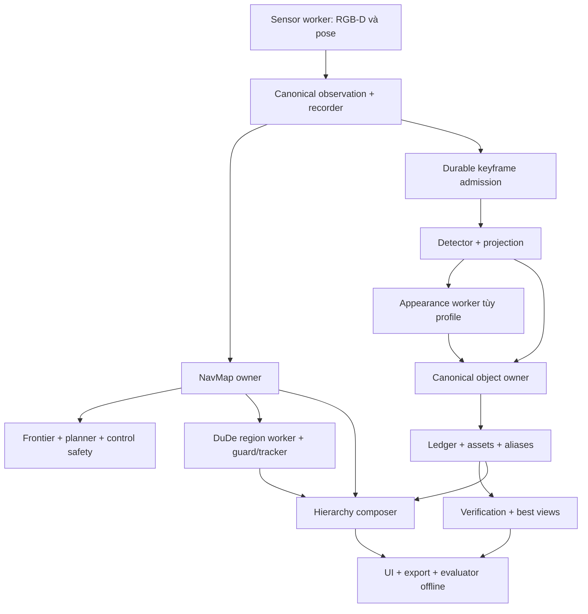

# Thiết kế NeuSymNav đề xuất

Ngày: 2026-10-27. Cơ sở: người dùng đồng ý phân tích tuyển chọn của hai folder và yêu cầu kế hoạch gộp. Các lựa chọn cụ thể trong tài liệu này do agent đề xuất để review; chưa có implementation hoặc benchmark mới.

## 1. Mục tiêu và lựa chọn kiến trúc

Đầu ra là một pipeline online single-floor: quan sát RGB-D/pose simulator, khám phá frontier, dựng object memory có ID và evidence, dựng region/room bằng hình học, xuất hierarchy thống nhất và giải thích được nguồn của node/edge. Có replay để kiểm tra correctness và ablation để đo lợi ích từng phần.

Ba hướng đã cân nhắc:

| Hướng | Đánh đổi | Quyết định đề xuất |
| --- | --- | --- |
| Chép nguyên hai runtime rồi nối JSON cuối | Khởi đầu nhanh nhưng giữ hai identity engine, hai vòng điều phối và graph không thống nhất | Chỉ dùng adapter đọc kết quả cũ cho đối chứng |
| Viết lại toàn bộ | Interface sạch nhưng mất nhiều logic và test đã có, rủi ro thay thuật toán âm thầm | Không chọn |
| Port chọn lọc vào package mới, một object owner, worker ở seam thật | Cần chuẩn hóa contract nhưng tận dụng tài sản tốt và kiểm tra parity từng phần | Chọn cho kế hoạch |

## 2. Tài sản được chọn và nguồn

Mọi đường dẫn nguồn ở bảng tương đối với workspace cha của `NeuSymNav/`.

| Tài sản | Nguồn chính | Cách dùng |
| --- | --- | --- |
| Observation, source frame, projection | `NewOH3DSG/core/`, `perception/base.py`, `mapping/projection.py` | Port contract/validation, adapter hệ tọa độ |
| Canonical ID, Hungarian, ambiguity/cannot-link, voxel fusion | `NewOH3DSG/association/` | Một identity owner; giữ các gate hình học |
| GraphStore, WAL ledger, assets, alias | `NewOH3DSG/scene_graph/{store,event_ledger,assets}.py` | Port object state/evidence, version schema mới |
| Verification, best view, negative evidence | `NewOH3DSG/runtime/online_verification.py`, `perception/{verification,best_view}.py`, `association/negative_evidence.py` | Consume committed evidence; không đồng nhất verified với GT-correct |
| TTL, health, worker isolation | `NewOH3DSG/runtime/` | Runtime mới có fast/graph lanes rõ |
| Sparse tiles, floor/height evidence | `NewOH3DSG/mapping/{occupancy,grid,tile_archive}.py` | NavMap mặc định đề xuất; không claim full 3D occupancy |
| CLIP feature extraction và aggregation | `3DSG/projects/Fusion_Concept_OccuSG/integration_v2/perception_feature_sessions.py`, reference `conceptgraph/slam/{mapping,utils}.py` | Appearance worker, feature space pin; không mang greedy merge thành owner thứ hai |
| DuDe guard/tracker, membership | `3DSG/projects/Fusion_Concept_OccuSG/src/standalone_sg/regions/`, `integration_v2/unified_scene_graph.py` | Region backend và footprint membership online mới |
| Keyframe/store/provider | `3DSG/projects/3DSG/exploration/{keyframe_policy,keyframe_scheduler,keyframe_store,scene_graph_provider,graph_bridge}.py` | Durable graph lane, ordered publication |
| Planner nhiều goal, frontier/controller | `3DSG/projects/3DSG/exploration/{planner,frontier,policy,controller,depth_safety}.py` | Chọn algorithms; adapter tới NavMap chung |
| Place/hierarchy, UI evidence | `NewOH3DSG/scene_graph/{places,hierarchy,relations}.py`, `visualization/` | Canonical hierarchy view; port logic, không copy renderer thứ hai |
| Desktop và live freshness | `3DSG/projects/3DSG/exploration/{desktop,live_dashboard}.py` | PyQt UI process đề xuất; thêm best-view/hierarchy từ New |
| Replay/evaluation/provenance | `NewOH3DSG/recording/`, `evaluation/`; `3DSG/tools/` | Chọn tests, exporter, manifest và rebuild |

Lưu ý source resolution: worker hiện tại của bộ 3DSG ưu tiên Python `Fusion_Concept_OccuSG/src/standalone_sg`; native occupancy/DuDe được build từ `Rebuild_3DScene_OccuSG`. Không chép đè hai package cùng tên. P00 ghi hashes và dependency closure của bản thực dùng.

## 3. Luồng và quyền sở hữu



Object owner quyết định identity và commit. Region owner quyết định geometry/lineage; nhãn phòng không được đổi ID. Hierarchy composer xuất snapshot theo cặp object/map/region revisions đã xác định; không giả transaction chung giữa các owner. Composer dùng đúng NavSnapshot đã tạo ra accepted RegionSnapshot, không yêu cầu bằng latest navigation revision. Region worker pin một input snapshot đang xử lý và một accepted snapshot gần nhất; consumer nhận immutable publication, không giữ lịch sử map vô hạn. Object revision được ghi riêng; membership là quan hệ đối với geometry của source_map_revision, không claim toàn graph đồng thời với control. Publication ghi latest_nav_revision và map lag/age để người dùng thấy độ trễ. Khi worker reject/timeout, giữ geometry cũ với stale=true và không tạo membership mới từ geometry đó (status unavailable). Kết quả accepted trở lại cho phép compose theo map nguồn đã pin; không dùng exact equality với latest nav để làm graph đói cập nhật.

Navigation mặc định frontier-only. Graph không điều khiển trực tiếp motion trong core. Điều này cho phép xác minh graph mà không trộn tác động của ObjectNav policy vào chất lượng perception.

## 4. Contract bắt buộc cho core

Tên và chữ ký dưới đây là đích triển khai, chưa phải module có sẵn. P01 tạo dataclasses frozen với array read-only hoặc copy sở hữu riêng, serialization versioned và validation. Các kiểu phụ nội bộ do implementer quyết định.

### Geometry và nguồn quan sát

- Canonical world **Z-up**, right-handed, mặt bằng XY, mét/radian; camera optical +X phải, +Y xuống, +Z trước; depth metric axial. Yaw dương theo right-hand quanh +Z.
- Adapter New Y-up dùng `p_new = R @ p_old`, `R=[[1,0,0],[0,0,-1],[0,1,0]]`: `(x,y,z)→(x,-z,y)`. Camera-to-world pose nhân trái homogeneous R; không nhân phải để đổi world. Đổi camera Habitat→optical là phép riêng. Covariance đổi `R C R.T`, AABB tính lại từ tám đỉnh, polygon/heading/velocity đổi cùng quy ước.
- `FrameKey(episode_id: str, sensor_id: str, frame_index: int)` duy nhất theo episode+sensor; `Observation(key: FrameKey, capture_monotonic_ns: int, clock_domain: str, sim_time_s: float, rgb: ndarray, depth_m: ndarray, valid_depth: ndarray, K: ndarray, T_world_camera: ndarray, calibration_id: str, pose_version: int, modality: str)`.
- No-return/far-plane là trường optional có chứng nhận range riêng; invalid depth không được suy thành free. Core hỗ trợ depth camera nhìn xuống phục vụ navigation/bootstrap, có K/pose/sensor_id riêng; không dùng mask RGB chính lên depth phụ. Depth phụ có thể bọc Observation với RGB placeholder được đánh dấu modality=depth_only; không được gửi detector. P01 validate modality=rgbd|depth_only và đường tiêu thụ tương ứng. Multi-sensor OctoMap vẫn thuộc E1.
- `DetectionBatch(source: FrameKey, geometry_hash: str, vocabulary_id: str, detections: tuple[Detection,...], completion: str, cap_reached: bool)`; `Detection(detection_id: str, raw_label: str, category: str | None, score: float, mask: ndarray)` mask bool H×W ảnh gốc. completion thuộc complete/partial/failed/unknown; cap_reached=true hoặc completion khác complete cấm negative evidence. Batch rỗng complete là dữ liệu hợp lệ, phải được commit như batch event. Canonical taxonomy versioned, giữ raw label và unknown; không sinh vocab từ GT active scene.
- `ObjectObservation(source: FrameKey, detection_id: str, geometry_hash: str, points_world: ndarray, camera_position: tuple[float,float,float], raw_label: str, category: str | None, score: float, evidence_kind: str, appearance: AppearanceFeature | None)`; `AppearanceBatch(source: FrameKey, geometry_hash: str, features: dict[str, AppearanceFeature])` và `AppearanceFeature(space_id: str, vector: ndarray)` chứa checkpoint/preprocessing identity qua space_id. Khác space hoặc dimension phải reject/disable có lý do, không so cosine tùy tiện.

### State và các interface

- `NavSnapshot(episode_id, revision, source, capture_monotonic_ns, clock_domain, resolution_m, origin_xy, states, floor_support, clearance, robot_geometry_id)`; states=unknown/free/occupied. Core không seed free từ semantic/navmesh GT. Floor datum là `floor_z_m` cấu hình theo scene calibration single-floor, kèm `floor_datum_source` và calibration hash; chuyển datum từ source Y-up trước sử dụng, không lấy mặc định 0 cho mọi scene. Đây là scalar calibration được khai báo, không phải bản đồ/semantic GT. Bootstrap có depth camera riêng nhìn thẳng xuống (optical axis canonical -Z), calibrated height/FOV phải phủ starting footprint và forward corridor đầu tiên; quay yaw tại chỗ bổ sung depth trước. Gate hình học kiểm coverage bằng ray-ground intersections và measured valid depth, không giả downward camera luôn đủ. Nếu fixture/native không quan sát đủ floor+clearance cho bước đầu, báo bootstrap_blocked; không seed free hoặc mở nới footprint. P03 phải kiểm gate này trước campaign.
- `ObjectSnapshot(episode_id, revision, source, objects, aliases)`; mỗi object giữ UUID, geometry, lifecycle, evidence refs và revision. `CommitResult(snapshot: ObjectSnapshot, committed_event_ids: tuple[str,...])`.
- `RegionSnapshot(episode_id, revision, source_map_revision, floor_id, regions, stale)`; `RegionGrid(episode_id, source_map_revision, resolution_m, origin_xy, values, preprocessing_policy)` là raster riêng cho DuDe, row-major [y,x], int8 -1 unknown/0 free/100 occupied, không suy z_floor/z_ceiling. Core pin `preprocessing_policy=extended_unknown_boundary` và ghi policy trong provenance; không claim parity với MapConversion hoặc preprocessing source khác policy; region có ID, polygon, predecessor IDs, adjacency. `HierarchySnapshot(episode_id, revision, object_revision, map_revision, region_revision, nodes, edges, statuses, latest_nav_revision, source_map_age_ns)`; mỗi membership có assigned/ambiguous/unassigned/unavailable và provenance.
- `PoseSource.capture() -> Observation` trả primary RGB-D; `PoseSource.capture_navigation() -> Observation` trả depth_only độc lập có pose/time/calibration thực; `Detector.infer(observation: Observation) -> DetectionBatch`; `Projector.project(observation: Observation, batch: DetectionBatch) -> tuple[ObjectObservation,...]`.
- `AppearanceEncoder.encode(observation: Observation, batch: DetectionBatch) -> AppearanceBatch` features keyed detection_id, source/geometry_hash phải khớp trước attach; feature không tự tạo detection mới.
- `NavMapper.update(observation: Observation) -> NavSnapshot`; `RegionBackend.update(nav: NavSnapshot) -> RegionSnapshot`; adapter NavSnapshot→RegionGrid giữ raster observed-free và unknown, không inflation lần hai. Port narrow DuDe wire (values/origin/resolution/revision), không tạo FreeSpaceGrid2D giả có floor/ceiling. Parity test dùng cùng raster và extended_unknown_boundary; kiểm output/preprocessing không biến unknown thành free. Region geometry là phân vùng raster này, không tự là functional room hoặc robot path.
- `ObjectOwner.commit(source: Observation, batch: DetectionBatch, observations: tuple[ObjectObservation,...]) -> CommitResult`; deduplicate bởi `(FrameKey,detection_id,evidence_kind)`, một writer; validate batch/projected observations cùng source và geometry hash. Batch event key là (FrameKey, detector_profile_id, vocabulary_id); profile ID được owner cấu hình và pin theo episode. Lưu batch completeness, source timestamps, source image/depth refs, masks/crops, committed views và negative-visibility evidence trong cùng transaction, kể cả batch không có object. Negative visibility tính với pre-commit object geometry của đúng source context; chỉ complete/non-saturated batch được dùng. Unique event không làm last_seen đi ngược; replay restart phải restore dispatch watermark. Core object lane chỉ primary RGB-D sensor, navigation depth phụ không được gửi vào object lane; tích hợp nhiều depth vào OctoMap thuộc E1.
- `HierarchyComposer.compose(objects: ObjectSnapshot, nav: NavSnapshot, regions: RegionSnapshot, *, latest_nav_revision: int, now_ns: int, clock_domain: str) -> HierarchySnapshot`; geometry membership dùng object footprint, không dùng camera position. Alias canonicalize mọi endpoint.
- `VerificationOwner.consume(commit: CommitResult) -> None` đọc committed views từ ledger, không suy detection count từ graph node. Negative evidence cần complete detector batch, clear depth và đúng source/revision.
- `Navigator.step(nav: NavSnapshot, robot_xy: tuple[float,float], yaw_rad: float, now_ns: int) -> NavigationDecision`; `NavigationDecision(goal_id, path, desired_linear_mps, desired_yaw_radps, map_revision, reason)`; `MotionGuard.filter(decision: NavigationDecision, latest: Observation, now_ns: int) -> MotionCommand`. MotionCommand có deadline và source/map revisions.

### Freshness, scheduling, persistence

- Fast lane dùng latest-wins và monotonic clock: depth safety mặc định 300 ms; tracked overlay 300 ms; semantic fast result 750 ms, inference-start 250 ms. Đây là đề xuất profile kế thừa, phải đo actual age; không tự nới để qua gate. Các controller guard chặt hơn vẫn giữ khi port.
- Durable graph lane: một in-flight, tối đa hai pending, một protected pending, cap payload pending+in-flight 32 MiB theo 3DSG. Keyframe quá 750 ms vẫn có thể xây lịch sử graph, nhưng status là historical; không dùng như semantic fast result hoặc negative visibility hiện tại. Chỉ một đường commit mỗi event. Hai lane không gọi hai detector cho cùng frame theo mặc định.
- Live clock_domain định danh host boot; worker restart cùng host boot không đổi domain, host reboot/host khác thì domain mới. Domain khác không được trừ trực tiếp. Replay dùng replay clock riêng; historical không qua motion guard. Worker failure ngừng publication phụ thuộc, ghi replay-required; stop motion nếu sensor/nav freshness không còn hợp lệ.
- Ledger+assets phục hồi atomically ở mức object commit. Region failure không rollback ngầm object ledger. Graph export giữ source revisions và stale flags. Raw-keyframe disk cap 2 GiB, tổng run cap 8 GiB: ngừng admission và shutdown có lý do trước khi vượt cap, giữ accepted evidence/pending refs; recorder tạo incomplete certificate khi thiếu input; không ghi completed khi mất frame.

## 5. Cấu trúc đích và môi trường

```text
NeuSymNav/
  AGENTS.md, README.md, pyproject.toml
  docs/                         # thiết kế, kế hoạch, status, provenance
  src/neusymnav/
    contracts/ geometry/ sensors/ perception/ mapping/
    objects/ regions/ hierarchy/ verification/ navigation/
    runtime/ recording/ evaluation/ visualization/ cli.py
  configs/                      # profiles, taxonomy, runtime paths
  native/ vendor/               # chỉ dependency closure cần dùng + notices
  tests/                        # unit, integration, replay, native opt-in
  tools/                        # preflight, build, verify
  runs/                         # ignored; outputs/evidence
```

Core host Python 3.12 là đề xuất; P00 kiểm chứng import requirements trước khi pin. Habitat/YOLOE/OpenCLIP/native dùng interpreter hoặc process thích hợp với môi trường sẵn có. Không nâng phiên bản Torch/NumPy toàn bộ chỉ để đồng nhất. Core contracts/CPU tests phải chạy không cần model, simulator hoặc display. Dữ liệu/model dùng manifest ngoài package; source runtime cuối không phụ thuộc `../NewOH3DSG`/`../3DSG`, không symlink source ra ngoài.

## 6. Phạm vi và tiêu chí

Core: N1–N6 và D1–D6 của phân tích; appearance có profile bật/tắt và chỉ promote khi evidence ủng hộ; hierarchy và room geometry phải có đường chạy thật. Detector mặc định đề xuất YOLOE11s theo baseline New, với profile actual resolution rõ; không tuyên bố hơn YOLO11n. UI PyQt một process, tái dùng presentation logic New.

Extensions, **không thuộc việc tự thực thi core**:

- E1: OctoMap native + multi-depth mapping; chỉ khi cần occupancy 3D và đã định nghĩa quan hệ với NavMap.
- E2: rule-based room semantics rồi Room Belief; tách khỏi geometry ID, có unknown/abstention. Qwen/A-table chưa là default.
- E3: instance-aware/ObjectNav policy, sau baseline frontier và identity đạt gate riêng.
- E4: multi-floor, SLAM hoặc arbitrary neuro-symbolic reasoning; cần spec mới. Tên NeuSymNav không chứng minh đã có các khả năng này.

Correctness gates là hard: source/geometry đúng, idempotency, alias không dangling/cycle, stale control bị chặn, unknown không free, recovery không mất accepted evidence, GT isolation. Runtime gates đo bằng dữ liệu thật: bounded memory/queues, cleanup, latency/drop/freshness và graph progress. Quality claims cần replay đối chứng cùng input/protocol, không chỉ số node tăng. Chi tiết campaign và điều kiện quyết định ở P10; các test lịch sử không được cộng vào kết quả mới.


## Opt-in long demo runtime (2026-10-29)

User-approved direction is recorded in `new-reference-runtime-audit.md`. The
explicit `long_demo` profile permits up to600s and selects `npz_v2` lossless
recording. Legacy profiles retain300s ceiling, JSON replay and existing disk
limits. Extended policy ceilings are archive<=raw/2, raw<=24GiB,total<=32GiB;
pre-start available disk must cover total cap plus1GiB. These are bounded
allocations, not promises that a run will complete. Sampled RSS10GiB/VRAM5GiB
limits and all motion/freshness contracts remain unchanged.

Optional `runtime` cadence separates primary capture from fresh navigation on
one simulator owner. Candidate primary5Hz/navigation20Hz skips missed timing
slots instead of catchup. Control still requires the exact current navigation
map, with source-one-use and original capture timestamps. Selective rendering
draws/reads only the requested lane; navigation capture carries a source-bound
body pose in the same transaction. No background thread calls Habitat.

Binary replay carries versioned scalar metadata plus exact NPY arrays in a
bounded lossless archive; v1 JSON remains readable. Admission reserves pending
upper bounds, worker completion replaces them with actual durable bytes plus
manifest/atomic headroom. Failed or missing evidence cannot certify complete.
Long-profile measurement bounds are explicit (trace<=512MiB,proof records<=20000)
to retain600s evidence without silently truncating a4096-record baseline.
Independent review and measured native evidence are required before claiming
throughput or long-run validation; P10 campaign protocol remains separate.

UI publication may optionally coalesce before pixel/crop/mask preparation via
`ui.publish_hz`; skipped publications are display-only, carry no fresh source
claim, and never delay command ACK processing. The long profile requests2Hz.
Canonical export obtains hierarchy and its exact immutable nav atomically from
`Pipeline.snapshot_bundle()`, independent of the UI's retained/coalesced bundle.
Object checkpoint revision, map revision, episode and clock checks still reject
incoherent exports; consumers do not relabel stale UI maps to make them match.
