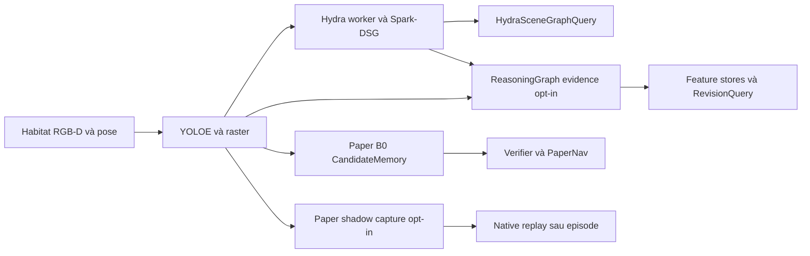
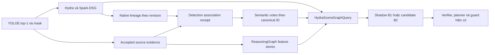
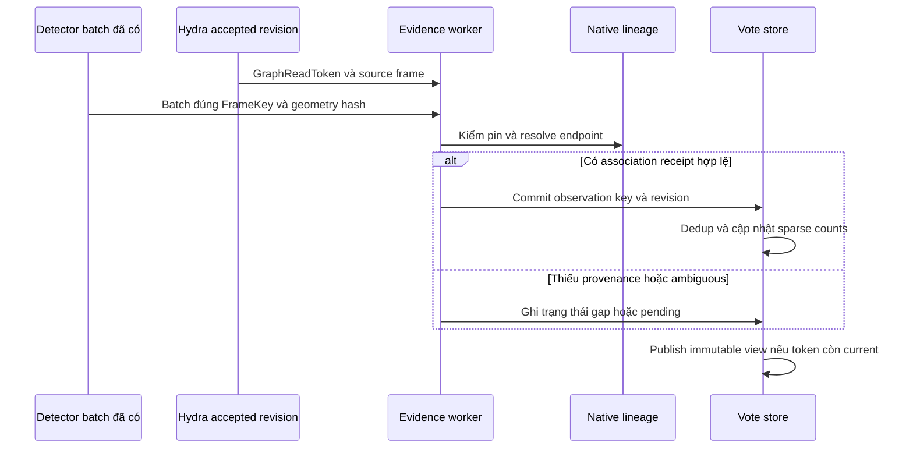
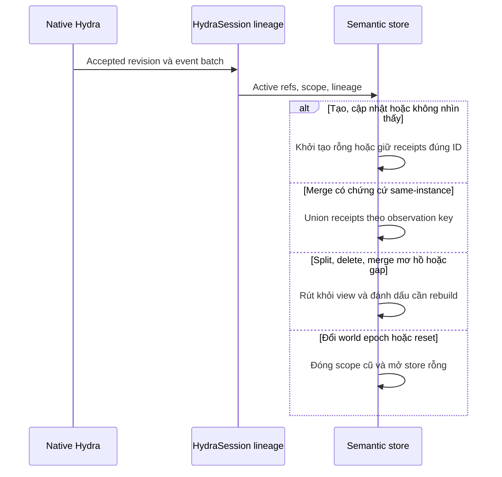
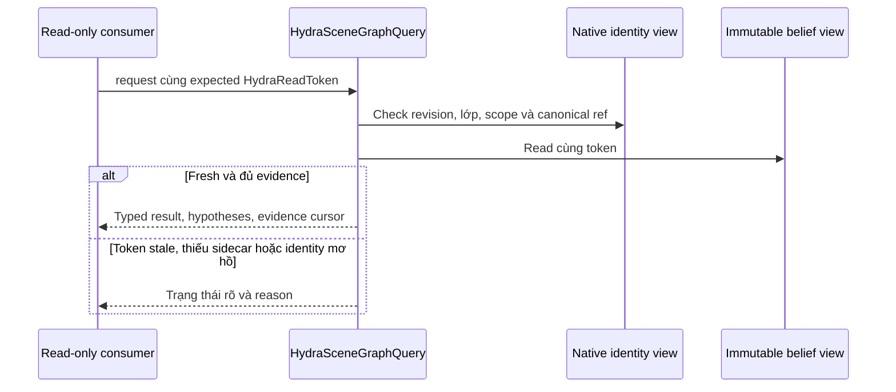
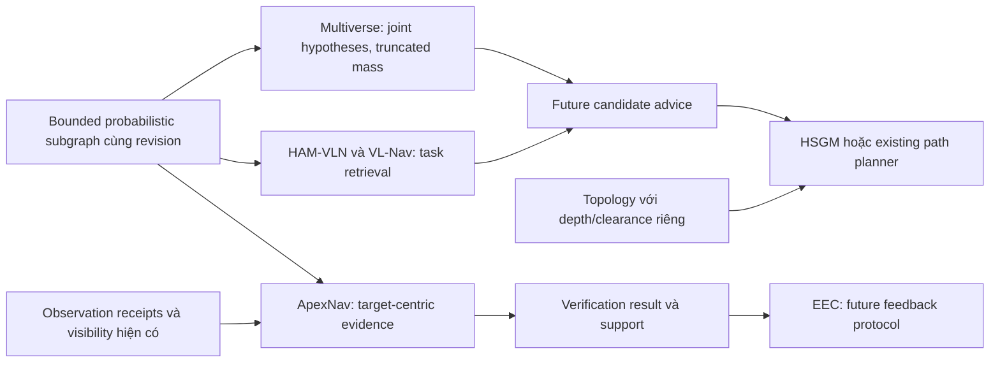

# Thiết kế Probabilistic Semantic Memory cho NeuSymNav

Phạm vi là L3, với một consumer thử nghiệm đọc L3 cho ObjectNav. Giữ Hydra/Spark-DSG làm owner geometry, native graph và topology. `HydraSession` sở hữu view canonical suy từ journal native. ReasoningGraph sở hữu object/room embeddings và edge features. Semantic memory sở hữu vote receipts và thống kê trên canonical ID đã được owner cấp. [Audit](current-system-audit.md) · [Paper-to-code](technical-analysis.md) · [Contracts](probabilistic-scene-graph-contracts.md).

## Chọn điểm tích hợp

| Phương án | Hệ quả |
| --- | --- |
| Derived vote sidecar trên accepted observation stream | Dùng lại native graph, lineage và evidence. Có thể bật shadow, khôi phục bằng journal và rollback reader. Cần exact join, producer receipt và giới hạn retention. Chọn cho L3. |
| Thêm trường xác suất vào Spark-DSG native attrs | Tốn schema/ABI/IPC migration, buộc rebuild và đồng bộ với cả geometry. Xét lại nếu consumer native sau này cần dữ liệu tại C++. Chưa cần cho read API Python. |
| Port PSG-Nav mapping độc lập | Tạo thêm point cloud, association và object ID. Vi phạm ownership và làm ablation không còn cùng baseline. Loại. |

### Kiến trúc hiện tại

### Kiến trúc tích hợp đề xuất

## Observation update

Tại acceptance, dùng source exact để join revision, raster/detector batch, calibration, timestamp, native journal và endpoint. Vote từ canonicalized detector category dưới đúng vocabulary, mỗi observation hợp lệ một phiếu. Không dùng native label làm nhãn observation. Không dùng score để weight. Hòa thì sắp category ID theo lexicographic order để replay ổn định. Khi rỗng, `unavailable`, `observation_count=0`, không có phân phối. Entropy dùng natural log và trả 0 chính xác cho một hypothesis. Xem khác biệt với v1 upstream ở [phân tích kỹ thuật](technical-analysis.md).

Queue và commit chạy trong worker background. Vị trí tap thích hợp là sau khi `EvidenceProducer` đã đối chiếu exact batch, trước khi bỏ `DetectionGeometry.category`. Không phát sinh inference, IPC mesh query hoặc I/O từ control tick. Revision đã được Hydra accept mà semantic feed chưa theo kịp cho kết quả `unavailable` hoặc `stale`. Drop/timeout của evidence lane ghi coverage và reason. Không generalize last-source timestamp thành object observation. `cap_reached` được lưu để đánh giá coverage, một instance dương tính đã có receipt vẫn có thể là valid observation.

## Lifecycle

Object inactive vẫn giữ state sau khi ra khỏi active window nếu owner còn chứng nhận canonical identity và graph còn endpoint. Không tìm thấy endpoint thì rút khỏi read view. Khi re-observe, chỉ nối lại nếu owner resolve đúng canonical ID trong scope. Khi merge, native lineage chứng minh graph entity nào tồn tại sau event. Association support chứng minh tập receipts thuộc cùng physical object. Nếu thiếu kiểm tra thứ hai, quarantine tập bị ảnh hưởng và rebuild từ receipts xem xét được. Split chỉ chuyển receipt có assignment child đã chứng nhận. Nếu journal hiện không đủ thì invalidate. Không được giả lập split bằng raw ID mới và overlap gần nhất.

## Query và candidate retrieval

Object, room và subgraph query chia sẻ Hydra facade. Room context đính belief vào object members đang có, bảo toàn trạng thái membership và relation. Derived groups chỉ là bounded subgraphs với pins, giữ place nodes cho topology. Không tổng hợp room categorical posterior. Candidate list B2 dùng ngưỡng/tie-break pin trên development split. Native search candidate có trạng thái `unverified`. Paper B0 chỉ nhận candidate nếu có join causal native→CID từ cùng observation evidence. Shadow Paper hiện capture và replay offline, nên cần graph/evidence path trước thời điểm act và join độc lập trước khi có B2. Nếu thiếu join, không tạo CID mới từ native raw ID. Giữ existing baseline fallback cho category search, đồng thời ghi reason để đo tỷ lệ fallback. Verify/STOP dùng các điều kiện B0 hiện có. Probabilities không sửa safety, approach, exploration, action space hay execution.

## Ranh giới tương lai

ApexNav cần visibility, occlusion, observed-free/occupied/unknown, source frustum, match confidence và verification. Vote và detector confidence có thể cùng nguồn nên consumer phải biết overlap receipts trước khi fuse. Không phát negative evidence từ detector absence. Multiverse có thể dùng top-k và preserved tail mass với cap, factorization explicit và semantic filtering bounded. L3 chỉ xuất marginal cùng provenance, không giả independence. EEC nhận verifier verdict theo protocol có nguồn và uncertainty. Strict zero-shot giữ evaluator offline. Lifelong cần định nghĩa feedback và reset bank riêng. HAM-VLN/VL-Nav nhận room/context/edges/alternatives và quyền advise. HSGM nhận geometry/navigation status riêng và không suy traversability từ structural edge. [Đối chiếu upstream](technical-analysis.md#ranh-giới-tham-chiếu-tương-lai).

## CPU, memory và retention

Một write vote tăng sparse count O(1) amortized và index observation key theo hash. Khi materialize view cho object đổi, O(K log K) để sắp K category đã thấy, entropy O(K). `K ≤ V` là native detector vocabulary pin, hiện khoảng 59 object labels trên profile Hydra đã kiểm. Không rebuild dense array cho mọi object mỗi tick. M4 tính category retrieval từ inverted index theo category (`O(C log k)` với C candidates và bounded top-k), room/subgraph duyệt tối đa số node/edge đã xin. Shared assets tham chiếu theo hash. State mới không giữ RGB-D crop, mesh hoặc embedding copy. Snapshot được đọc trong host, IPC vẫn dùng native detail lane hiện có.

RAM tăng theo N observation keys và số pairs object/category có vote. Trần khởi điểm đề xuất là 16.384 receipt và 16 MiB cho canonical ledger payload tuần tự hóa, đo Python RSS riêng vì object overhead lớn hơn encoded bytes. Giữ immutable view current và tối đa một view đang commit, trong cùng budget read/write đã đo. Khi đầy, reject cả transaction, ghi saturation, giữ dedup keys và aggregate cũ cho export lịch sử. Không publish state mới dưới nhãn complete. Rebuild phải đọc đúng sealed receipt stream và canonical history, hoặc trả unavailable nếu thiếu. Không âm thầm drop receipt rồi đếm lại khi replay. Không dùng GPU mới cho faithful baseline. [Ngân sách chạy thử và cách đo](evaluation-plan.md#tài-nguyên-và-latency).

Soft evidence là thí nghiệm riêng sau B1/B2. Official single-frame option đọc distribution mới nhất, trong khi YOLOE contract hiện có confidence top-1. Nếu một backend sau này expose class scores toàn vocabulary, cần pin score domain, class mapping, preprocessing, detection/mask alignment và calibration trước khi so sánh với votes. CLIP cosine ranking vẫn chỉ là feature score và cần protocol riêng nếu muốn xây calibrated model. Không thêm Dirichlet, calibration, weighted counts hoặc smoothing vào faithful baseline.
