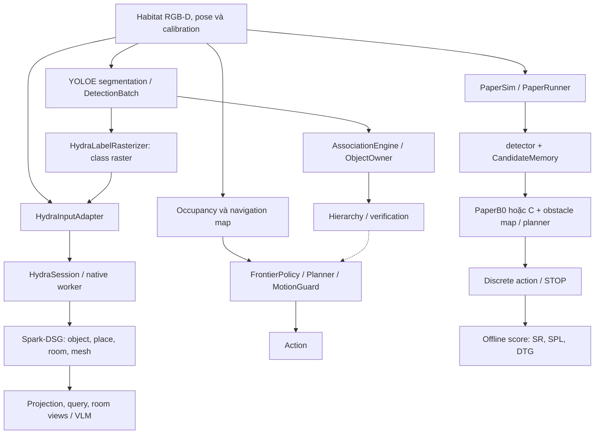

# Kiểm kê hệ thống hiện tại cho ReasoningGraph

Ngày 2026-11-26. Phạm vi là source và artifact cục bộ, không chạy simulator/GPU hoặc sửa implementation. Snapshot Git `8f0521e5d10f6965ce96173329673033d23d350b` có nhiều thay đổi và file chưa theo dõi. Kết luận mô tả cả working tree, không chỉ commit. Các đường chạy dưới đây không phải một pipeline duy nhất. Tên class chỉ tới code hiện tại, không mặc định chứng minh khả năng end-to-end.

## Cấu trúc và tài liệu đang dùng

`src/neusymnav/` chứa contracts, simulation/sensor transport, perception, object memory, hydra/room backends, runtime, navigation, visualization và evaluation. `tools/` là entry points và offline diagnostics, `configs/` giữ profiles/benchmarks, `tests/` có fixtures/runtime checks, `.runtime/` chứa interpreter và native workspace local, `runs/` lưu exports và evaluation. Rebuild/DuDe và Hydra là các backend có đường chạy riêng. [Architecture](../architecture.md), [kế hoạch core P00–P10](../implementation-plan.md), [running](../running.md), [status](../implementation-status.md).

## Các đường dữ liệu đang tồn tại

Sơ đồ gộp các thành phần để chỉ quan hệ dữ liệu. Cạnh nét đứt chỉ luồng lockstep đọc hierarchy của backend riêng. Demo live chọn `scene_graph.backend=hydra` qua `tools/run_hydra_map_demo.sh`, cấu hình mặc định CPU theo scene. Coordinator cấp frame bất đồng bộ và đọc projection. ObjectOwner/AssociationEngine là đường object memory riêng, không giả định native Hydra dùng cùng CID. `tools/objectnav/run_episodes.py` chạy ObjectNav lockstep, có B0 và các tùy chọn A/S/C. `tools/objectnav/run_paper_episodes.py` gọi `PaperRunner`, `PaperSim`, `PaperB0Policy`/C, detector và `CandidateMemory` riêng. Paper launcher chưa cấp frame cho Hydra hoặc đọc room graph. Kết quả paper thuộc nhánh riêng. Lựa chọn default chuẩn Hydra + Qwen3-VL CPU được pin trong launcher. B0 v2 dùng detector profile cùng nguồn config nhưng không chạy Hydra. Xem [audit Hydra/ObjectNav](../objectnav/hydra-msgnav-audit.md) và [running](../running.md).

## Provenance và môi trường

- Host `Ubuntu 24.04.5 LTS`, kernel `7.0.0-43-generic`, `.venv` Python 3.12.3. `pyproject.toml` khai báo numpy, scipy, PyYAML, Pillow, Python >=3.12. Sensor env Python 3.9.23 có distribution Habitat-Sim 0.3.3. ROS Jazzy base package `0.11.0-1noble.20261105.164630`. Preflight paper đọc env và dataset, không khởi tạo simulator. CUDA/GPU chưa được khởi tạo. `nvidia-smi` exit 9, driver không giao tiếp được. RTX 3060 Laptop 6 GiB là cấu hình tham chiếu. ROS2 Jazzy thuộc native environment, còn luồng dữ liệu giữa các worker dùng transport repo.
- `.runtime/hydra_ws/dependencies.lock.yaml`: Hydra 2.0.0 upstream `MIT-SPARK/Hydra` commit `2e58a35baea629eee8838409771876acff015daf`. Spark-DSG 1.1.3 `MIT-SPARK/Spark-DSG` commit `3c40997e4ae739c56ed3cdd6ef5e882d403d8b64`. `git rev-parse HEAD` hai checkout khớp lock và `git status --short` trống tại thời điểm audit. Installed CMake package versions khớp các version này. `CMAKE_HOME_DIRECTORY` của hai build trỏ tới đúng hai checkout. Chưa có clean rebuild để chứng minh byte reproducibility từ source head.
- `.runtime/hydra_ws/env.sh` source `/opt/ros/jazzy/setup.bash`, workspace install và ưu tiên Python bindings / install libraries. Import `hydra_python,spark_dsg` bằng `.runtime/hydra_ws/.venv/bin/python` sau source env thành công. `/proc/self/maps` ghi nhận `install/hydra/lib/libhydra.so` và `install/spark_dsg/lib/libspark_dsg.so`. Host `.venv` không import được `hydra` (tên và môi trường này khác `hydra_python`), không chứng minh native worker lỗi.
- SHA-256 `install/hydra/lib/libhydra.so`: `1e10618e81dd5484b52ba43b39042685e9a9b3421b3577cacbd0130b58746e9c`. `build/hydra/libhydra.so`: `a655dc3152f7d96d69b57ee954a18f6edfd6457887499465f020648b1b489161`. Chúng **khác byte**. Spark `build/spark_dsg/libspark_dsg.so` và `install/spark_dsg/lib/libspark_dsg.so` cùng hash `2d23752c447fe556e067471df7fd32f6b0104a5e28646e238e1bb0982cd8e795`. Hydra build/install có cùng ELF build ID `cb6ccf0ba1990744e60addd5f2835b3cf95726dd`. Áp đúng CMake `file(RPATH_CHANGE … NEW_RPATH "")` từ install recipe lên bản sao build trong /tmp cho binary khớp byte với install. Đây là bằng chứng liên kết build/install đang có. Chưa tái dựng từ commit để kiểm toàn chuỗi source→binary hoặc test runtime graph và ABI room-stability tùy chọn.

## Existing capability matrix

Phân loại theo phạm vi từng capability. **Fully implemented** có đường chạy trọn vẹn cho mục đích ghi rõ. **Partially implemented** còn thiếu nối contract hoặc bằng chứng. **Not implemented** chưa thấy đường chạy cho chức năng đã nêu. **Incompatible** có interface khác contract cần tích hợp. **Unknown** chưa đủ bằng chứng. I/O được tóm tắt tại ranh giới, không diễn giải như API mới. Cột cuối ghi limitation và điểm nối ReasoningGraph. Path tương đối với `src/neusymnav/` trừ entry points `tools/` và native checkout.

| Capability / trạng thái | Code và I/O hiện tại | Giới hạn. Tương đương / thay đổi cần thiết |
|---|---|---|
| Habitat RGB-D + pose trong mỗi runner — Fully implemented | `sensors/habitat_worker.py:HabitatCapture`, `sensors/client.py:HabitatPoseSource`, `objectnav/paper/sim_worker.py:PaperSim`: simulator → observation, pose/calibration | Hai runner có sensor path khác. Kiểm calibration/extrinsics và nguồn theo episode trước cấp vào semantic layer. |
| YOLOE detection + segmentation — Fully implemented | `perception/yoloe.py:YOLOEDetector` → `DetectionBatch`, masks, labels, confidence. `Projector` → geometry | YOLOE class raster không giữ mapping detection → Hydra node. RG cần observation evidence có identity và model provenance. |
| Association + CID — Partially implemented | `objects/association.py:AssociationEngine`, `objects/store.py:ObjectOwner`, `objects/conceptgraphs.py`, `objects/fusion.py:VoxelCloud`: detection/geometry → tracks, object state/aliases | Đây không phải cùng identity với native Hydra hoặc paper `CandidateMemory`. Xác định owner và mapping có thể kiểm chứng trước fusion. |
| Lifecycle object — Partially implemented | `objects/store.py:ObjectOwner`, `objects/ledger.py:Ledger`. Native `backends/hydra/worker.py`, `graph_adapter.py` xuất revision snapshot | Có state và projection, chưa chứng minh event stream merge/delete/remap đồng bộ giữa native graph và semantic extensions. Cần invalidate/orphan handling. |
| Mesh/TSDF/ESDF/point cloud — Partially implemented | native Hydra/Spark-DSG tạo graph và mesh. `objects/fusion.py:VoxelCloud`. `mapping/occupancy.py` và rolling map | Hai native exports đã lưu có mesh links. Audit này chưa chứng minh ESDF hoặc API mesh-feature assignment cho RG. Không đồng nhất occupancy và ESDF. |
| Object/place/room topology — Partially implemented | `backends/hydra/graph_adapter.py:HydraGraphAdapter`, `query.py:HydraSceneGraphQuery`. `hierarchy/places.py`, `membership.py` | Native projection có revision và namespace. Room là hình học, nhãn semantic riêng. Cần quản lý split/merge/reassignment khi cache feature. |
| Semantic labels / visual embeddings — Partially implemented | `HydraLabelRasterizer`, `perception/appearance_worker.py:encode_rgb_features`, `objects/appearance.py:fuse_visual`. YOLOE `LocalMobileCLIPPromptProvider` | MobileCLIP text prompt embedding không chứng minh object feature RG. Profile demo được xem có `appearance_mode=off`. Hai graph native đã kiểm có `semantic_feature` rỗng 0×0. Cần shared space, model/preprocess/version, fusion và retrieval có kiểm thử. |
| Object-object relationships — Not implemented cho RG | Native graph projection có edge tổng quát, `query.py` chủ yếu query objects/category | Hai snapshot được kiểm có 0 edge trong object layer. Không suy mọi graph đều vậy. Chưa thấy relational visual embedding / directed relationship service. Thêm edge lifecycle và evidence. |
| Room semantics / VLM — Partially implemented | `rooms/service.py:RoomLabelDebugService`, `rooms/vlm_backend.py:RoomVlmBackend`. Room views → label proposal | Gán nhãn phòng không phải RG room feature clustering hay relational reasoning. Cần query và invalidation theo room revision. |
| DeepSeek projected tokens → VLM — Incompatible | `rooms/vlm_backend.py:RoomVlmBackend` dùng ảnh/text cho room hoặc crop verdict | Có thể tái dùng worker transport pattern. API hiện tại thiếu DeepSeek visual-token layout/checkpoint pairing. |
| Native merge continuity — Unknown | `MeshSegmenter::mergeActiveNodes` và `MergeTracker::applyMerges` có quyết định native. `_graph_summary` chỉ xuất snapshot | Chưa chứng minh lifecycle stream đủ để cộng features qua revision. |
| Task reasoning — Not implemented cho RG | Paper policy và room VLM có logic chuyên biệt. Không thấy service query subgraph / evaluate relation theo RG | Cần service trả evidence, uncertainty và candidate IDs. Policy/coordinator vẫn sở hữu action. |
| Navigation policy + planner — Partially implemented | `navigation/_policy_core.py:FrontierPolicy`, `_planner_core.py:AStarPlanner`, `controller.py:Navigator`, `safety.py:MotionGuard`. Paper `paper/planner.py:DistanceField` | Có các đường policy/planner riêng. Không thay chúng chỉ để thêm RG. Structural edges không chứng minh traversability. Lockstep có MotionGuard. PaperNav dựng `ObstacleMap` và `DistanceField` theo step, scored controller kiểm raster nhưng có fallback waypoint. Chưa chứng minh paper có cùng latest-depth interlock với lockstep. Chế độ advice cần gate riêng trước khi dùng. |
| Target verification — Partially implemented | `verification/best_views.py:BestViewSelector`, `verification/ledger.py`, Paper B0 | Verification theo đường chạy, không phải generic relational evaluation. Native live `scene_graph_query()` chưa nối `HydraEvidenceIndex` theo detection. |
| ObjectNav evaluation — Fully implemented trong paper mode | `evaluation/objectnav_metrics.py:score_episode`, `evaluation/tracking_quality.py:evaluate_tracking`, `quality_*`, `tools/objectnav/score_trajectories.py` | Có SR/SPL/SoftSPL/DTG, tracking và offline GT tooling. Paper protocol dùng cùng scoring navmesh với snap và threshold 0,1 m. Paper B0 chạy DEV60 theo manifest, TEST180 là holdout sẵn có. Chưa có bằng chứng benchmark RG object/room retrieval hoặc relation precision/recall. GT chỉ offline. |
| Recording / provenance — Partially implemented | `recording/writer.py`, `recording/replay.py`, Hydra session journal và graph export manifest | Có source frame, revision, calibration binding. Cần lineage observation → native object và retention bounded cho feature/edge. |

## Native semantics cần kiểm ở M1

Paper Hydra §§III–IV dùng TSDF/mesh, ESDF/GVD, room graph và loop closure. Checkout Hydra hiện tại có frontend `src/frontend/mesh_segmenter.cpp` theo same-label active cluster và geometry matching. `MeshSegmenter::mergeActiveNodes` biết cả old và retained ID trước `graph.removeNode`. Backend `src/backend/merge_tracker.cpp:MergeTracker::applyMerges` giữ `SharedDsgInfo::merges` khi merge thành công. Hai điểm này là ứng viên instrumentation khác nhau. `_graph_summary` hiện không xuất merge lineage, lý do xóa hoặc mesh indices, nên thiếu proof hợp nhất semantics dù native export đầy đủ có mesh. Test continuity phải bao phủ cả hai đường merge, archive, delete và episode reset. [Hydra paper §§III–IV](https://arxiv.org/html/2201.13360v2), [native mesh segmenter](https://github.com/MIT-SPARK/Hydra/blob/2e58a35baea629eee8838409771876acff015daf/src/frontend/mesh_segmenter.cpp#L197-L275), [native merge tracker](https://github.com/MIT-SPARK/Hydra/blob/2e58a35baea629eee8838409771876acff015daf/src/backend/merge_tracker.cpp#L40-L103), [worker summary](../../src/neusymnav/backends/hydra/worker.py).

## Baseline và bằng chứng đã lưu

Theo [trạng thái](../implementation-status.md), run paper B0 v2 + C full DEV60 trước tinh gọn có 60 UID/6 scene, 0 invalid, SR 30/60, SPL 0,1943, SoftSPL 0,2259. [summary](../../runs/objectnav/paper-c-last-mile/dev60-full/schema3-summary.json). Đây là kết quả lịch sử của cấu hình đó, không phải phép đo lại working tree hiện tại hay bằng chứng Hydra. Trạng thái cũng ghi chưa đo lại SR/SPL sau tinh gọn. Các export [Hydra graph audit](../../runs/objectnav/hydra-msgnav-audit/local-graph-audit.json) ghi `00770` revision 196: 7 object, 1.062 place, 7 room. `00806` revision 34: 11 object, 282 place, 2 room. Tổng 18 object có bbox, mesh link và parent. Feature rỗng và object-layer edge bằng 0 trong hai snapshot. Demo tổng thể ghi `incomplete`. Các mẫu chỉ đại diện hai snapshot đã đọc.

## Kiểm chứng và giới hạn của audit

- `git rev-parse HEAD`, `git status --short`, hai lệnh `git -C .runtime/hydra_ws/src/{hydra,spark_dsg} rev-parse HEAD` và `status --short`: exit 0. Checkout native khớp lock, workspace chính dirty.
- `bash -c 'source .runtime/hydra_ws/env.sh && .runtime/hydra_ws/.venv/bin/python -c "import hydra_python,spark_dsg. ..."'`: exit 0, module paths và `/proc/self/maps` xác nhận thư viện install được nạp trong tiến trình import này.
- `sha256sum` cho bốn thư viện build/install, `readelf -n/-d`, `cmake -P /tmp/neusym-hydra-rpath.U3DEeH/replay-rpath.cmake` và `cmp /tmp/neusym-hydra-rpath.U3DEeH/libhydra.so .runtime/hydra_ws/install/hydra/lib/libhydra.so`: exit 0. Script tạm tái hiện riêng `RPATH_CHANGE` từ `.runtime/hydra_ws/build/hydra/cmake_install.cmake` trên bản sao build. `dpkg-query` và `importlib.metadata` đọc package versions, exit 0. `uname -a`, `cat /etc/os-release`: exit 0. Host `.venv/bin/python -c 'import hydra'`: exit 1, `ModuleNotFoundError`, là kiểm sai môi trường/tên binding nếu dùng để đánh giá worker.
- **Implemented:** chỉ kiểm kê source/artifact, không sửa runtime. **Correctness-verified:** các đối chiếu commit, hash, import và mapping nói trên. Main chạy 106 kiểm thử tập trung và preflight DEV60, xem checkpoint. **Runtime-validated:** chưa rollout ở lượt audit này. Chỉ kiểm import native CPU trong tiến trình ngắn. Các số rollout được trích dẫn là bằng chứng lịch sử, không được chạy lại. Chưa có clean source rebuild để xác minh reproducibility, parity mọi launcher, lifecycle merge/delete thực tế, khả năng truy xuất evidence theo native object, model capacity/latency, hoặc hiệu quả retrieval và navigation của RG.
