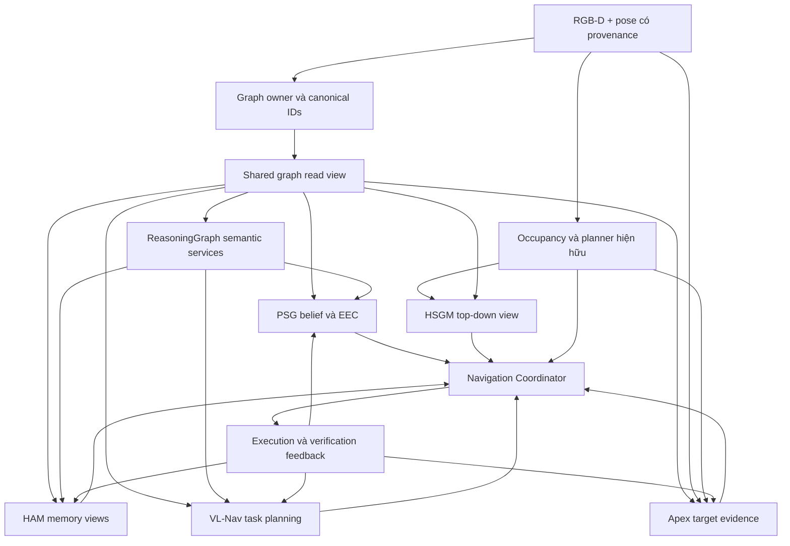

# Lộ trình contract cho các module tương lai

Ngày khảo sát: 2026-11-26. Đây là thiết kế tích hợp đề xuất, không phải mô tả implementation NeuSymNav hay một kiến trúc nguyên bản của bất kỳ paper nào. Chưa cho phép triển khai, tải model hoặc thay policy. Main sở hữu và phê duyệt shared contracts. Mỗi module chỉ sở hữu state dẫn xuất được giao. Snapshot tham chiếu: HEAD `8f0521e5d10f6965ce96173329673033d23d350b`, workspace có thay đổi chưa commit. HEAD không xác định toàn bộ nội dung workspace.

## Nguồn gốc và mức kiểm chứng

| Module | Paper và nguồn chính thức | Tình trạng nguồn, license và giới hạn |
| --- | --- | --- |
| PSG-Nav | [Chen et al., PSG-Nav, arXiv:2606.01313](https://arxiv.org/abs/2606.01313) · [ICML/PMLR](https://proceedings.mlr.press/v306/chen26i.html) · [project](https://psg-nav.github.io/) · [repository chính thức](https://github.com/Chenrf1121/psg-nav) | Repo công khai có code, README nói đang chuẩn bị release và tập trung HSSD. [snapshot 181d878ff207845a31e542a19a6592925c1e9bab](https://github.com/Chenrf1121/psg-nav/tree/181d878ff207845a31e542a19a6592925c1e9bab) có LICENSE MIT. GroundingDINO và SAM vendored Apache-2.0, Habitat-Lab vendored MIT. Chưa xác minh checkpoint hay tái lập kết quả. Paper dùng categorical distribution, Multiverse Decision và Evidential Experience Calibrator (EEC). |
| HAM-VLN | [Liu et al., arXiv:2607.29600](https://arxiv.org/abs/2607.29600) · [project](https://an1iu.github.io/HAM-VLN/) · [repository tác giả](https://github.com/an1iu/HAM-VLN) | [Cây 075db09ee53a825563d4aa051b3f72bf3d5d2f7c](https://github.com/an1iu/HAM-VLN/tree/075db09ee53a825563d4aa051b3f72bf3d5d2f7c) chỉ có .gitignore, README và assets. Không có launcher trong README hoặc root LICENSE ở revision này. Không coi README là bằng chứng code runnable. Paper mô tả working, episodic, semantic và reflection memory trên world graph. |
| VL-Nav | [Du et al., bản NeSy trên OpenReview](https://openreview.net/pdf?id=qZ64ZUT07l) · [trang phòng thí nghiệm](https://sairlab.org/vlnav/) | Trang tác giả dẫn [arXiv 2502.00931](https://arxiv.org/abs/2502.00931), hiện là v7 với tiêu đề cập nhật. Hợp đồng dưới đây bám bản OpenReview §3.1–3.2 và Fig. 3. Chưa tìm thấy repo chính thức được xác nhận, SHA và license chưa xác định. Paper nêu NeSy task planner, image memory và exploration. Không suy ra code đã phát hành. |
| ApexNav | [Zhang et al., arXiv:2504.14478](https://arxiv.org/abs/2504.14478) · [repository chính thức](https://github.com/Robotics-STAR-Lab/ApexNav) | [Snapshot 049971b613fcd2554b034bd4a853d79cc1e61613](https://github.com/Robotics-STAR-Lab/ApexNav/tree/049971b613fcd2554b034bd4a853d79cc1e61613) có GNU GPL v3. Chưa kết luận tương thích khi tích hợp/phân phối. Có adaptive exploration và target-centric semantic fusion. Không sao chép source trước khi đánh giá license và dependency. |
| HSGM | [Li et al., CVPR 2026](https://arxiv.org/html/2606.00095v1) · [repository chính thức](https://github.com/Teacher-Tom/HSGM_public) | [Snapshot e2df6e70df869af57d77a32ba658fba04e6814eb](https://github.com/Teacher-Tom/HSGM_public/tree/e2df6e70df869af57d77a32ba658fba04e6814eb) có source và Apache-2.0. §3.3–3.4 mô tả geometry, semantics, decision và A* cho low-level. Dependency/model terms chưa xác minh đầy đủ. |

Các SHA trong bảng là HEAD của bốn repo công khai tại ngày khảo sát. `git ls-remote --symref <url> HEAD`, shallow clone, `git rev-parse HEAD` và `git ls-tree --name-only HEAD` trả exit 0. Mỗi experiment cần pin version paper, tree, model và dependency đúng profile. License repo không tự bao phủ weights, dataset hoặc code bên thứ ba. Không kết luận pháp lý từ bảng này.

## Điểm nối theo phương pháp gốc

- **PSG-Nav §3.2–3.4.** Categorical distributions theo object và phân cấp group/room. Multiverse Decision sample các cấu hình có khả năng, kết hợp spatial/semantic information gain và so sánh landmark. EEC truy xuất contrastive crops cùng context từ success/failure memory trước STOP. Source có `SceneGraph`, `LandmarkSelector`, `RAGManager` và collection success/false positive. NeuSymNav cần nối feedback được protocol cho phép. [Paper](https://arxiv.org/html/2606.01313), [entry point](https://github.com/Chenrf1121/psg-nav/blob/181d878ff207845a31e542a19a6592925c1e9bab/PSG_Nav.py#L1500).
- **HAM-VLN.** Persistent World Graph trong episode giữ waypoint, place/object links, working window và lịch sử. Task-relevant retrieval lấy episodic trajectory, semantic place-object context và reflection notes. Structured write-back đề xuất note với subgoal, waypoint, evidence, verification status, TTL và provenance. [Paper](https://arxiv.org/html/2607.29600).
- **VL-Nav §3.1–3.2.** NeSy task planner lấy graph và best views, decomposition explore/go-to, verify top candidate rồi replan theo memory mới. Exploration đọc frontier từ occupancy và instance point từ detection. NeSy Scoring phối hợp semantic relevance, geometric curiosity và travel cost. Interface đề xuất gồm `Subgoal` (target/anchor/constraints, progress), candidate (frontier/instance, pose, cost, revision) và feedback (rejected/verified/arrived/unreachable). [OpenReview PDF](https://openreview.net/pdf?id=qZ64ZUT07l).
- **ApexNav.** Adaptive exploration chuyển ưu tiên geometry/semantic theo context. `ObjectMap2D::inputObservationObjectsCloud` và `fusionConfidenceScore` xử lý voxel support và confidence dương/âm. Dùng observation/visibility và planner path cost hiện có. Safe waypoint và target verifier tiếp tục là cổng riêng. [Paper](https://arxiv.org/html/2504.14478), [fusion source](https://github.com/Robotics-STAR-Lab/ApexNav/blob/049971b613fcd2554b034bd4a853d79cc1e61613/src/planner/plan_env/src/object_map2d.cpp).
- **HSGM §3.3–3.4.** BEV multi-channel và first-person marker view từ geometry, semantic, decision layers. Filter waypoint theo cylindrical footprint, neighbor height/distance và collision/reachability. Nối waypoint candidate của planner vào projection có coordinate/calibration/revision. Source có `create_top_down_map_centered`, `PathPlannerAgent` và helper `path_planning`. [Paper](https://arxiv.org/html/2606.00095v1), [agent source](https://github.com/Teacher-Tom/HSGM_public/blob/e2df6e70df869af57d77a32ba658fba04e6814eb/src/agent/agent.py).

## Ranh giới và quyền state

Đề xuất một **shared graph read view** có `episode_id`, `graph_revision`, timestamp, frame/convention/calibration version, vocabulary/model provenance, canonical object ID và region ID độc lập room label. Graph/geometry owner hiện hữu là nguồn có thẩm quyền duy nhất cấp, merge và xóa canonical ID. Alias, merge/delete, room split/merge và revision phải được phát tới consumer. View bất biến theo revision, có thể cache có giới hạn. Reject hoặc remap kết quả cũ sau lifecycle event. Đây là contract dự kiến, không khẳng định đã tồn tại. Không tạo map độc lập thứ hai hay hai owner cùng ghi semantic belief. RGB-D và simulator pose là input runtime. Semantic GT chỉ evaluator offline.

| Thành phần | Đọc | Ghi được phép | Giới hạn |
| --- | --- | --- | --- |
| ReasoningGraph đề xuất | graph view, observation evidence | object/room/relationship feature và kết quả query trong namespace semantic được giao | Không tự điều khiển. Relationship embedding không mặc định là predicate xác thực. |
| PSG-Nav tương lai | CID, features, raw category scores có vocabulary/model provenance, evidence đã deduplicate, phản hồi verification hợp lệ | categorical belief và EEC memory trong namespace PSG. Candidate landmark có revision và confidence | Không cấp ID, ghi geometry hay ghi đè feature. Không cập nhật từ oracle success. Multiverse là consumer của belief, không biến CLIP similarity thành probability nếu chưa hiệu chuẩn. |
| HAM-VLN tương lai | object/room query, topology, relationship và waypoint history | instruction progress và bounded working/episodic/reflection memory. Đề xuất observation có provenance gửi graph owner kiểm tra | Memory view tham chiếu CID/revision, không sao chép graph như nguồn chân lý. Không ghi trực tiếp world state hoặc action. |
| VL-Nav tương lai | subgraph, instruction, image references, frontier/instance candidates và cost | subgoal, trạng thái tiến độ và đề xuất replanning | Không phát action. Chưa định nghĩa scoring formula hay PDDL trong milestone này. |
| ApexNav tương lai | observation ID, detector confidence, visible geometry, category alternatives, frontier scores, distance, verification | target-centric evidence và đề xuất frontier trong namespace Apex | Không gộp confidence fusion với embedding fusion. Chỉ ghi negative evidence khi đã kiểm tra visibility, occlusion và detector opportunity. |
| HSGM tương lai | occupancy với unknown/free/obstacle, geometry, semantic view, topology và waypoint | top-down view dẫn xuất hoặc đề xuất waypoint có revision, không sửa map gốc | Tái dùng planner hiện hữu nếu đủ. Edge cấu trúc không chứng nhận traversability. Cần depth/clearance hợp lệ trước motion. |
| Navigation Coordinator | candidates, freshness, planner path, verification | chọn goal/action cuối và phản hồi execution | Không chờ worker detector/CLIP/room. Thiếu sensor mới hay clearance hợp lệ thì dừng an toàn theo contract. |

Evidence chung cần observation/frame/detection ID, timestamp, pose, calibration, bbox/mask reference, CID sau association, confidence, model/vocabulary version, visible geometry và association confidence. Retention có giới hạn, lưu sufficient statistics và references khi có thể. Deduplicate bằng observation ID và ghi lineage để tránh belief feedback quay vòng. Chỉ graph owner xử lý merge/split/delete. Các state dẫn xuất remap hoặc invalidate theo revision, không tự phát hành CID mới.

## Phụ thuộc và vòng điều khiển

Mũi tên thể hiện đường dữ liệu dự kiến, không yêu cầu bật tất cả module. Coordinator nhận candidate kèm source, episode, revision, timestamp, mục tiêu, chi phí và evidence. Kiểm tra stale/alias, feasibility và safety, chọn một goal, planner kiểm tra đường đi rồi control hành động. Feedback thực sự quan sát được gồm execution status, visibility, verification result và provenance quay về consumer liên quan. Rejected/timeout/insufficient evidence không tự thành thất bại đã xác minh. Graph khởi đầu rỗng theo episode. Reset memory mặc định theo episode, persistence xuyên episode chỉ khi protocol cho phép, khai báo scope, provenance và cơ chế tránh leakage. Không dùng GT success/failure cho EEC hay verification memory nếu agent không được phép thấy.

## Các gate tương lai

1. **Cơ sở:** baseline và regression được đo lại trên snapshot cố định. Graph owner, lifecycle, freshness, planner và safety được chứng minh bằng test phù hợp. ReasoningGraph phải có consumer thực sự trước khi kỳ vọng SR thay đổi.
2. **Evidence/view:** main khóa contract read view, alias/revision và observation lineage. Test merge/delete, stale response, duplicate và episode reset. Chưa cần port algorithm khác.
3. **ReasoningGraph:** object/room/relationship query có evidence và insufficient-evidence. Đánh giá retrieval và integrity riêng, giữ baseline khi tắt.
4. **PSG:** cần raw categorical evidence và calibration, vocabulary version, deduplication, cùng verification feedback được phép. Replay belief/alias trước Multiverse và EEC. So sánh calibration và decision cùng budget.
5. **HAM/VL:** cần instruction benchmark, topology, subgoal và feedback. Đánh giá từng planner/memory trên cùng candidate set. HAM write-back chỉ là đề xuất qua owner. VL-Nav là adapter theo paper, không tuyên bố faithful khi thiếu code/version đã pin.
6. **Apex/HSGM:** visibility/occlusion và target evidence cho Apex. Occupancy, unknown, clearance, path-cost và top-down projection cho HSGM. So sánh với planner/policy hiện hữu trước khi cân nhắc thay. Chỉ một coordinator có quyền quyết định.
7. **Đóng vòng:** tích hợp từng module qua gate correctness rồi runtime có tài nguyên và datasets thực tế. Đo latency, memory, freshness và hiệu quả navigation, rollback bằng tắt module. Một GPU workload tại một thời điểm.

## Đánh giá và ablation

Cố định dataset/split, UID, seed, detector, association, action space, step budget, planner và policy nền, model versions, thiết bị và memory reset. Báo thay đổi bắt buộc. Dùng paired episodes, số mẫu, uncertainty và failure breakdown. Ground truth chỉ cho evaluator, episode generation hoặc oracle được đánh dấu riêng. Đo retrieval top-k/relationship precision-recall-F1 và graph integrity riêng SR, SPL, SoftSPL, distance, false STOP, steps, calls, latency và peak memory. Không suy SR từ retrieval.

Chuỗi tích lũy đề xuất đi từ C0 (graph/Hydra baseline), C1 (+ ReasoningGraph consumer), C2 (+ PSG), C3 (+ từng nhánh HAM hoặc VL task reasoning), C4 (+ adaptive navigation kiểu Apex), C5 (+ target verification) đến C6 (tích hợp đầy đủ). HSGM view chỉ bật khi phép so sánh planner đạt gate. Khi prerequisite thiếu, báo blocked.

Dùng leave-one-out hoặc factorial có prerequisite cho từng nhóm. Với ReasoningGraph, tách object, room và relationship features. Với PSG, tách belief, Multiverse và EEC. Với HAM, tách từng memory view và retrieval. Với VL, tách decomposition và replanning. Với Apex, tách adaptive exploration và target fusion. Với HSGM, tách projection và waypoint consumer. Đánh giá verification riêng. Giữ candidate set và ngân sách tương đương, báo interaction và chi phí tăng. Chạy negative controls cho visibility/occlusion, alias merge, stale data và feedback độc lập với GT.

## Trạng thái và phần chưa chứng minh

**Implemented:** tài liệu đề xuất này. **Correctness-verified:** chỉ đối chiếu nguồn và kiểm tra văn bản, không phải kiểm định thuật toán. **Runtime-validated:** chưa. Không chạy simulator, GPU, benchmark hoặc tải dependency. Chưa xác minh khả năng tương thích license đầy đủ, khả năng chạy model trên GPU 6 GB, hiệu quả hoặc fidelity của bất kỳ adapter nào. Các gate trên là kế hoạch, không phải quyền triển khai hiện tại.
