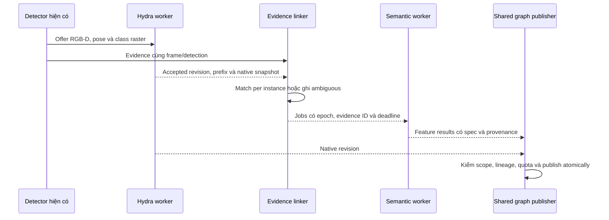
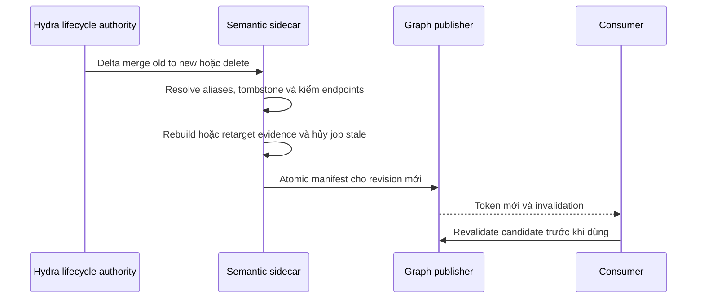
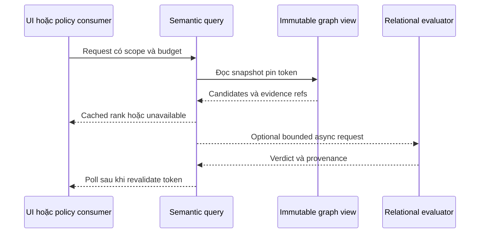

# Thiết kế tích hợp ReasoningGraph

## Lựa chọn kiến trúc

| Phương án | Fidelity và reproducibility | Tương thích và consistency | Runtime, bộ nhớ, maintainability | Vai trò |
| --- | --- | --- | --- | --- |
| Full port | Tương đối gần code tác giả nếu khớp đúng checkout, recipes và decoder. Paper và profile public vẫn cần pin riêng. | Fork dựa trên ROS1/Noetic và Spark-DSG khác revision. Đổi native build và wire schema sẽ chạm toàn bộ consumers. | Tăng dependency/ABI và chi phí ROS bridge, yêu cầu tái xác nhận planner/runtime. | Reference cô lập khi cần đối chứng. |
| Selective module port | Giữ semantics Eq. 3–5 và standalone reasoning, ghi rõ thay đổi association, model và pair policy. | Reuse Hydra geometry, join bằng provenance, giữ read-only sidecar với revision. | Tải model và pair jobs theo profile. Một adapter graph có thể kiểm retry/rollback. | Phương án đề xuất cho milestone. |
| External semantic enhancement | Tách process deployment dễ tái lập. Độ sát paper phụ thuộc input lineage và encoder/decoder protocol. | Graph view vẫn là nguồn đọc duy nhất qua manifest. Export/poll riêng làm tăng nguy cơ stale. | Tách CUDA/dependencies, thêm serialization, truyền dữ liệu và remote cost. | Dùng cho model worker, đặc biệt DeepSeek-VL2, và reference offline. |

Chọn selective module port với sidecar có version và worker tách process khi cần. Lý do chính là giữ Hydra core, B0 và planner hiện hành trong khi có thể xác minh từng contribution với replay. Bên paper, adapter full coverage phụ thuộc kiểm chứng calibration đổi khi tilt. M7 có phương án thử tách riêng. ABI và data contract gate ở M1 quyết định mức độ cần chạm native binding. [Phân tích mã upstream](technical-analysis.md), [hợp đồng](shared-graph-and-semantic-contracts.md).

## Object features và lựa chọn fusion

| | A. Mesh-based | B. Direct object |
| --- | --- | --- |
| Fidelity | Theo §IV-B và Alg. 2, gắn temporary feature/ID qua mesh rồi map tới objects, cần đúng attribution từng observation. | Dùng recipe từ Eq. 3 trên các quan sát đã gắn canonical object. Eq. 4 object accumulator chạy ngay ở sidecar. Trọng số theo event khác trọng số theo mesh support. |
| Association | Có mesh correspondences trực tiếp hơn nếu native boundary xuất đủ lineage, song lớp class overlap và mesh rewrites vẫn cần đo. | Hiện class raster không chứa instance IDs. Cần link bằng evidence và unique 3D support, thử adjacent same-class, reject mơ hồ. |
| Compatibility và effort | Cần vendor/native adapter cho temporary per-vertex data, cleanup và mapping. Khó giữ ABI/schema. | Dùng `HydraSceneGraphQuery` và RGB-D projected evidence. Kế thừa geometry và association hiện có ở cả demo và paper. |
| Runtime/memory | Chi phí per-vertex và transfer mesh revisions, cộng feature extraction. | Cập nhật O(d) mỗi accepted observation, lưu O(objects × d) stats và linked refs có quota. |
| Đánh giá | Reference replay riêng nếu đủ stack và dữ liệu. | Arm production opt-in. So trên cùng detector và frame. Báo coverage/quota và ID fidelity. |

B là adaptation được đề xuất. M2 dùng ba modality với recipe chuẩn paper, một profile parity theo config công khai khi đủ backend và một profile local. Crop giữ bbox XYXY, clipping và RGB order, masked crop dùng fill policy đã pin. Text prompt cache theo taxonomy/model/template. Encode text cùng checkpoint, tokenizer và normalization với image. Reuse transport và preprocessing của `AppearanceWorkerEncoder`/`appearance_worker.py` khi phù hợp. Backend existing ViT-B/32 chỉ có đường image trong contract hiện tại, do đó M2 bổ sung text và full-frame APIs cùng feature space. YOLOE MobileCLIP text prompts phục vụ detector classifier. Profile L/14, B/32 và MobileCLIP dùng manifest/cache riêng.

Theo §IV-B, với ba output CLIP đã preprocess theo recipe, lấy weighted blend Eq. 3 rồi cập nhật weighted observation mean Eq. 4. Giữ count và numerator với dtype ổn định, dùng L2 view lúc cosine, lưu raw norm và reject zero/non-finite. Khóa profile theo paper hoặc source configs sau khi đối chiếu toán học, normalized inputs, count initialization và parity oracle. Đổi checkpoint, normalization hay crop semantics cần arm riêng. [Paper Alg. 1–2 và Eq. 3–4](https://arxiv.org/html/2602.02456v1), [worker local](../../src/neusymnav/perception/appearance_worker.py), [paper-to-code](technical-analysis.md).

## Room features

Encode ảnh RGB full-frame ở keyframe lane. Gắn feature vào source pose, gán room qua containment/membership theo geometry revision và floor. Nếu chỉ có place→room thì dùng nearest eligible place có containment/support, pin distance/ambiguity gate và đo coverage. Boundary, missing transform, pending room và hai room cạnh tranh trả unassigned. Room hình thành muộn thì re-evaluate retained samples theo cùng episode. Split/merge và optimization xử lý bằng corrected poses + origin event IDs, reassign rồi fit deterministic K-Means với seed và `k_eff=min(K, samples)`. Geometry owners giữ room IDs. Room query dùng mean trên mọi cặp centroid–text query ở paper profile. Max cosine một query là arm source-config-inspired, triển khai bằng loop đúng trục và bỏ room rỗng. Cả hai trả centroid support, coverage và source token. Thay vì tăng sample pool vô hạn, giữ pooled CPU features theo time/room/source caps và representative samples theo view direction. Coverage giảm do eviction được báo cùng kết quả. Chi phí refit khoảng O(iters × samples × k × d), chạy ngoài control và coalesce revision, cache theo membership hash. Existing Qwen room label là consumer/attribute song song. Room-based exploration giữ ở roadmap tương lai. [Paper Alg. 3](https://arxiv.org/html/2602.02456v1), [room contracts](../../src/neusymnav/contracts/room_semantics.py).

## Relationship features và lifecycle

Dùng detections cùng frame, giữ cả subject/object order, union bbox với hai marker rõ ràng và link marker→endpoint trong payload. Recipe source giữ semantics paper khi đủ khả năng. Alternate marker (phân biệt hai instance cùng class) là adaptation có test. Trước encode phải có valid RGB/boxes và endpoint eligibility theo profile. Encode bằng visual encoder đã pin, giữ contract cho tile layout, pattern tokens, dtype, cut point và checkpoint đối ứng. Upstream exact shape/branches và source paths nằm trong [paper-to-code](technical-analysis.md). Backend local chỉ được dùng như relational evaluator khi có paired model/decoder kiểm parity hoặc như image-based comparison arm dùng crop, được báo riêng. Relation payload không đi qua CLIP object encoder.

Aggregate Eq. 5 chỉ khi tensor shapes, layout, marker hướng, model và dtype tương thích. Nếu encoder profile sinh nhiều layout, giữ nhóm stats theo layout hoặc dùng fixed layout trong arm adaptation đã validate. Tính memory theo pair cap và serialized bytes, tránh tự padding/truncate. Với DeepSeek large non-tiling public config, suy từ code ra 392×2560 float32 mỗi hướng, khoảng 3,83 MiB/lane và 421 tokens sau decoder formatting. 8 lanes đầy đủ chiếm khoảng 30,63 MiB tensor/keyframe trước overhead. Lập cap bytes từ payload thực tế. Edge tạo khi cả hai endpoint có canonical IDs và observation dedup pass. Merge retarget trong transaction, kiểm lại marker role và chuyển stats từ các disjoint event sets, rebuild hoặc invalidate khi proof thiếu. Edge trùng/self/orphan bị loại khỏi publication. Delete tombstone hủy edges và queued jobs. Native loop closure có thể thay geometry/assignment, visual token giữ provenance camera cũ và chỉ còn queryable nếu endpoint continuity vẫn xác nhận được. Reopen cần manifest pin cùng native graph/prefix và endpoint validation.

## Reasoning service và consumer

Standalone evaluation đọc saved graph hoặc replay snapshot. Task LLM trích objects/rooms và subtasks từ instruction, retrieval rank theo text/object/room embeddings, bounded subgraph retrieval theo IDs, VLM evaluate supported pairs bằng question và marker mapping, LLM decisor trả structured subtask candidates. Mỗi bước trace IDs, model/prompt versions, supporting evidence, deadline, insufficient evidence và retry. Schema validate candidate ID, enums, confidence kind và số lượng. LLM output chỉ là analysis artifact ở standalone mode. Không cần PDDL hoặc lớp symbolic inference mới.

Paper B0 hiện hỗ trợ `off` và `shadow`. Chọn điểm nối advice sau khi policy mới được xác định và có kiểm chứng về identity join, freshness và an toàn di chuyển. Giữ B0 làm đối chứng cho action và STOP. [Đánh giá](evaluation-plan.md).

## Profiles và giới hạn tài nguyên

| | Faithful | Lightweight |
| --- | --- | --- |
| Detector / association | YOLOE upstream trong reference replay khi có đúng asset, giữ detector hiện tại cho comparisons trong NeuSymNav. Nếu dùng B direct fusion thì tên profile ghi adaptation. | Existing YOLOE và association giữ nguyên. |
| Object / room | OpenAI CLIP ViT-L/14 theo paper. Source-parity ghim OpenCLIP ViT-B-32 LAION và weights text/mask/bbox 0,9/0,1/0. Mỗi feature space có cache riêng. | Backend ViT-B/32 phù hợp đã có đường image local, thêm text cùng checkpoint. CPU hoặc GPU timeslot. |
| Relations | DeepSeek-VL2 vision+projector/decoder tương ứng, strict parity. Source public mặc định visual InstructBLIP cap hai object, cần profile riêng và decoder tương thích. | Keyframe subsampling, spatial gate và task-relevant sparse pairs. DeepSeek-VL2 từ xa opt-in. Nếu unavailable, thử crop-based VLM arm riêng hoặc Tắt relations với coverage explicit. |
| Scheduling | Replay hoặc detached worker, keyframe cadence cấu hình, lưu queue latency và request timing. | Hàng đợi bounded, optional mixed precision đã kiểm parity, cache theo frame/order/spec hash, batch khi còn deadline. Detector/control ưu tiên, từng GPU workload một. |

Với N detections, tối đa N(N−1) cặp có hướng hoặc N(N−1)/2 union crops dùng chung nếu marker/layout cho phép. Chi phí mỗi frame là O(P × encoder_cost) và cache/relation memory O(E × T × D × bytes) cho P pair jobs, E stored payloads, T tokens, D feature dim. Spatial gating dựa trên RGB-D support, separation 3D hay union bbox area, sau đó deterministic rank theo relevance và quota. Dùng log count trước/sau gate và lý do bỏ để đo recall tradeoff. Gợi ý pilot, chốt sau M0/M4: 1 Hz hoặc thấp hơn, 8 pair jobs/keyframe, 2 pending + 1 in flight, cap bytes riêng cho payload và queue. Deadline/TTLs ghi theo profile, control hiện tại không chờ CLIP, room hoặc relational worker. DeepSeek-VL2 được load theo pha, không giữ nhiều foundation models trên GPU 6 GB. Pad/OOM/retry có metrics, timeout vẫn chạy baseline.

Đo riêng warmup/load, detector, CLIP object/room, candidate pairing + crop, encoder, CPU↔device copy, native graph update, room refit, serialize, remote upload/queue/decode, end-to-end evidence age và control latency. Ghi p50/p95/p99, VRAM allocated/reserved và đo process/host peak, CPU RSS, disk growth, accepted/dropped jobs. Cost remote báo calls, payload bytes, billed tokens/request và receipt theo profile/version. Remote chỉ cấp dữ liệu phù hợp với điều khoản dataset, profile explicit và host đã cho phép. [Đánh giá](evaluation-plan.md), [rủi ro](integration-risk-analysis.md).
