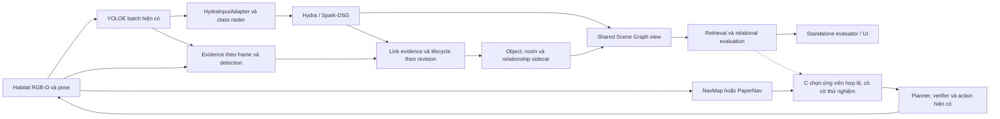
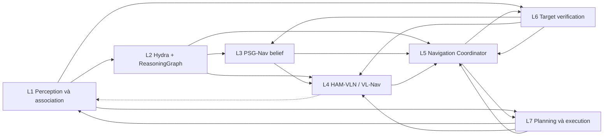

# Kiến trúc đích NeuSymNav với ReasoningGraph

Phạm vi hiện tại là L1 audit, L2 semantic enhancement và thiết kế interface L3–L7. [Audit](current-system-audit.md), [kế hoạch M0–M8](implementation-plan.md), [hợp đồng](shared-graph-and-semantic-contracts.md).

## Một Scene Graph logic

Hydra/Spark-DSG là nguồn geometry và topology cho profile tích hợp. Graph view kết hợp một native snapshot với semantic sidecar theo cùng scope, revision và manifest. Sidecar giữ đặc trưng, liên kết evidence và quan hệ theo khóa đối tượng duy nhất, không giữ bản sao mesh, place graph hoặc occupancy. Renderer, truy vấn, memory và policy đọc qua view này. Local obstacle map dùng cho điều khiển tiếp tục là projection phục vụ planner với vòng đời riêng. Profile legacy độc lập được giữ để chạy regression.

| Tầng logic | Trách nhiệm và state owner | Trạng thái / consumer |
| --- | --- | --- |
| L1 Neural Perception | Habitat RGB-D/pose, YOLOE mask/bbox/score, projection và association hiện có. Mỗi admitted frame chỉ suy luận detector một lần. | Hydra nhận class raster, Paper B0 dùng ứng viên theo CID của runner. Canonical ID của profile Hydra được phát từ lifecycle native đã xác minh. |
| L2 Hierarchical 3D Scene Graph | Hydra giữ TSDF/mesh, object geometry, place/room topology và native lifecycle. ReasoningGraph giữ embeddings object/room, relational visual evidence, query và relational evaluation. | Hydra đã có đường demo. Semantic sidecar và reasoning là đề xuất. Viewer, standalone evaluator và tùy chọn C là consumer đầu tiên. |
| L3 Probabilistic Semantic Memory | PSG-Nav sở hữu categorical distribution, uncertainty và history theo canonical object ID. | Tương lai. Đọc raw evidence và verification feedback, cấp belief snapshot cho L5. |
| L4 Decomposition & Retrieval | HAM-VLN sở hữu episodic/reflection memory và instruction progress. VL-Nav đề xuất decomposition, subgoal và replanning. | Tương lai. Đọc graph view, beliefs, constraints và feedback. |
| L5 Navigation Policy | Paper B0 hoặc lockstep B0 tạo đề nghị theo profile. ApexNav, VL-Nav, PSG-Nav sau này có thể đóng góp candidate scoring/advice. Một Navigation Coordinator duy nhất chọn goal và action theo profile. | M7 giữ nguyên quyền hành động hiện tại. Trong paper mode, policy/runner là điểm tích hợp của chức năng coordinator. |
| L6 Target Verification | Verifier hiện tại giữ verdict theo đúng mục tiêu, pose và bằng chứng. Future ApexNav giữ target-centric evidence accumulator, PSG-Nav nhận feedback cho EEC. | Semantic query chỉ gửi cue, evidence hoặc yêu cầu tái quan sát. |
| L7 Path Planning & Execution | PaperNav/DistanceField + Habitat action rời rạc cho paper, Planner A* và guard điều khiển ở lockstep. HSGM tương lai biểu diễn waypoint và constraints theo map đã quan sát. | Kết quả path cost, reachability, va chạm và chuyển động thực quay lại policy. |

## ReasoningGraph trong đường chạy Hydra

Demo Hydra là điểm nối đầu tiên để kiểm tra graph, provenance và visualization. Paper B0 là đối chứng ObjectNav. Paper B0 hỗ trợ chế độ quan sát và ghi trace khi bật shadow. Consumer advice sẽ được xác định khi tích hợp policy tiếp theo. [Chiến lược](integration-design.md), [đánh giá](evaluation-plan.md).

## Closed-loop bảy tầng

L4 có thể đề nghị góc nhìn mới. L5 quyết định có thực hiện hay không theo thời hạn, ngân sách và đường đi. L6 trả verdict, nguyên nhân và references về cùng evidence, qua đó cập nhật tiến độ và belief đúng một lần. Graph có thể bắt kịp chậm hơn control. Khi semantic snapshot thiếu điều kiện, policy dùng fallback hiện có. Với rollout advice, coordinator phải chặn movement mới nếu thiếu depth hoặc clearance hợp lệ. Cổng đó cần được xác minh ở đường paper riêng trước khi bật advice. Cạnh cấu trúc và điểm semantic không xác nhận clearance. Lượt chạy mặc định reset map, aliases, feature, beliefs, task memory và in-flight requests theo episode. Cross-episode memory chỉ được đánh giá ở arm có giao thức cho phép. [Roadmap tương lai](future-module-integration-roadmap.md).

## Phân biệt provenance phương pháp

- Hydra gốc trình bày ESDF, places, phân vùng và tối ưu loop closure. Khả năng của binding và cấu hình thực tế phải được xác minh theo build local. [Hydra RSS 2022](https://arxiv.org/abs/2201.13360), [MIT-SPARK Hydra](https://github.com/MIT-SPARK/Hydra), [Spark-DSG](https://github.com/MIT-SPARK/Spark-DSG), [audit binding](../hydra-python-bindings.md).
- ReasoningGraph gốc dùng temporary mesh feature/ID, CLIP object/room, visual tokens DeepSeek-VL2 và task reasoning LLM/VLM. [Paper §IV–V](https://arxiv.org/html/2602.02456v1), [paper-to-code](technical-analysis.md).
- Ghép sidecar theo graph revision, direct object fusion, liên kết sang Paper shadow và các interface L3–L7 là thiết kế tích hợp NeuSymNav. Kết quả từ mỗi thay đổi được báo theo arm tương ứng.
