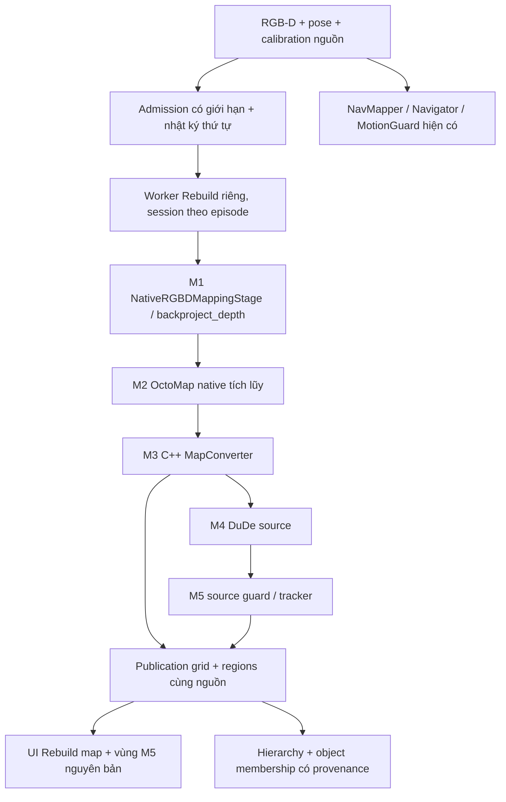

# Kế hoạch triển khai đầy đủ nhánh phân phòng Rebuild

Ngày: 2026-11-02. Trạng thái thực thi: **R0–R6 đã triển khai từng phần; R7 có parity harness tổng hợp nhưng gate đầy đủ và R8 còn mở**. Chi tiết bằng chứng và giới hạn ở [implementation status](implementation-status.md) và [audit response](results/rebuild-rgbd-progress-audit-response-2026-11-02.md).

**Historical-plan note (2026-11-03):** this plan predates the M5-only hierarchy
follow-up. Current Rebuild RGB-D uses accepted M5 polygons as its only room
partition source and has no RoomOwner/stable-room identity or portal-debug
projection. Historical references to Stable Room below describe the earlier
proposal, not current code.

Yêu cầu viết kế hoạch ban đầu không cho phép triển khai; người dùng sau đó đã
ủy quyền thực hiện và tiếp tục theo plan. Không tải model/training; người dùng
đã cho phép sửa M4 trong Rebuild cho lỗi contour này. 3DSG giữ nguyên. Tài liệu
này không tự chứng nhận chất lượng.

## 1. Mục tiêu và ranh giới

Đưa quan sát RGB-D/pose trực tiếp vào các stage gốc của Rebuild, giữ session theo
episode, lấy cả occupancy M3 và vùng M5 về NeuSymNav. Không tiếp tục dùng occupancy
NeuSymNav làm đầu vào của profile này. Đây là đầy đủ **nhánh dựng bản đồ/phân vùng**;
object memory và điều khiển vẫn do NeuSymNav sở hữu. Portal giữ ẩn mặc định và không
tham gia thuật toán đối chứng. Chưa bổ sung active-room exploration/room semantics.

Kết quả cần đạt: có profile chạy thật M1→M5; có bằng chứng dùng M3 của Rebuild;
UI thể hiện đúng đầu ra source, không bị lớp ổn định Room hiện tại che đường cắt;
có replay cùng dữ liệu để phân biệt hiệu ứng mapping với segmentation.

## 2. Tài sản đã kiểm tra chỉ đọc

- Root: `/home/kiettran05/Desktop/test_Room_segmentation/Rebuild_3DScene_OccuSG`.
- `src/standalone_sg/mapping/native_pipeline.py`: `NativeRGBDMappingStage` gọi
  backprojection M1, sau đó `NativePointCloudMappingStage` tích hợp M2 và project M3.
- `src/standalone_sg/pipeline/stages.py`: `DudeM5RegionStage` gọi native M4 và source M5.
- `src/standalone_sg/pipeline/builder.py`: `SceneGraphBuilder.update(packet)` điều phối
  mapping trước region; mutation ở stage native không được rollback bởi graph transaction.
- 3DSG handoff: `projects/Fusion_Concept_OccuSG/integration_v2/occusg_session.py`
  bọc builder, kiểm tra thứ tự packet và đánh dấu failed khi callback lỗi.
- Worker M2/M3 hiện có:
  `build/native-m3/occupancy/standalone_sg_octomap_fixture_runner`, SHA256
  `617477524aa81acb0a0a46575741497aa15ed9b095f8fd72f92e09a81043cdc6`.
- Worker M4 hiện có: `build/native-m4-dude/occusg_dude_worker`, SHA256
  `b7c31163135740eb93a66ec56e2cb2abd0cb02e417bd75edbd97a34d9d83a164`.
- Python source closure hiện dùng: 50 file, SHA256 aggregate
  `60aebf8a0433afa23dbdf94e6ed8415347b03e58464a0f7a71c3b8c7d07b0da0`.

Đường dẫn tồn tại/hash đã đọc không có nghĩa toàn M1→M5 chạy đúng. Các tham số
trong smoke synthetic không tự là profile live 3DSG cũ; bước R0 phải xác minh cấu
hình caller thực tế, thư viện liên kết và lựa chọn stage trước khi chốt parity.

## 3. Quyết định thiết kế cần khóa trước khi code

### Dữ liệu đầu vào

Profile đối chứng đầu tiên dùng primary RGB-D với K và T_world_camera của chính
sensor đó. Downward depth tiếp tục phục vụ control; không tự trộn hai stream vào
Rebuild. Multi-sensor là thay đổi riêng sau khi baseline một sensor đạt kiểm chứng.

Giữ depth metric axial, `valid_depth`, min/max range, pose version, calibration ID,
clock domain và FrameKey. Ghi rõ `depth_units=m`, `depth_representation=axial`,
`depth_scale_to_m=1.0`. Pixel invalid không thành ray no-return. Source pose simulator
được khai báo đúng nguồn; semantic GT/navmesh không đi vào mapping/phân vùng.

Canonical world Z-up/XY và camera optical phải có phép đổi tường minh. Không xoay
lần hai nếu Observation đã canonical. `frame_id` ánh xạ duy nhất từ FrameKey;
metadata giữ timestamp ns nguyên bên cạnh timestamp giây của source, không mất
clock identity do ép float. RGB, depth, pose, K khác nguồn phải bị từ chối.

### Session và xử lý lỗi

Một worker/session/episode sở hữu M2/M3/M4/M5. Không reset OctoMap theo từng frame
hoặc thay đổi extent. Full-refresh/partial-update của M3 theo source. Chỉ giữ cơ
chế reset M4 khi shape/origin thay đổi nếu oracle chứng minh cần; mọi khác biệt với
caller cũ phải ghi trong profile và kiểm tra world-coordinate parity.

Ưu tiên subprocess riêng để isolate import, CPU và lifecycle; không gọi mapping
nặng trên sensor/control thread. Process-group shutdown gồm cả hai native child;
bytecode/cache/output không được ghi sang Rebuild. Không tự rebuild source sibling.

Nếu native đã mutate rồi frame thất bại: không gọi lại packet một cách mù quáng.
Đánh dấu session cần replay, giữ publication cũ có stale, dừng admission phụ thuộc.
Khôi phục bằng session mới và replay đúng prefix đã ghi; bản đầu được phép fail
closed thay vì tự động phục hồi. Không âm thầm đổi sang mapper NeuSymNav.

### Thứ tự, bộ nhớ và hiệu năng

Admission độc lập detector/CLIP, immutable bounded queue: 1 in-flight + tối đa
2 pending, tổng payload tối đa32MiB; đo theo bytes thật gồm copy/serialization.
Dùng chính sách lấy mẫu cấu hình rõ và journal các frame được nhận/bỏ cùng lý do.
Không hứa xử lý mọi frame camera hoặc dùng latest-wins âm thầm cho stateful mapping.
Replay nạp lại đúng chuỗi admitted, thứ tự timestamp/frame và config.

Chốt resolution/range/stride/probabilities/clamping/projection parameters từ profile
được audit. Đo chi phí trước khi chọn sampling live; không tự tăng stride/rút range
để pass. Giữ raw/run budgets hiện hành; bổ sung cap voxel/cell/response/native RSS
và timeout trước R3. Vượt cap → incomplete/stale rõ ràng, không crop/coarsen ngầm.
Source `records`/event history phải được lưu có giới hạn hoặc stream ra artifact;
không giữ danh sách tăng vô hạn trong RAM. Chỉ một native campaign/benchmark một lúc.

### Thí nghiệm admission local có FPS cap — bổ sung theo quyết định người dùng 2026-11-03

Trước mọi kiểm chứng Kaggle mới, chạy một baseline local tách riêng cho Rebuild:
`fps_cap_hz` giới hạn số primary RGB-D frame đưa vào room lane; chế độ
`latest_wins` chỉ giữ tối đa một frame chờ và thay frame chờ cũ bằng frame mới
hơn khi cap cho phép. Đây là tùy chọn thử nghiệm rõ ràng; profile mặc định vẫn
FIFO bounded như trước. Mỗi frame bị cap hoặc bị thay phải có journal reason,
không coi việc bỏ qua là processed. Telemetry ghi source age tại lúc worker bắt
đầu/kết thúc, thời gian chờ queue, thời gian room service, offered/processed/
replaced và coverage pose. Control, raw recording và acceptance checker không
đổi.

**Kết quả local 2026-11-03:** Smoke 0.10 Hz xử lý ba frame nhưng chưa kích hoạt
pending replacement. Smoke 0.25 Hz trong 30 giây đã kiểm tra được chính sách:
65 room candidates → 8 offers → 3 pending frame bị thay → 5 processed; strict
acceptance pass với một polygon M5 hợp lệ và fresh. Full replay 65 primary
RGB-D frame đối chiếu với sequence 0.25 Hz gồm 8 frame cho M3 known-cell recall
0.9992, occupied recall 0.9660, occupied IoU 0.8987; M5 có một vùng ở cả hai
nhánh, polygon IoU 0.9165. Trajectory chỉ đi 0.0478 m, nên đây là baseline tích
cực cho cảnh gần tĩnh, không chứng minh đi hết phòng/hành lang hoặc run dài.
Timing đo được residual M1–M3 ngoài timer stage p50 2.101 giây. Follow-up local
đã tách integrate wrapper: trên ba frame, wrapper tổng 8.523 giây, pipe write
4.129 giây, response read 1.306 giây, validate 0.033 giây và format/other
remainder 3.056 giây. cProfile đếm ~916k point-generator/ScanPoint constructor
calls trên ba frame; profile timings bị phóng đại nên chỉ dùng counts để định vị
hotspot. Replay toàn bộ 65 frame: stride 2 nhanh hơn 3.36× với occupied recall
0.8912, occupancy IoU 0.8851, M5 polygon IoU 0.9659; stride 4 nhanh hơn 9.27×
nhưng occupied recall chỉ 0.7415 và IoU 0.7267. Cả ba giữ một vùng M5 fresh.
Vẫn chưa kiểm chứng scene traversal: trajectory chỉ đi 0.0478 m. Stride 1 tiếp
tục là default; stride 2 cần thử trên trajectory có lối đi và nhiều ranh giới
trước khi cân nhắc dùng live. Xem
`docs/results/local-room-fps-cap-00805-2026-11-03.md` và
`docs/results/local-room-m2-stride-00805-2026-11-03.md`.

**Follow-up live stride-2 smoke 00805:** bounded 60-second run with
`backprojection_stride=2` passed local preflight and strict acceptance
(`accepted=true`, M3 accepted/latest r22, M5 r11, one fresh valid polygon,
complete 186/186 raw frames). It processed 22 of 92 primary RGB-D candidates;
median room service was 2.749 s. The measured pose path was only 0.0066 m, so
this does not test boundary retention during room traversal. The app had no X
display in this environment; the accepted retry used Qt offscreen and its
snapshot is saved under
`.runtime/local-room-fps-experiment-00805-20261103/stride2-live-demo-60s/`.
Keep stride 1 as the production default. Before any Kaggle rerun, compare
stride 1 and 2 on the same recording with meaningful translation and turns.

**Same-recording turning replay follow-up:** the complete raw recording from
the first stride-2 demo contains 108 primary RGB-D frames with 0.0663 m camera
path and about 101.2° accumulated camera yaw. Full M1–M5 replay at stride 1
took 824.53 s; stride 2 took 241.65 s (3.41×). Stride 2 retained M3 known-cell
recall 0.9987 and free recall 0.9992, while occupied recall was 0.8938 and
occupied IoU 0.8827. Both outputs had one fresh M5 region; polygon IoU was
0.9576. This adds a turn-only comparison, not evidence for room traversal or
doorway retention because translation was just 6.6 cm. See the report and A/B
image under
`.runtime/local-room-fps-experiment-00805-20261103/stride-comparison-turning-108frames/`.
The next gate is still a same-recording comparison that crosses new space and
room boundaries; do not promote stride 2 or rerun Kaggle yet.

Đối chứng dùng cùng raw RGB-D recording: replay đầy đủ làm reference, sau đó
replay sequence đã giới hạn FPS/latest-wins. So sánh M3 occupancy/unknown masks,
M5 validity/geometry và coverage pose trên cùng trajectory. Recording mới
00805 đã có một bounded run strict-accepted, nhưng robot chỉ di chuyển 0.0478 m;
stride/FPS results hiện chỉ là kiểm tra logic và suy giảm tương đối trên góc nhìn
gần tĩnh, chưa là chất lượng chuẩn scene traversal. Chỉ cập nhật Kaggle bundle
sau khi local replay và bounded run trên trajectory đi qua vùng mới giữ đủ
coverage/geometry, M5 hợp lệ và checker đạt.

### Contract publication và hai bản đồ

M3 geometry map và control NavMap là hai domain riêng, kể cả khi số revision trùng.
Đề xuất frozen `RoomMapSnapshot`/`RoomPipelinePublication` (tên khóa tại R1), chứa:

- Episode, map-domain ID, source FrameKey/timestamp/clock/calibration và prefix hash.
- M2/M3 revisions, shape/origin/resolution, states -1/0/100 và provenance cấu hình.
- z_floor/z_ceiling và validity masks thực sự xuất từ M3; unknown không thành free.
- Request revision, accepted region-source map revision, M5 revision/regions/stale.
- Worker/source hashes, last admission ID, timings, caps, failure/replay status.

**Không ép M3 thành NavSnapshot bằng floor_support/clearance/robot certificates giả.**
Nếu tái dùng một contract cũ phải chứng minh mọi field có nguồn hợp lệ. Các ô thiếu
height giữ unavailable. Projection free-height của M3 không chứng minh clearance
cho robot hiện tại. Shared schema/API do main quản lý, có version và roundtrip tests.

Publication ghép region với đúng M3 input đã accepted; không ghép region cũ với M3
mới như cùng generation. Khi reject, giữ cặp accepted cũ và biểu thị newest M3 riêng
nếu cần debug. Control map revision luôn có nhãn/domain riêng. Publisher/hierarchy/
exports cần nhận geometry-map type trực tiếp; giữ tương thích profile cũ rõ ràng.

### Quyền sở hữu và UI

Dùng source M5 làm owner ID hình học, không chạy thêm tracker thứ hai. Có thể bọc
`SceneGraphBuilder`/session như caller cũ; không gửi detections vào source object
manager rồi tạo owner object thứ hai. Chỉ consume grid/regions và source diagnostics;
canonical ObjectOwner/aliases/evidence vẫn do NeuSymNav quản lý.

Profile `rebuild_rgbd` hiển thị source M3 map + source M5 polygons mặc định. Lớp
Stable Room là overlay tùy chọn, không có quyền che kết quả M5 khi đối chứng. UI
phân biệt số source regions với số Room sau policy. Robot trail lấy pose nguồn và
ghi age; planner/frontier thuộc control map phải có nhãn riêng hoặc tắt overlay
trên M3 để tránh hiểu nhầm. Portal vẫn ẩn, zoom/orbit/resize/popup giữ nguyên.

Object membership dùng footprint canonical + đúng geometry source, giữ assigned/
ambiguous/unassigned/unavailable; stale không tạo membership mới. Không đòi object
và M3 capture cùng thời điểm, nhưng phải công bố age/revision. Functional room label
không nằm trong lần triển khai này.

## 4. Các bước triển khai và gate

| Bước | Công việc / file dự kiến | Đầu ra và điều kiện hoàn tất |
| --- | --- | --- |
| R0: audit reference | Đọc caller 3DSG thực tế, Rebuild session/config/native libs; lập source pin manifest | Xác định RGBD hay pointcloud path, range/stride/projection, binaries/deps, mọi khác biệt; preflight không mutate source |
| R1: khóa contracts | `contracts/` geometry-map/publication; config/source policy; tests roundtrip | Domain/revision/source binding, NaN masks/caps rõ; không giả safety fields; independent review trước fan-out |
| R2: adapter frame | `regions/rebuild_rgbd_input.py` hoặc package riêng; tests projection | FrameKey/K/depth/pose→source RGBDFrame/FramePacket đúng đơn vị/hệ tọa độ; invalid/no-return/duplicate/out-of-order bị xử lý đúng |
| R3: worker session | `regions/rebuild_room_worker.py`, host client/session; tests IPC/failure | M1→M2→M3→M4→M5 gọi thật; empty episode; admission journal; bounded IPC/timeouts; reaping và poison/replay semantics |
| R4: nối runtime | coordinator/launcher/config/measurements | Nhánh room nhận Observation độc lập, không nhận NavMapper grid; control không chờ room; accepted map/region pairing đúng |
| R5: hierarchy/UI/export | publisher/transport/map view/composer/export adapters | Hiển thị M3/M5 đúng generation; nhãn backend + map domain; raw-vs-stable room rõ; footprint/alias/stale đúng; artifacts đủ replay |
| R6: runner/config | `run_rebuild_rgbd_map_demo.sh`, profile versioned, docs | Một lệnh rõ ràng, preflight pin cả M2/M3 và M4/source; không đổi baseline/M4-M5 runner; sensor/body/safety không thay |
| R7: parity/replay | Harness oracle trực tiếp source vs adapter; comparison/render scripts | Cùng frame sequence/config: M3 grid/height/masks và M5 geometry tương đương oracle; lỗi có reproduction, không normalize geometry để pass |
| R8: native live/acceptance | Bounded smoke + fixed comparison campaign và report | Hoàn tất correctness/runtime gates; kết quả cải thiện hay không được báo trung thực; toàn CPU liên quan/final gates pass |

Dependencies: R0→R1→R2→R3→R4; R5/R6 sau khi contracts ổn định, R7 sau R3 và hoàn
thiện sau R5; R8 sau review/freeze R4–R7. Các file R0–R6 hiện đã tồn tại và R7
có harness parity tổng hợp ban đầu. Những gate chưa đạt được liệt kê tại §8; không
chạy các campaign tranh tài nguyên cùng lúc.

## 5. Oracle và ma trận kiểm chứng

**Contract/correctness bắt buộc**

- Depth axial/metres, known 3D points, transform roundtrip, negative origin, floor
  khác0, K sai/shape sai/invalid/all-empty; không double rotation hoặc GT leakage.
- Sequence trống đầu episode, duplicate/stale/out-of-order, đổi sensor/calibration,
  source-clock mismatch; timestamp float không là source identity duy nhất.
- Native M2/M3 revisions cùng update; partial/full refresh; extent growth giữ world
  geometry; regions phải bind đúng M3; reject không làm già canonical M5 tracker.
- Queue byte cap, source records cap, worker hang/crash/malformed/oversize response,
  close trong startup, child sống sau timeout: host có kết quả bounded và reap đủ.
- Block room worker vẫn capture/control được theo contract hiện hành; không nới
  depth freshness300ms hoặc command horizon100ms. Graph stale không làm motion mới.
- UI/serialization/export không trộn M3 với control grid; M5 split thật nhìn thấy
  dù Stable Room còn giữ chung; membership mơ hồ không đoán; alias không dangling.

**Native correctness / source parity**

Dùng một recorded admitted sequence cho hai cách: gọi source Rebuild trực tiếp và
qua adapter NeuSymNav. Cùng native worker/source pins/config/initial state. So M3
values/masks/origin/resolution ở từng checkpoint; float height dùng tolerance theo
precision serialization được khóa trước run. M5 so partition/world geometry,
lineage/adjacency; không chỉ so count hoặc raw native IDs. Nếu native nondeterminism
được tái hiện thì ghi oracle/tolerance có căn cứ, không giấu khác biệt bằng relabel.

**Đối chứng chất lượng ba profile**

A. NeuSymNav occupancy → backend DuDe hiện tại.
B. NeuSymNav occupancy → Rebuild M4/M5 (`run_rebuild_map_demo.sh` hiện có).
C. RGB-D → Rebuild M1–M5 (profile mới).

Giữ cùng admitted RGB-D/pose sequence cho A/B/C; cùng spawn/seed/sensor, calibration
và sampling; cùng threshold segmentation nếu chế độ cho phép, khác preprocessing
phải ghi rõ. So A/B để tách hiệu ứng segmentation, B/C để thấy hiệu ứng mapping.
Ảnh chụp/final snapshot cũ không thay cho sequence; nếu recording hiện có chỉ lưu
keyframes thì phải ghi phạm vi đó hoặc thu một bounded sequence mới có completeness.

Lấy source M3/M5 trước Stable Room làm baseline chính. Báo count, split/merge/ID
churn, vùng unknown/free/occupied, geometry overlap, coverage quan sát và latency/
queue/RSS. Có nhãn phòng offline mới đo room accuracy/over-under segmentation;
không dùng số vùng cao hơn hoặc UI đẹp hơn làm chứng minh tốt hơn. GT chỉ evaluator.

## 6. Live campaign và tiêu chí bàn giao

Sau source parity: smoke 30–60s một scene/seed/profile; nếu fail phải giữ và sửa
nguyên nhân, không retry chọn kết quả đẹp. Sau smoke sạch, một đoạn replay có lối
nối giữa hai không gian và một ca hành lang/không gian mở; sau đó scene độc lập nếu
assets cho phép. Fixed slots/durations/seeds/chỉ số phải ghi trước chiến dịch.
Không hứa tái hiện chính xác lần chạy cũ nếu thiếu recorded inputs/config.

Bàn giao gồm: code/config/runner đã nối vào live path; preflight; focused + toàn
CPU phù hợp; review độc lập; native logs; source/worker/input/config hashes; M3/M5
checkpoints và ảnh đối chứng; báo cáo thất bại/caps/completeness; giới hạn chưa đo.
Phân biệt **implemented**, **correctness-verified**, **runtime-validated**, **quality
measured**. Pipeline chạy đúng nhưng không tách tốt hơn vẫn là kết quả hợp lệ; không
sửa ngưỡng để ép xuất hiện hai phòng. Không tự đặt `native_runtime_validated=true`
hoặc nhận P10 từ một smoke thành công.

## 7. Điều phối tiết kiệm token

Main giữ contract, integration decisions và review. Một Luna6.0High làm R0–R3 theo
milestone, tiếp R4/R6 sau gate; chỉ thêm một LunaHigh cho UI nếu có phần độc lập
và contract đã khóa. Một reviewer độc lập sau frozen snapshot, ưu tiên LunaHigh.
Không mở agent cho từng thao tác. Chỉ nâng Terra khi có reproduction về bất định
mapping/provenance/lifecycle xuyên module; Sol khi vấn đề thật sự khó còn tồn tại.
Không Astra. Dùng targeted tests trong vòng sửa; toàn CPU trên snapshot cuối khi
các focused checks pass. Không dùng chi phí test/review để hạ gate.

## 8. Trạng thái hiện tại

Checkpoint 2026-11-02 (sau audit progress): R0–R6 có implementation, nhưng
R0/R1/R3/R4/R5/R6 vẫn có gate chưa đóng. R0 ghi nhận profile source: M3 5 cm, stride 1, depth 0.1–10 m,
M2 max-range 5 m; chưa có bằng chứng tham số khớp một live caller 3DSG. R1 contract
đã chặn accepted revision tương lai, bắt buộc failure/replay stale và giữ accepted
M3 raster cùng M5; independent review còn thiếu. R2 adapter và R3 M1–M5 worker/session
đã focused-correctness verified; empty native episode và cumulative OctoMap node cap
còn mở, RSS là sampled ceiling. R4 dùng `Observation` độc lập với NavMapper;
smoke tích hợp đã chạy qua lane này. R5 có UI/export M3/M5 tách biệt, retained pair
và selector Latest/Accepted M3; raw M5 geometry/membership vào hierarchy bằng
`source_region` nodes riêng và provenance domain/revision. Stale/replay/floor
mismatch không cấp membership mới; control map và Stable Room không đổi owner.
R6 runner/preflight sẵn sàng; bằng chứng runtime tích hợp là smoke giới hạn
mô tả bên dưới, chưa phải lượt nghiệm thu đầy đủ.
Runner R6 hiện nhận mã map bất kỳ hoặc `--config PATH`, thay cho allowlist
`0080x`; map 007xx dùng cùng đường chạy khi có profile RGB-D/calibration và
scene assets riêng. Đây là hỗ trợ cấu hình/entry point, không tuyên bố mọi map
đều đã có dữ liệu hiệu chuẩn hoặc runtime validation.

R7 có `tools/compare_rebuild_rgbd_source_oracle.py`: synthetic RGB-D sequence ba
frame, prefix năm frame từ Habitat recording và recorded synthetic replay đều
được so với pinned Rebuild M1–M5 source trực tiếp. M3 states/origin/resolution/
revisions và height masks bằng nhau; height atol 1e-7; M5 IDs/polygons bằng nhau. Artifact
`runs/rebuild-rgbd-source-oracle-20261102-final/parity-report.json` ghi
`parity_pass`, 3/3 frame, clean shutdown. Lượt đầu sai ở oracle mask (đã sửa cách
áp dụng quy tắc unknown-height của contract; artifact lỗi được giữ lại). Đây là
synthetic/live-recording source parity, không phải historical caller parity, room
quality hoặc A/B/C campaign. Một smoke Habitat tích hợp 30 giây hoàn tất với
M3 latest/accepted revision 7, M5 revision 3, một raw M5 region, không stale và
clean shutdown. Tuy nhiên lane chỉ xử lý 7/67 frame offers; 60 bị queue-drop.
UI chạy offscreen; RSS peak lấy mẫu 2.38 GB, cap không breach nhưng đây không là
absolute memory proof. Đây là runtime smoke, không phải R8 acceptance. Focused
suite cuối: 141 passed/27.03s; preflight ready với issues rỗng; `git diff --check`
exit 0. Review R1,
empty episode, voxel cap, caller parity và quality campaign còn mở. Xem
`docs/results/rebuild-rgbd-progress-audit-response-2026-11-02.md` cho kết quả
audit/findings và verification chi tiết.

Follow-up lỗi polygon: worker kiểm tra simple-ring trước khi commit M5 tracker
và rollback tracker khi native output lỗi; M3 vẫn xuất bản, M5 giữ stale theo
contract. Unit regression 25 passed/5.96s. Demo visible 180 giây khởi chạy UI
và shutdown UI sạch, nhưng mọi M5 output trong sequence này bị loại vì polygon
tự giao; M3 revision 29. Recording đủ 984 sensor frame, nhưng 29/491 room offers
được xử lý và 462 bị queue-drop. Summary `incomplete`, exit 1 vì resource
sampling thiếu một process sample và một sample bị truncate; không nâng
`native_runtime_validated`. Artifact và command ở
`docs/results/rebuild-rgbd-live-smoke-2026-11-02.md`.
Root-cause inspection found the raw M4 contour already self-intersecting before
M5; M4 validates only count/area/bounds and M5 preserves its vertices. The new
demo acceptance gate requires a fresh valid M5 region paired to latest M3; it
rejects the visible 180-second run and accepts only the earlier completed
offscreen smoke with one valid M5 region. Details:
`docs/results/rebuild-rgbd-m5-invalid-polygon-diagnosis-2026-11-02.md`.

### Follow-up: M4 caller parity and saved-input diagnosis (2026-11-02)

Against R0/R7, checked-in Rebuild RGB-D smoke, Habitat replay, M4 local demo,
`DuDeConfig` defaults, source worker defaults, and the saved visible run profile
agree on M4 `1.5 m` threshold, `0.5 m` safety distance and `source`
preprocessing. No config change is justified. Exact admitted-prefix replay
through source frame 39 captured the 58x108 M3 preprocessing mask and reproduced
the same 133-vertex raw M4 ring. The preceding admitted frames 0, 1, 2 and 20
had no regions; frame 39 produced the first region on `accept_incremental`.

Private M4 source-copy instrumentation proves the frame-39 `findContours`
output itself has the same self-intersecting ring later passed into DuDe; its
`Point2d` vertices are already integral, so `cv::Point` conversion is not the
cause. Three 2x2 diagonal-only mask contacts explain that weakly-simple ring.
The user later authorized a narrowly scoped source fix in Rebuild. M4 now
resolves diagonal-only contacts deterministically, splits repeated-vertex
weakly-simple contours into simple loops, bypasses contour→raster→contour when
the incremental contour is already simple, and rejects self-intersecting
polygons before accepting DuDe output. Original source copies are saved in
`.runtime/rebuild-m4-vertex-diagnostic/original-source-backup/`.

The first rebuilt M4 pin is
`5e34759d1c32197ee207c408579604fb797e86839d034d5752ac42b222a9608d`; M2/M3 and
the Rebuild Python source hash remain unchanged. Exact replay of all 29
admitted frames passes with final M3 rev29, M5 rev24 bound to M3 rev29, two
valid regions and `stale=false`. A 3-frame synthetic direct-source parity
oracle also passes. The requested visible live run is still unaccepted because
no X server is reachable at `DISPLAY=:0`; 22/289 room offers were processed and
the final M5 was stale (accepted M3 rev18 vs latest M3 rev22). Its acceptance
checker exits 1, so R8/live acceptance remains open. Do not equate source replay
success with live demo acceptance. Full source and run evidence are in
`docs/results/rebuild-rgbd-m5-invalid-polygon-diagnosis-2026-11-02.md` and
`.runtime/rebuild-rgbd-m5-invalid-polygon-20261102/`.

### Follow-up: fallback area collapse (2026-11-02)

The 22-frame live recording was replayed through first corrected M4 pin
`5e34759d1c32197ee207c408579604fb797e86839d034d5752ac42b222a9608d` to capture
the exact M5 candidate. At frame243, the candidate was a simple 0.11875 m²
polygon against the prior 7.7175 m² region; M3 free ratio slightly increased
(45.85%→45.93%). M5's unchanged area-drop guard correctly rejected the 98.46%
area drop.

Rebuild M4 now rejects full-fallback candidates whose total contour area is
below 15% of the previous stable contour area, matching the existing M5 maximum
85% drop boundary, and preserves the previous M4 state. Both full-fallback
sites use the same check. The official worker builds with SHA-256
`b7c31163135740eb93a66ec56e2cb2abd0cb02e417bd75edbd97a34d9d83a164`; M2/M3 and
Rebuild Python pins are unchanged. Replay with the new worker rejects frame243
as `fallback_candidate_area_drop_too_large`, retaining prior M4 geometry. This
prevents M4 state poisoning but does not recover freshness: final accepted
M3/M5 remains rev18/M5 rev13 while latest M3 is rev22.

Native diagnostics show the unresolved source issue: at frame243 the expanded
contour wrapper rejected 4/4 contours; full fallback saw 12 contours, rejected
11, and retained one 47.5-pixel contour. The M4 mask has a 3,503-pixel largest
connected component, so topology-safe extraction that preserves the component
is still open. Do not relax M5 validation or treat this replay as live
acceptance. Further Rebuild contour-topology work and a reachable display remain
required before another visible 180-second run. The 22-frame replay artifact is
`.runtime/rebuild-m4-vertex-diagnostic/live-run-22frame-after-area-guard-replay-final.json`;
the 3-frame parity oracle and the 29-frame replay have not been rerun against
this latest M4 pin.

### Follow-up: preserve a contour through edge touches (2026-11-02)

The frame-243 M4 mask was replayed through OpenCV 4.6, matching the official
Rebuild build. Its 142-point contour has a boundary contact represented by a
vertex on the interior of another edge, so splitting only repeated vertices
leaves a retraced two-point spur. The M4 wrapper now inserts contact vertices
before loop splitting and drops degenerate child loops while preserving valid
sibling loops. A saved-mask C++ probe returns one 3,327.5-pixel loop from that
contour. The existing M4 fallback area guard and M5 polygon validation remain
unchanged.

The official M4 worker rebuilt successfully and is pinned as
`6ff1fb5ba2275c9311004bcb7bd41995a7f4c64c76107dda8fba785d964a3693`. The exact
22 admitted frames replay with M5 accepting updates at M3 revisions 5–22,
including frame243/rev19. Final M3 rev22 has one valid, non-stale M5 region of
7.9975 m². Current-pin synthetic direct-source parity is 3/3, and RGB-D
preflight is ready with no issues. Artifacts:
`.runtime/rebuild-m4-vertex-diagnostic/live-run-22frame-degenerate-loop-replay.json`
and
`runs/rebuild-rgbd-source-oracle-20261102-m4-topology/parity-report.json`.

The 29-frame admitted sequence from an older run profile was also replayed
against this current pin. M5 accepts revisions 5–29, finishes at M3 rev29 with
two valid regions, and has no M4 failures. Artifact:
`.runtime/rebuild-m4-vertex-diagnostic/live-run-29frame-topology-replay.json`.
An offscreen 30-second RGB-D run with the current pin completed: 7/7 room frames
processed, M3 rev7/M5 rev3, one valid region, no stale state and clean shutdown.
The acceptance checker passes. Direct pinned-source comparison of those same
7 recorded frames passes exact M3 state/origin/revision/height-mask and M5
region ID/polygon parity. Artifacts:
`runs/rebuild-rgbd-currentpin-offscreen-00805-30s-20261102/` and
`runs/rebuild-rgbd-source-oracle-20261102-m4-topology-currentpin-recorded/parity-report.json/parity-report.json`.
Preflight is ready with no issues, all at M4 pin `6ff1fb5b…`.

The previous 180-second run's UI could not connect to `DISPLAY=:0`; `xdpyinfo`
still fails to open that display, so a visible run was not attempted. Current
evidence covers correctness and bounded offscreen runtime, not a visible
180-second R8 run. Keep M5 validation strict; next attempt the requested visible
run after a reachable display is available and judge it only with the acceptance
checker.

### Follow-up: render source-region hierarchy nodes (2026-11-02)

The 180-second run at
`runs/rebuild-rgbd-live-00805-180s-m4-topology/` did run to completion at the
data-pipeline level: 844 sensor frames, clean raw recording and clean M1–M5
recording. The viewer exited early with code `-6` when the spatial scene
renderer sorted a `source_region` node using a rank table that only contained
floor/room/object. `ui/desktop.log` identifies the uncaught
`KeyError: 'source_region'` at `SpatialSceneWidget.paintEvent()`. The final
acceptance checker rejects the run because its outcome is incomplete and UI
failed; its final map is nevertheless accepted M3 rev26/M5 rev21, non-stale,
with two valid regions (8.7313 m² and 1.6088 m²).

Spatial Scene now assigns source regions their own rank, position and distinct
M5 polygon outline. The 30-second offscreen rerun passes UI shutdown and the
demo acceptance checker with one valid non-stale M5 region. The 180-second run
processed 26/421 room offers, dropping 395 at the bounded queue, so map update
throughput still needs improvement. No room-quality ground truth is included;
valid polygon acceptance does not prove the segmentation matches semantic room
boundaries. R8 is open pending a fresh visible 180-second run with healthy UI,
and quality evaluation remains open.
