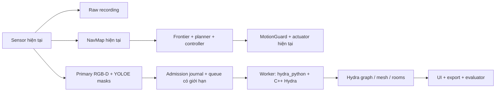

# Kiet_branch2 — Hydra Scene Graph Implementation Plan

> **For agentic workers:** REQUIRED SUB-SKILL: Use superpowers:subagent-driven-development hoặc superpowers:executing-plans để thực hiện từng task khi được giao triển khai. Checklist dưới đây chưa được thực thi.

**Goal:** Tạo nhánh chính xác `Kiet_branch2`, dùng MIT-SPARK/Hydra thay backend Scene Graph và phân phòng, giữ nguyên frontier exploration và movement hiện tại, cô lập khỏi `Kiet_branch`.

**Architecture:** Giữ sensor/recorder → NavMap → frontier/planner/controller/MotionGuard. Nhánh perception nhận primary RGB-D và mask dự đoán, đưa qua Python binding của Hydra trong worker process riêng; graph, objects, places và rooms của profile mới do Hydra sở hữu. Không chạy Rebuild M5 hay object owner cũ như backend thứ hai trong profile Hydra.

**Tech Stack:** NeuSymNav Python3.12; Hydra C++17 + pybind11 (`hydra_python`); Spark-DSG (`spark_dsg`); workspace native/colcon và interpreter riêng. Không chuyển movement sang ROS/Nav2.

**Spec:** Yêu cầu người dùng và lựa chọn đã xác nhận tại mục1; nền tảng [architecture](../../architecture.md), [status hiện hành](../../implementation-status.md).

## Global Constraints

- Trong lượt lập kế hoạch, chỉ đọc và ghi tài liệu. Người dùng đã giao triển khai ngày 2026-11-04; lượt này được phép thực hiện H0–H7 trong phạm vi kế hoạch, không training/tải model hoặc đổi movement.
- Tên nhánh là `Kiet_branch2`, không thêm prefix; checkout hiện tại vẫn là `Kiet_branch`.
- Giữ byte/hash của `src/neusymnav/navigation/` và các thiết lập movement đã chụp ở baseline; không âm thầm chọn hybrid, đổi gain, tốc độ hay cadence để làm benchmark Hydra tốt hơn.
- Giữ depth/map TTL300ms, horizon100ms, tốc độ tối đa0.2m/s, unknown khác free và collision-filtered actuation.
- Hydra không được cung cấp goal, route, map, pose đã tối ưu hoặc chứng nhận clearance cho MotionGuard. Pose Hydra không ghi ngược vào simulator.
- Runtime không nhận semantic GT, navmesh occupancy hay quỹ đạo GT. Pose và RGB-D đo từ simulator hiện tại vẫn hợp lệ.
- Chỉ một owner cấp/hợp nhất ID trong một graph domain. Trong profile Hydra, owner đó là Hydra; không ép Hydra node ID vào UUID của object owner cũ.
- Chỉ sửa NeuSymNav; các repo nguồn hiện có giữ nguyên. Môi trường và output Hydra nằm trong worktree mới; không dùng chung thư mục build hoặc cài vào `.venv` của checkout cũ.
- Theo [agent-orchestration](../../agent-orchestration.md): Luna xhigh mặc định; nâng Terra/Sol khi có lý do kỹ thuật; cấm Astra; một writer/file và một native/GPU benchmark tại một thời điểm. Không tự commit/push/publish.

## Review Focus

1. Dirty tree hiện tại và ignored local profiles: worktree mới phải nhận đúng code, không mất file mới hoặc trỏ worker về checkout cũ — H0.
2. Quaternion, camera/body extrinsics, mét/mm và invalid depth: graph phải đúng tọa độ, không loại mất hình học nền — H2/H3.
3. Hydra chậm/crash/restart hoặc queue đầy: không chặn control, không reset graph âm thầm hoặc replay nguồn sai — H4/H6.
4. Merge/remove native IDs, room chưa xuất hiện và backend unavailable: không tạo node/room/alias giả hoặc fallback sang M5 — H5/H6.
5. Hai branch dùng chung `.git` nhưng không được dùng chung executable/config/output có thể ghi: hash môi trường cũ phải giữ nguyên — H0/H1/H7.

## 1. Phạm vi đã chốt và hiện trạng

Người dùng chọn **Hydra thay Scene Graph/phân phòng ngay trong nhánh mới**; không phải shadow mode. Chỉ so sánh hai backend bằng các run riêng. `Kiet_branch` tiếp tục là baseline Rebuild; không merge Hydra ngược vào đó.

Đã kiểm tra ngày2026-11-04:

- Branch hiện tại `Kiet_branch`, HEAD `62f16fcf0b1ae508b49820e0184e99714387c490`; chưa có `Kiet_branch2`, hiện có một worktree.
- Có nhiều tracked edits và untracked files. Chỉ tạo branch từ HEAD sẽ thiếu các sửa movement và các module/test mới.
- Navigation hiện hỗ trợ gain/heading-aware frontier, discrete và hybrid opt-in. **Không đồng nhất code có sẵn với mode đang bật trong một profile.** Phải chụp cả source và effective config.
- Full suite2362 passed/10 skipped thuộc snapshot trước các thay đổi cuối; không phải chứng nhận toàn bộ dirty tree hiện tại. Hybrid300s chỉ đi2.663m, còn vấn đề NavMap latency. Encoder UI mới đã qua focused tests nhưng benchmark lưu149.8ms so với142.1ms của reference: chưa có bằng chứng nhanh hơn. Không chốt thêm tối ưu đó trong kế hoạch này.
- Ubuntu24.04, `/opt/ros/jazzy` tồn tại, core yêu cầu Python>=3.12. Chưa xác minh ROS toolchain/dependencies đầy đủ và chưa build/import Hydra.

Hydra không tự giải quyết movement chậm vì nhánh control được giữ nguyên. Tiêu chí kế hoạch này là thay backend đúng, hoạt động thật và không làm movement tệ thêm; mục tiêu tăng tốc exploration tuyệt đối vẫn là công việc riêng chưa đóng.

## 2. Lựa chọn tích hợp

| Hướng | Đánh đổi | Chọn |
| --- | --- | --- |
| Import binding trực tiếp trong coordinator | Ít IPC nhưng mang ABI, native crash và tác vụ nặng vào process đang chịu latency | Không |
| Dùng Hydra-ROS topics làm giao diện runtime | Có hạ tầng ROS, nhưng thêm vận hành/serialization và không cần thiết để giữ frontier hiện tại | Không cho runtime đầu tiên |
| Python binding trong worker riêng | Cần adapter/IPC nhưng cô lập Python/native và lifecycle | **Có** |

Colcon/ROS có thể phục vụ **build dependencies**; điều đó không có nghĩa robot phải di chuyển bằng ROS. Giữ backend cũ trong source để chạy baseline tường minh, nhưng profile Hydra phải từ chối cấu hình bật đồng thời M5/legacy ObjectOwner.



Không có cạnh từ D trở lại N/F/G. Không dùng demo trajectory generator của Hydra.

## 3. Đọc Python Binding trước khi code

Đây là checklist bắt buộc ở **commit Hydra đã pin**, không chỉ đọc README hoặc chạy `import`:

| Nguồn chính thức | Nội dung phải xác nhận và ghi vào `docs/hydra-python-bindings.md` |
| --- | --- |
| [Python README](https://github.com/MIT-SPARK/Hydra/blob/main/python/README.md) | Build native dependencies trước; cài Spark-DSG và Hydra vào environment riêng; Python package không thay cho C++ build. |
| [pyproject.toml](https://github.com/MIT-SPARK/Hydra/blob/main/pyproject.toml), [Python CMake](https://github.com/MIT-SPARK/Hydra/blob/main/python/CMakeLists.txt) | Build backend hiện tại, interpreter/pybind11, `find_package(hydra)`, CMake prefix và shared-library resolution. Không áp dụng mù quáng `setup.py` cũ. |
| [pipeline.py](https://github.com/MIT-SPARK/Hydra/blob/main/python/src/hydra_python/pipeline.py) | Camera creation, config/labelspace loader, `HydraPipeline.from_config`, step mode. Đối chiếu schema config loader với native tại commit pin. |
| [python_pipeline.cpp](https://github.com/MIT-SPARK/Hydra/blob/main/python/bindings/src/python_pipeline.cpp) | `step(timestamp_ns, world_t_body, world_R_body, depth, labels, rgb)`, quaternion **w,x,y,z**, boolean kết quả; `graph`, `save_graph`, `reset`, lifecycle/global singleton. |
| [python_sensors.cpp](https://github.com/MIT-SPARK/Hydra/blob/main/python/bindings/src/python_sensors.cpp) | `CameraConfig`, `ExtrinsicsConfig.body_R_sensor/body_p_sensor`, camera optical frame và body-to-sensor transform. |
| [depth_parser.cpp](https://github.com/MIT-SPARK/Hydra/blob/main/python/bindings/src/depth_parser.cpp), [label_parser.cpp](https://github.com/MIT-SPARK/Hydra/blob/main/python/bindings/src/label_parser.cpp), [sensor input](https://github.com/MIT-SPARK/Hydra/blob/main/python/bindings/src/python_sensor_input.cpp) | Dtype/layout/shape; float32 depth là mét, uint16 có đường chuyển mm; labels nguyên một kênh. Chọn float32 và int32 trong adapter, kiểm invalid/NaN và RGB channel order bằng native test. |
| [Habitat config](https://github.com/MIT-SPARK/Hydra/blob/main/config/datasets/habitat.yaml), [labelspace mẫu](https://github.com/MIT-SPARK/Hydra/blob/main/config/label_spaces/ade20k_mp3d_label_space.yaml) | Reconstruction/GVD/place graph/UpdateRoomsFunctor; điều kiện cập nhật rooms, invalid/object/surface labels. Không hứa một `step` sẽ tạo room ngay. |
| [Spark-DSG](https://github.com/MIT-SPARK/Spark-DSG), `examples/python_api.py` trong clone | Layer/node/edge/mesh APIs, save/load, native ID, merge/remove và dữ liệu thực sự có thể xuất. |
| [Hydra Habitat helper](https://github.com/MIT-SPARK/Hydra/blob/main/python/src/hydra_python/simulators/habitat.py) | Chỉ tham khảo quy ước. Helper có semantic simulator, navmesh trajectory và `set_state`; không đưa các đường này vào runtime NeuSymNav. |

Các URL `main` là tài liệu đã tham khảo khi lập plan, **không phải version lock**. H1 phải thay bằng permalink SHA trong báo cáo API trước khi H2/H3 triển khai. Đối chiếu [manifest ROS2](https://github.com/MIT-SPARK/Hydra-ROS/blob/main/install/ros2.yaml) để khóa dependency closure; không để các dependency trôi theo `main`/`develop` khi tái build.

## 4. Seam dữ liệu và ownership đề xuất

### 4.1 Đầu vào

`HydraInputAdapter.convert(obs: Observation, detections: DetectionBatch, calibration: HydraCalibration) -> HydraFrame`

- Chỉ primary `rgbd`; detections phải khớp chính xác frame, calibration, vocabulary. Không ghép mask cũ với depth mới, không gửi downward-depth như RGB-D primary.
- `HydraFrame` chứa source key, capture/domain, calibration/hash, detector/vocabulary hash, RGB uint8 H×W×3, depth float32 H×W mét, labels int32 H×W, K và transform/calibration convention.
- Pixel depth không hợp lệ/no-return/far-plane không được biến thành surface hợp lệ. Chuyển sang sentinel được H2 native test xác nhận; không sửa Observation gốc.
- `T_world_body = T_world_camera @ inverse(T_body_camera)` từ extrinsics đã pin; gửi cùng extrinsics cho Hydra để tái dựng đúng `T_world_camera`. Không suy body6DoF từ mỗi yaw/XY, không áp hai lần phép đổi Habitat→optical/Z-up. Binding nhận quaternion wxyz; scipy trả xyzw nên phải đổi tường minh.
- Timestamp dùng original capture nanoseconds, strictly ordered theo selected primary stream. Nếu binding cần thời gian tương đối thì mapping epoch phải khả nghịch, lưu cả hai; không retimestamp thành thời gian xử lý.

### 4.2 Labels dự đoán, giữ hình học nền

Mặc định tái dùng **một YOLOE inference** hiện tại; detector chỉ tạo semantic evidence, không quản lý object ID. Tạo dense label raster từ instance masks: score giảm dần, tie-break detection ID, mapping taxonomy pin theo file. Nhãn chưa biết không suy thành wall/floor/free.

Raster này mang **semantic class**, không mang identity của YOLOE instances. Hydra phải tự dựng object instances từ hình học/semantic clustering. Không tuyên bố giữ nguyên instance mask ID; hai vật cùng lớp chạm nhau có thể bị gộp và phải được báo trong đánh giá chất lượng.

Đề xuất labelspace riêng:0=`unknown_static`,1=`invalid`, categories2..N+1 theo thứ tự taxonomy đã khóa; `object_labels` chỉ gồm categories, `invalid_labels=[1]`, không dùng0 làm object. Mọi pixel depth hợp lệ chưa có mask vẫn có semantic unknown0 và giữ measured geometry. Invalid depth mang label1 và depth sentinel. GVD freespace places/rooms dùng hình học; không yêu cầu bịa nhãn sàn cho phần nền. Không sao chép cấu hình ADE20K có void0 invalid rồi làm mất hình học ngoài mask.

**Đây là thiết kế phải chứng minh bằng H3, chưa phải khả năng native đã kiểm chứng.** Nếu commit pin không giữ được TSDF/GVD với labelspace này, H3 fail; ghi nguyên nhân và sửa adapter/config hoặc đề xuất dense semantic provider riêng. Không âm thầm dùng GT, gán toàn bộ nền thành floor hoặc đưa Rebuild vào bù. Room-category semantics và chất lượng dense semantic segmentation không được coi là đã giải quyết bằng raster mask này.

### 4.3 Worker và graph

- `HydraSession.offer(frame: HydraFrame) -> HydraAdmission`: enqueue nonblocking; `snapshot() -> HydraGraphSnapshot | None`; `close(timeout_s: float) -> dict`. Binding chỉ import bên child.
- Một process/episode, step mode, một in-flight và tối đa một pending; live latest-wins với payload pending+in-flight tối đa32MiB. Frame bị thay phải có journal reason. Offline replay lossless chạy ordered, không dùng live replacement.
- `HydraGraphSnapshot`: episode/domain, graph revision, last accepted source/capture/domain, input-prefix SHA, config/source/build hashes, graph asset ref+SHA, bounded node/edge summary, stale/replay_required/failure_reason và nguồn frame transform.
- ID dạng `hydra:<run_id>:<layer>:<native_id>`; giữ native graph, chỉ chiếu sang UI. Merge/remove theo native output: mọi cạnh phải có endpoint còn tồn tại; không đoán alias khi upstream không cung cấp replacement.
- Prefix journal ghi chính xác selected sequence, input/mask hashes, acceptance và result; graph có provenance theo input-prefix, không tự tuyên bố per-object crop evidence nếu binding không cung cấp.
- Mesh/native graph là artifact riêng, không nhét toàn mesh vào mỗi gói UI. Ngưỡng khởi đầu: graph summary≤16MiB, mỗi asset≤128MiB, quota run giữ cấu hình đã pin. Worker timeout30s; RSS budget đề xuất4GiB được giám sát và báo giới hạn sampled, không gọi đó là hard peak proof.
- Nếu worker lỗi: graph unavailable/stale, `replay_required=true`; control còn sensor/NavMap hợp lệ tiếp tục theo policy hiện tại. Không restart với graph trống rồi nhận là graph đã phục hồi; phục hồi từ journal hoặc khởi episode/domain mới có thông báo.

### 4.4 UI và những consumer cũ

Profile Hydra không tạo `ObjectOwner`, `VerificationOwner`, legacy region worker, RebuildRoomSession hoặc legacy hierarchy membership composer. Tái dùng detector transport/raw recorder; `HydraHierarchyProjector` chiếu native layer/edge sang hierarchy/display, không tạo owner thứ hai.

Hydra rooms là room nodes + place membership/topology; không mặc định có polygon2D giống M5. UI hiển thị native rooms/places/objects trên mesh/cloud Hydra; occupancy control vẫn ghi rõ NavMap. Outline2D chỉ xuất khi có phép chiếu có provenance, không vẽ convex hull nối xuyên cửa rồi coi là ranh giới gốc. Consumer nào bắt buộc M3/M5 phải nhận unavailable đúng backend, không nhận số revision M5 giả.

Legacy verification/best-view/alias gallery chưa có tương đương Hydra thì UI ghi rõ unavailable; không gán `verified` hoặc tạo object evidence giả. Chọn node vẫn xem native ID, layer, attributes, parent/membership, revision, nguồn và input-prefix.

## 5. File map cho nhánh mới

Các đường dẫn dưới đây tương đối với **worktree Kiet_branch2**, không phải checkout đang mở:

| File | Vai trò |
| --- | --- |
| `docs/hydra-python-bindings.md`, `docs/results/hydra-branch2-*.md` | API audit, manifests và kết quả thật |
| `vendor/hydra.lock.yaml` | URLs/SHAs/dependency/build/ABI/license manifest; source clone nằm ngoài tracked source |
| `tools/setup_hydra_backend.sh`, `tools/check_hydra_bindings.py` | Provision/build có kiểm tra, import + native step/save/load probe |
| `configs/hydra/{pipeline,labelspace}.yaml`, `configs/hydra/runtime.example.json` | Cấu hình riêng, không sửa default/profile của Kiet_branch |
| `src/neusymnav/contracts/hydra_graph.py`, `contracts/{__init__,serialization}.py` trong cùng package | HydraFrame, HydraCalibration, admission/publication; fixed registry/import registration, không import module tùy ý từ wire |
| `src/neusymnav/backends/hydra/{input_adapter,session,worker,graph_adapter}.py` | Chuyển đổi, process client, binding owner, native graph projection |
| `src/neusymnav/runtime/hydra_graph.py` | Detector→Hydra graph runtime, journal và admission; không cấp object ID |
| `src/neusymnav/runtime/{configuration,launcher,coordinator}.py` | Backend selection/lifecycle và offer primary; không đổi navigation/control implementation |
| `src/neusymnav/visualization/{publisher,hierarchy_view}.py`, `src/neusymnav/runtime/ui_transport.py` | Projection có provenance cho Hydra, legacy path giữ tương thích |
| `tools/run_hydra_map_demo.sh`, `tools/replay_hydra.py`, `tools/check_hydra_acceptance.py` | Entry point branch2, replay và gate riêng; không sửa checker Rebuild để Hydra pass |
| `tests/test_hydra_{contracts,bindings,input,labels,session,runtime,projection,acceptance}.py` | CPU/fake/native tests tách marker và artifacts |

Chỉ tạo file/module thực sự cần dùng; `backends/hydra/` là namespace mới, không copy cả Hydra vào `src/neusymnav`.

## 6. Tasks và tiêu chí hoàn thành

### H0 — Cô lập Git và chụp đúng baseline hiện tại

**Files/artifacts:** `docs/results/hydra-branch2-baseline.md`; source/config manifests; dirty patch và untracked inventory trong `.runtime/hydra-handoff/`.

- [x] Ghi branch/HEAD, staged và unstaged diffs riêng, aggregate `git diff --binary HEAD`, danh sách NUL-delimited untracked nonignored và SHA256. Chụp actual movement config; phân biệt runner defaults với các experiment profile.
- [x] Chụp hash interpreter/worker scripts/config local cần chạy; không đưa secrets, `.env`, datasets, models, `.venv`, `.runtime` hay runs vào Git snapshot.
- [x] Tạo worktree riêng khi được giao triển khai, từ đúng HEAD đã ghi, bằng tên nhánh chính xác:

```bash
HYDRA_WORKTREE=/home/kiettran05/Desktop/test_Room_segmentation/NeuSymNav/.runtime/worktrees/Kiet_branch2
git worktree add -b Kiet_branch2 "$HYDRA_WORKTREE" 62f16fcf0b1ae508b49820e0184e99714387c490
```

- [x] Không chạy lệnh trên nếu HEAD đã đổi hoặc branch/path đã tồn tại: kiểm tra và cập nhật manifest, không dùng `-B`, `--force`, reset hoặc stash tự động. Apply aggregate patch và copy đúng untracked inventory vào worktree mới; kiểm từng source hash. Source checkout/index cũ không đổi.
- [x] Local profiles ignored phải được tạo lại trong worktree mới: script/executable/build/output trỏ worktree mới; model/scene có thể tham chiếu read-only asset cũ, có hash. Không symlink environment có thể ghi hoặc chép nguyên absolute script paths về checkout cũ.
- [x] Tạo actual package inventory từ **interpreter baseline đang chạy**: `sys.version`, `sys.executable`, `sysconfig`, `.venv/bin/python -m pip freeze --all` và `pip inspect` nếu được hỗ trợ; ghi metadata/RECORD hashes của distributions và native `.so`/linked-library versions. Tách project editable path cũ khỏi dependency lock: source NeuSymNav được pin bằng H0 manifest, không cài lại editable về Kiet_branch.
- [x] Từ inventory, khóa exact versions và artifact hashes của dependency closure core/runtime/test cần dùng, lưu wheel/source provenance; không dùng version ranges trong pyproject thay lock. Provision interpreter riêng và so lại Python/runtime package versions, native dependencies cùng baseline navigation replay. Nếu không lấy được artifact hoặc tái tạo không khớp, H0 chưa pass; không tự nâng NumPy/SciPy rồi gọi là cùng baseline. Hydra interpreter có ABI lock riêng. Redirect cache/bytecode/temp về worktree mới.
- [x] Nếu chưa có quyền commit rõ ràng, giữ snapshot bằng patch+manifest và nói rõ branch2 working tree chưa commit; không tự commit baseline ở bất kỳ branch nào. Có thể checkpoint commit **chỉ branch2** khi được phép.
- [x] Gate H0: `git -C "$HYDRA_WORKTREE" branch --show-current` là `Kiet_branch2`; checkout cũ vẫn `Kiet_branch`; protected source/config hashes khớp; không thiếu file mới. Lưu command/exit code. Việc đọc chung `.git`/object database không đồng nghĩa chia sẻ working tree.

### H1 — Clone Hydra, khóa dependency và build Python Binding

**Files:** lock/setup/probe/API audit ở mục5. **Depends:** H0.

- [x] Trong `Kiet_branch2/.runtime/hydra_ws/src/hydra`, clone HTTPS `https://github.com/MIT-SPARK/Hydra.git`; resolve và ghi commit SHA trước build. Dùng dependency manifest Hydra-ROS làm nguồn khảo sát, resolve toàn bộ repo sang exact SHA (`vcs export --exact` hoặc tương đương); không fetch thêm trong runtime.
- [x] Khóa cả dependency Python/VCS trong pyproject, gồm `spark_dataset_interfaces`, NumPy và pybind11; không chỉ khóa các repo colcon. Cài theo closure đã resolve, không để pip tự kéo một Spark-DSG hoặc git dependency khác SHA.
- [x] Kiểm tra ROS Jazzy, compiler, CMake, Python dev headers, Eigen/OpenCV/GTSAM/Spark-DSG và dependency closure thực tế. Ghi version/các package thiếu trước khi provisioning; không upgrade host ROS hoặc môi trường Kiet_branch. Package hệ thống còn thiếu cần được xử lý theo quyền cài đặt của lượt triển khai; nếu dùng container, phải có build/image lock riêng.
- [x] Build workspace với jobs giới hạn ban đầu2; tạo interpreter Hydra riêng, build/install `spark_dsg` cùng closure rồi `hydra_python` bằng build backend đã audit. Không cài `hydra-core` nhầm với Hydra robotics. Không giả định `pip install` một package sẽ tự có tất cả native libs.
- [x] Hoàn thành checklist mục3 với SHA permalinks. Ghi `.so`/ABI/hash, Python/NumPy versions, prefixes và environment script chỉ source trong child Hydra.
- [x] Probe thực: import bindings + Spark-DSG, make camera, construct pipeline, step một RGB-D hợp lệ, đọc graph, save/load graph, shutdown. Expected exit0 và artifacts có SHA; chỉ import thành công chưa pass H1. API lỗi/config incompatibility phải chặn H2, không đoán signature.

### H2 — Contracts và adapter hình học có oracle

**Files:** contracts/input adapter; tests contracts/input/bindings. **Produces:** HydraFrame/HydraCalibration và `convert(...)` ở4.1.

- [x] RED: tests reject sai frame/calibration/mask shape, future/wrong clock theo contract nhập; frame-order validator reject duplicate/out-of-order indices/timestamps and wrong episode/domain. H4 must call this validator in the actual session. Khóa roundtrip wire và không mutate input arrays.
- [x] Đăng ký contracts trong public exports và fixed deserializer imports; test decode trong interpreter sạch không phụ thuộc thứ tự import, reject unknown type/field. Không đưa native Hydra imports vào CPU-only contracts.
- [x] RED: scene đo được với camera extrinsic khác identity, dịch/xoay90°, RGB sentinel đỏ và plane ở độ sâu2m; kiểm world point và `T_world_body @ T_body_camera` bằng original pose (sai số≤1e-6m cho phép tính adapter). Quaternion xyzw đưa sai phải bị test bắt.
- [x] Implement float32 metric/NaN-invalid conversion và transforms một lần; xác minh sentinel bằng native tiny reconstruction, không chỉ mock quaternion.
- [x] Run CPU input/contracts tests và native marked probe riêng; ghi exit, graph/mesh nguồn. Expected plane không bị scale1000×, xoay/lật hoặc dịch theo camera offset hai lần.

### H3 — Semantic raster và room pipeline đầy đủ

**Files:** input label mapping/config; tests labels/bindings; API audit cập nhật. **Depends:** H1/H2.

- [x] RED/GREEN: overlap masks/ties, unknown class, invalid depth, frame mismatch; unknown0 không nằm trong `object_labels`, nền không remap thành floor, và output không đổi khi detections đổi thứ tự.
- [x] Implement raster mapping4.2, labelspace version/hash và dùng `DetectionBatch` sẵn có. Rasterizer không khởi detector.
- [x] Native geometry gate: custom labelspace nhận empty-detection frames, giữ background label0 thành measured mesh/freespace places; depth invalid là NaN/label1 và invalid patch không tạo mặt.
- [x] Native object gate: hai box cùng class, cách tâm1m, đủ điểm theo frozen `min_cluster_size=40` và `cluster_tolerance=0.25m`; tạo `O(0)`/`O(1)`, giữ đúng hai node qua8 frames, Spark-DSG reload2 nodes; input-prefix và graph được lưu.
- [x] Effective config ghi reconstruction/GVD/room-finder, backend `UpdateRoomsFunctor`, trigger và thresholds trong report H3.
- [x] Native geometry fixtures không semantic GT: hai không gian4×6×2.5m nối lối0.7m cho2 rooms; open-space8×6×2.5m đối chứng cho1 room sau28 views mỗi fixture, cùng config/threshold. Ghi graph và result JSON sau native reload.

### H4 — Worker process, journal và backpressure

**Files:** session/worker/runtime hydra graph; tests session. **Produces:** `offer/snapshot/close` ở4.3.

- [x] RED/GREEN fake worker sleep30s, crash, malformed/oversized reply, queue/byte cap, replayed frame, wrong episode; `offer` không đợi step, tối đa1 in-flight/1 pending và32MiB payload. Replaced/dropped có counter và source/reason.
- [x] Implement bounded transport và journal selected payload/result/original timestamps. `step=false` không tăng revision; protocol ở stdout, stderr có tail cap.
- [x] Worker native chạy trong child, TSDF/mesh integrator effective2 threads và BLAS/OpenMP1; cả hai mức2 được xác nhận qua native logs. ROS/workspace env chỉ được source bên child wrapper. Không tăng threads hoặc benchmark contention.
- [x] Restart process Hydra và replay prefix đã accepted trên native child mới; source key, revision, input-prefix SHA và graph SHA khớp run đầu. Episode validation ngăn trộn source episode.
- [x] Stats có candidates/fps_limited/queued/replaced/started/accepted/failed, queue/service/source-age p50/p95, sampled RSS, artifact bytes/quota; close timeout kill/reap child và trả incomplete.

### H5 — Đưa Hydra vào đường chạy thật, giữ nguyên movement

**Files:** config/launcher/coordinator/hydra graph runtime; tests runtime. **Depends:** H3/H4.

- [x] Thêm backend selector `scene_graph.backend`: legacy hoặc hydra; Hydra config cần pin và calibration rõ ràng. Reject Hydra cùng M5/legacy region, appearance/identity và room workers. Legacy config không import Hydra.
- [ ] RED: hoàn thiện monkeypatch ObjectOwner, VerificationOwner, RebuildRoomSession và legacy composer thành hàm báo lỗi; test sensor/recorder/nav nối đúng source.
- [ ] RED: Hydra chậm/crash không thay NavigationDecision/MotionCommand khi chạy cùng recorded nav observations, pose, config và clock. Nav/controller source hashes phải khớp H0. Hiện có test offer chậm/crash độc lập với submit và 135 navigation regressions, nhưng chưa có test cùng run quyết định/lệnh movement.
- [x] Implement offer primary từ durable observation journal trên graph thread. Native step/save không chạy đồng bộ trong sensor/control; coordinator lock không được giữ trong offer. Runtime publication sẽ được nối ở H6.
- [x] Run focused Hydra runtime/session and navigation tests; H0 navigation source hashes khớp. Hydra failure không fallback sang M5 và không đặt global navigation health thành failed. Chưa inspect live coordinator worker metadata.

### H6 — Hiển thị và export Hydra graph/rooms thật

**Files:** graph adapter, publisher/UI transport/view, exporter; tests projection/acceptance. **Depends:** H5.

- [ ] RED: native graph fixture có object/place/room/building, merge/remove và missing room; edges closure, node namespace, selection invalidation và stale status đúng. Không đòi tầng floor nếu Hydra không xuất.
- [x] Implement UI projection4.4; giữ NavMap tách khỏi Hydra graph. Native mesh/cloud rendering, giữ orbit/zoom/resize trên mesh, chưa hoàn tất.
- [x] Wire versioned DTO/default và offscreen publication/selection regression; visible X11 coordinator-to-UI smoke now passes with a local UI-enabled profile.
- [x] Exporter xác minh native Spark-DSG graph+mesh cùng selected-input/input-prefix manifest; H4 native reload evidence được giữ riêng trong H4 report.
- [x] UI-on 15 s live smoke ran with Qt offscreen. Final publication seq 34 contains Hydra revision 3, matching the complete native export; Qt acknowledged rendering seq 34, with zero drops and clean UI/sensor/Hydra shutdown. The graph had 0 nodes/edges and generic outcome stayed `incomplete` because the legacy hierarchy/NavMap/object bundle is unavailable. Detector fell back to Torch CPU because this environment exposes no UHD device; X11 was not accessible here. A previous 30 s offscreen attempt exited `-6` before ACK; its log was lost, so the cause is unknown. Close-time post-drain refresh and child-render ACK are now runtime-validated for this 15 s run only.
- [ ] Same-recording UI replay A/B completed on all 172 observations, with identical 7 detector calls/commits and Hydra revision 4. UI-off wall time was 63.1 s; UI-on offscreen was 55.7 s. Both used Torch CPU fallback and novelty sampling, so this is graph/detector replay throughput, not live control cadence or UHD evidence. The pair does not show UI slowdown, but one pair is insufficient to conclude no effect. Existing separate live runs still show different control cadence and cannot establish causation. Room membership selection and mesh/cloud display remain unverified; consumer M5-only displays unavailable.
- [x] A separate offline control-cadence harness now joins the same recording with source-bound pose/control sidecars, paces a 5 s warmup plus 15 s measured window, and calls the existing control path through an actuator stub that cannot reach Habitat. UI-off/on profiles differed only by `ui.enabled`; both completed 42 control ticks with exact map on 42/42, clean shutdown. Mean intervals 353.98/355.83 ms, p95 506.79/541.31 ms; replay-generated `expired_or_zero` 0/1 and `navigation_source_pending` 0/0. It does not model sensor roundtrip or real actuation latency; selected live source window had 3 expired and 3 pending. CPU fallback, one pair, no UHD/live certification and no long run. Artifact `hydra-openvino-control-cadence-ab-00805-20261104/final-15s`; see `docs/results/hydra-branch2-live-ui-00805.md`.

### H7 — Đối chứng, nghiệm thu và bảo vệ Kiet_branch

**Files:** runners/replay/checker riêng; tests acceptance; docs/results/status. **Depends:** H0–H6.

- [x] Runner kiểm active branch/worktree, source/ABI/asset/config pins, binding probe và transform/labelspace pins mà không tự clone/build/download; calibrated profile preflight exits 0 (`ready=true`, `issues=[]`, `native_runtime_validated=false`). Live coordinator/A-B gates remain open.
- [ ] Offline A/B trên cùng ordered RGB-D/pose recording, cùng semantic evidence nếu hợp lệ cho mỗi backend; Hydra và Rebuild chạy tuần tự. Báo cả khác biệt sampling/input, không quy quality improvement cho backend nếu đầu vào khác.
- [ ] Quality fixture: room split ở lối hẹp, open-space không tách tùy tiện, tường không có object mask vẫn tồn tại; room revision/merge/remove không để dangling links. 00805 thật không bị bắt buộc ra2 phòng khi coverage chưa đủ. GT nếu có chỉ nằm evaluator offline tách nguồn runtime.
- [ ] Live ladder:30s smoke →3 cặp90s baseline/Hydra →300s trên00805 chỉ sau khi smoke/replay/latency không lỗi; thêm một scene local đã preflight. Bounded post-fix smoke đã xử lý 2/2 Hydra inputs và shutdown sạch nhưng `outcome=incomplete`: detector capture-return p50/p95 14.328/25.342s (n=2), mọi control interval đo được đều >100ms, strict actuation evidence thiếu. Xem `docs/results/hydra-branch2-smoke-00805.md`. Không chạy dài tới khi latency/cadence được xử lý và smoke đạt acceptance. Một native workload tại một thời điểm.
- [ ] Khóa navigation/source/config giống H0 cho A/B; đo actual body-pose/action translation, displacement, coverage, goals reached, stalls, source-pending, command/depth age và native resource completeness. Tiêu chí không hồi quy đề xuất: median translation≥90% baseline và pending-source không tăng quá5 điểm phần trăm qua3 cặp90s; nếu fail thì tối ưu admission/CPU isolation, không sửa movement hoặc TTL trong task Hydra.
- [x] Checker Hydra độc lập fail-closed theo native object/room-gate evidence H3, source/config pins, incomplete export, timeout, ordered source và outcome metrics. Synthetic positive/negative cases pass; real H3 gate artifacts are found. A pinned calibrated local profile now passes preflight; real coordinator/A-B evidence is still absent. Tách `binding-built`, `correctness-verified`, `runtime-validated`, `room-quality-evaluated`; không nới checker Rebuild.
- [ ] Chạy full CPU suite cuối, native opt-in tests riêng, `git diff --check`; báo số test/skip và exit thực. Hydra runtime regression file đã qua 11 test (exit 0); full CPU suite gần nhất là 2416 passed/10 skipped/3 failed (exit 1; ba legacy UI worker SHA checks), trước publication-revision regression mới. Chưa chạy lại full suite sau thay đổi này.
- [ ] So lại `Kiet_branch` ref/HEAD/index/source và local profile/environment hashes với H0; mọi thay đổi ngoài worktree mới phải được giải thích. Cập nhật status **bên branch2**, không sửa status checkout cũ để giả nhận Hydra đã tích hợp.

## 7. Phân công và điểm dừng

Lệnh verification trong worktree mới (các file/tool này sẽ được H1–H7 tạo, hiện chưa có):

```bash
.venv/bin/python -m pytest tests/test_hydra_contracts.py tests/test_hydra_input.py tests/test_hydra_labels.py -q
.venv/bin/python -m pytest tests/test_hydra_session.py tests/test_hydra_runtime.py tests/test_hydra_projection.py tests/test_hydra_acceptance.py -q
.venv/bin/python tools/check_hydra_bindings.py --config configs/hydra/runtime.local.json
bash tools/run_hydra_map_demo.sh 00805 --preflight
bash tools/run_hydra_map_demo.sh 00805 30
.venv/bin/python tools/check_hydra_acceptance.py RUN_DIR
.venv/bin/python -m pytest -q
git diff --check
```

RED chạy trước phần implementation tương ứng phải fail đúng nguyên nhân thiếu API/behavior, sau đó GREEN exit0. Binding probe/native marker phải báo run thật hoặc skip có lý do; skip không đóng native gate. Checker chỉ exit0 khi toàn bộ tiêu chí H7 của loại run đó đạt; không lấy exit0 của script chẩn đoán làm launcher success. Preflight phải validate các đường dẫn local đã provision chứ không yêu cầu file `.local.json` nằm trong Git.

H0 do main quản lý Git/snapshot, H1 do một environment owner Luna thực hiện; H2/H3 có rủi ro ABI/tọa độ/semantics nên main khóa contracts và reviewer độc lập kiểm tra. Luna phụ trách adapter/tests/IPC/UI theo file ownership; chỉ nâng Terra khi có lỗi native/transform hoặc bất định thực tế. Sau H3 và H5 có review độc lập, cuối H7 review toàn diff. Không tạo reviewer cho mọi thao tác tài liệu nhỏ.

Thứ tự: **H0 → H1 → H2 → H3 → H4 → H5 → H6 → H7**. Có thể viết fake CPU tests H4 trong khi H1 build nếu không benchmark và không tranh resource; native tests luôn tuần tự. Không vượt gate bằng mock, geometry GT hoặc graph do backend cũ xuất.

Khi xong H7, bàn giao worktree/branch, exact Hydra+dependency SHAs, binding audit, config/launch/replay commands, native graph artifacts, report A/B và các khả năng UI chưa được nối. Không merge, commit hay push khi chưa có quyền tương ứng.

## 8. Trạng thái kế hoạch này

**Planning completed; implementation authorized and started 2026-11-04.** H0 and H1 are complete. H0 created the exact `Kiet_branch2` worktree from the recorded dirty `Kiet_branch` snapshot, captured source/config/environment hashes, and passed the baseline navigation/replay checks; evidence is in `docs/results/hydra-branch2-baseline.md` and ignored `.runtime/hydra-handoff/`. H1 pinned and built Hydra, Spark-DSG, the Python dependency closure, and native workspace dependencies. The pinned API audit is `docs/hydra-python-bindings.md`; `docs/results/hydra-branch2-h1.md` records build/probe commands, exit codes and artifact hashes.

Implemented/correctness/runtime evidence remain separate. H0–H4 are implemented and correctness-verified: H3 includes custom semantic labeling plus native geometry/object/room gates; H4 adds bounded sessions, native child step/save/reload, and exact selected-prefix restart replay. The local 00805 profile is calibrated from an actual Habitat sensor readback and passes preflight; this is not live NeuSymNav runtime validation. H5 selector/admission/failure isolation is implemented and CPU-correctness-verified, with its live coordinator and concurrent navigation gates still open (see `docs/results/hydra-branch2-h5.md`). H6 graph projection, offscreen UI path, and verified manifest export are implemented and correctness-verified; live coordinator/visible UI and mesh/cloud rendering remain open (see `docs/results/hydra-branch2-h6.md`). H7 branch2 runner and fail-closed acceptance checker are implemented and CPU-correctness-verified; same-input A/B, live ladder, and runtime acceptance remain open (see `docs/results/hydra-branch2-h7.md`). No movement changes, commits, pushes or publishes were made.
