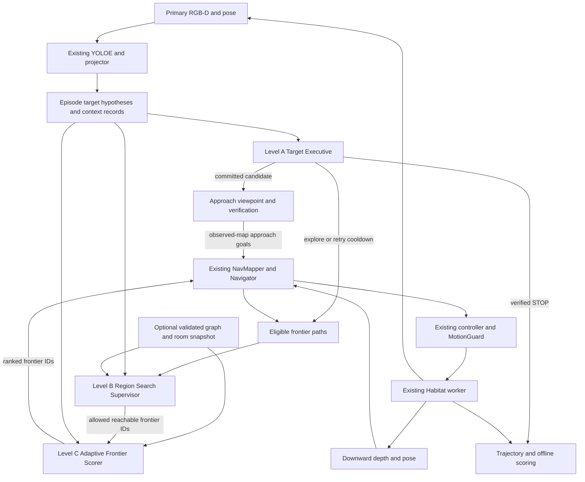
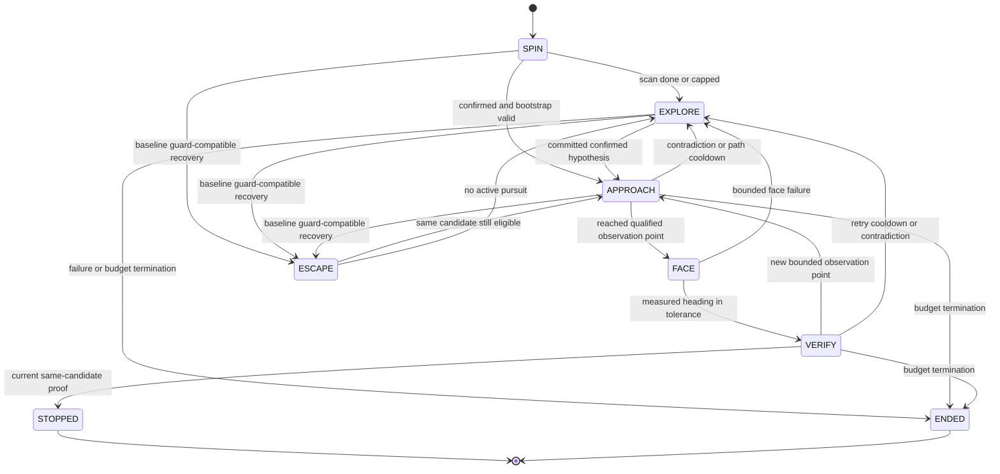

# Hierarchical ObjectNav Policy Implementation Plan

> Hồ sơ lịch sử. Mã và tùy chọn chạy của C, A, S đã được gỡ khỏi checkout hiện tại.

> Tài liệu lưu kế hoạch ObjectNav lockstep ngày 2026-11-14. Các mục B0 và DEV60 bên dưới dùng giao thức của đợt đó. Ablation hiện hành dùng [baseline B0](../../objectnav/paper-pr7-setup.md) theo giao thức paper.

> Rà soát nguồn và thiết kế C cho B0 hiện hành nằm trong [Thiết kế B0+C](../../objectnav/c-executive-design.md), gồm mã Navigation-Memory tìm được sau đợt audit lockstep.

> Bản lockstep hiện tại đã bỏ cache provider thử nghiệm và hai cờ runtime dự trù cho graph và tour. Loader schema 1 tiếp tục đọc cấu hình lịch sử. [Bàn giao tinh gọn C/A/S](../../implementation-status.md#đánh-giá-tích-hợp-closer-và-tinh-gọn-cas--2026-11-25).

## Cập nhật phạm vi ngày 15/11/2026
Dừng DEV60 của cấu hình `lightweight` theo yêu cầu. Kết quả B0 được lưu làm mốc kiểm tra runner/scorer. ObjectNav mới dùng Qwen3-VL-2B-Instruct với cùng model, projector và runtime đã ghim cho pipeline chuẩn Hydra + VLM. VLM chạy trên một worker bất đồng bộ và xử lý tối đa một yêu cầu cùng lúc. Mỗi yêu cầu gắn với frame RGB-D đã nhận, calibration, đồng hồ và episode. Vòng điều khiển tiếp tục dùng kết quả đã sẵn sàng hoặc cách xếp hạng hình học.

- **C · Kiểm tra vật thể.** Khi phép xác minh RGB-D có bằng chứng đạt yêu cầu, crop ảnh được tạo từ mask của đúng candidate để Qwen phân loại `match`, `mismatch` hoặc `uncertain`. `STOP` yêu cầu cả `match` khớp CID, thời điểm, pose và bằng chứng RGB-D còn mới tại thời điểm dừng. `mismatch`, `uncertain` hoặc hết ngân sách xác minh dẫn tới thử lại góc nhìn theo giới hạn pursuit. Dựa trên candidate memory và guarded STOP của [ConsistNav §3.3–3.5](https://arxiv.org/html/2605.09869v2#S3).
- **A · Xếp hạng điểm khám phá.** Chiếu tối đa bốn viewpoint có đường đi lên ảnh, lọc theo depth và thêm dấu số. Qwen xếp hạng các dấu dựa trên goal, ảnh và ngữ cảnh đã quan sát. Mức tin cậy thấp chỉ tạo ưu tiên nhẹ. Khi ảnh có frontier nhìn thấy được ở ranh giới chọn waypoint, robot có thể quan sát tại chỗ tối đa 14 giây mô phỏng trước khi chốt đích, cách nhau ít nhất 30 giây. Vòng điều khiển tiếp tục chạy và planner kiểm lại đường đi trên revision hiện tại. Ngân sách này được chọn sau khi đo một câu trả lời đến 11,28 giây mô phỏng sau lúc gửi request trên CPU. Dựa trên chuyển chế độ của [ApexNav §IV-B](https://arxiv.org/html/2504.14478v3#S4) và ảnh có dấu đánh số của [OpenFrontier §III và §S1-C](https://arxiv.org/html/2603.05377v3#S3).
- **S · Gán nhãn và suy luận chuyển vùng.** Qwen gán nhãn vùng đang quan sát; gợi ý phòng được lưu theo ID vùng hình học và tuổi bằng chứng. Khi ảnh cho thấy ngữ cảnh mâu thuẫn với goal, S cân nhắc vùng khác từ các frontier VLM đã xếp hạng. Đích phải qua các điều kiện sẵn có về đường đi, gain, chênh lệch utility và thời gian giữ vùng. Dựa trên cổng context và giữ mission của [SOR-Nav §III-C](https://arxiv.org/html/2609.34707v1#S3).

`--policy vlm --vlm-config ...` chạy qua ObjectNav lockstep hiện có. Vùng của runner là cụm frontier suy ra từ bản đồ quan sát. Gắn cùng policy vào graph Hydra live và kiểm chứng nhãn theo native room ID là bước tích hợp riêng. Đánh giá ban đầu dùng ảnh đã lưu, fixture và một episode `val_mini`. DEV60 và TEST180 không nằm trong đợt kiểm chứng này.

## 1. Executive Summary

Mục tiêu là cải thiện đồng thời SR và SPL so với B0 trong cùng benchmark. Giữ FSM B0 làm Target Executive, đưa quyết định search/relocate vào lúc chọn exploration goal, rồi chấm điểm frontier trong vùng được chọn. Navigator chọn và giữ waypoint trên bản đồ đã quan sát. MotionGuard kiểm mỗi pulse. P1 ưu tiên chuyển từ phát hiện sang STOP có bằng chứng, P2 dùng cue từ detector hiện tại để tìm mục tiêu sớm hơn, P3 giảm di chuyển lặp giữa vùng. Các cơ chế có ba flag độc lập để đo tác động và tương tác.

Đề xuất triển khai P2A nhẹ trước, P3 dùng frontier clusters dựa trên đường đi, và thử Hydra/Qwen qua snapshot phụ khi profile đó có dữ liệu và vượt gate. Việc giảm Missed STOP, tìm mục tiêu nhanh hơn và giảm backtracking là giả thuyết cần đo. False positives lặp, giả định room sai, sparse map chặn approach, và overhead path queries có thể làm SR/SPL giảm.

## 2. Current Repository Assessment

Audit trên `hiiluo-policy` tại `8f0521e5d10f6965ce96173329673033d23d350b`, checkout sạch khi bắt đầu, `main` và local `origin/main` cùng SHA. [Repo upstream](https://github.com/hiiluo/NeuSymNav) có thể truy cập qua trang web. Fresh Git ref lookup lỗi DNS (exit 128) và remote SHA live còn `UNVERIFIED`. SHA trên là mốc source của kế hoạch. Đã đối chiếu README, architecture, core plan, status, ObjectNav handoff, source, configs và tests. [Current Architecture vs Required Capability Gap Analysis](../../objectnav/policy-capability-gap.md) ghi call paths, FSM, safety, graph contracts và các giới hạn.

Mốc chính thức đã lưu DEV60 v3h dùng `lockstep-b0-v3h.json` + `b0-policy-v3.json` + scorer schema 3. Runner override 300 s trong runner JSON thành **500 s** từ policy, giữ 3000 cycles. Từ 60 outcome rows, SR 17/60, SPL 0,06450, OSR 25/60, SoftSPL 0,11368. 37 STOP tổng, 20 STOP không thành công theo scorer, 8 oracle-reached không gọi STOP, 5 wrong-object theo classifier. 26 never-seen trên sampled detector frames. B0 lịch sử khoảng 320 s wall/episode; 3,29 cycles/wall-s ước tính từ 63.245 cycles, không có throughput pulse đo trực tiếp. [Artifacts](../../objectnav/results/b0-dev60-v3h/), [bàn giao](../../objectnav/b0-baseline-handoff.md).

Môi trường audit Ubuntu 24.04.5, host venv Python 3.12.3, NumPy 1.26.4, SciPy 1.11.4, pytest 7.4.4. `.runtime/sensor/bin/python` 3.9.23 import được Habitat-Sim 0.3.3; interpreter Habitat mặc định trong runner không có ở path hiện tại. `.runtime/detector26/bin/python` 3.12.3 có torch 2.7.1+cu126 và Ultralytics import báo 8.4.24 (package metadata có cả 8.3.221, cần khóa module path/hash); `recipe_from_profile` xác minh pins cho Torch CPU với assets có sẵn, không infer. `gpu_device_id=-1` ở runner; accelerator renderer thực tế cần ghi từ runtime. Report trước dùng CPU+iGPU; RTX 3060 6 GiB được ghi cho demo khác, `nvidia-smi` trong phiên audit exit 9. Kiểm tra completeness scene/manifest ở P0. Các profile Hydra/Qwen CPU/Vulkan thuộc demo riêng, chưa được chứng minh trên lockstep ObjectNav.

## 3. Research Method Comparison

Các mục **Paper-authored** mô tả cơ chế được công bố. Cột tích hợp là **NeuSymNav-specific adaptation**. Tham số, fallback và gates ở §4–§8 là **Engineering recommendations**. §11 chứa **Future contribution hypotheses**.

### ConsistNav

**Paper-authored.** Persistent Candidate Memory lưu vị trí làm mượt, số quan sát thuận/nghịch, detection confidence, ITM, failure và cooldown. Guarded executive chuyển Search → Suspect → Approach → Verify → Final-Approach → Success, với Failover có giới hạn. Consistency và viability xét các quan sát lặp, xung đột và thất bại trước đó. SAC kiểm tiến triển tịnh tiến, giới hạn quay, phát hiện stall và xác minh STOP từ hits, khoảng cách candidate và semantic evidence. Implementation dùng BLIP-2 ITM và thresholds theo stack gốc, gồm consistency 0,42, verify radius 0,8 m, internal stop radius 0,28 m và evaluator radius 0,2 m. Ablation HM3Dv2 bổ sung dần modules, 76,20/38,00 → 77,10/39,60 → 81,00/40,75 → 84,20/41,24 (SR/SPL %, khác protocol). Các trọng số và chi tiết association chưa đủ để tái lập từng action. Kiểm arXiv v2, trang tác giả và tìm title/ID/tác giả kèm GitHub/project, chưa tìm được release được tác giả xác nhận. **SOURCE CODE NOT VERIFIED**. [ConsistNav v2 §3.3–3.5, §4.1, §4.4](https://arxiv.org/html/2605.09869v2), [trang đồng tác giả](https://lagrangeli.github.io/).

### ApexNav

**Paper-authored.** BLIP-2 image-text score được chiếu vào observed free space, với score/confidence tích lũy theo angular weighting. Mức phân biệt được đo bằng max/mean và độ lệch chuẩn giữa frontier scores. Semantic mode lấy nhóm score cao, sắp open tour bằng path costs; geometry mode chọn reachable frontier gần nhất. Target-centric fusion là đường riêng, dùng target và visually similar concepts, detection/segmentation, map cluster và confidence fusion đa quan sát để giảm false confirmation. HM3Dv2 Table II báo adaptive 76,20/38,03, greedy geometry 73,80/36,42 và semantic-only TSP 74,50/37,03. Table IV §V-E báo HM3Dv2 full 76,20/38,03, bỏ similar objects 75,00/37,63, bỏ fusion 55,00/29,72. Eq. 2 weighted confidence theo số point downsampled; miss chỉ phạt theo depth-supported overlap. Các kết quả dùng stack RTX4090, camera 0,88 m, 500 steps và success 0,2 m. NeuSymNav dùng protocol ở §8. [ApexNav v3 §IV-A–D, §V-A, §V-D–E](https://arxiv.org/html/2504.14478v3), [project](https://robotics-star.com/ApexNav).

**Official code.** `main` có `hybridExplorePolicy`, `getSortedSemanticFrontiers`, `calcSemanticFrontierInfo`, `findClosestFrontierPolicy`, `findTSPTourPolicy`, `computeATSPCostMatrix/computeATSPTour`. Code bỏ frontier không có path, sample max score vùng 5×5 không occupied/inflated, lọc điểm theo mean và tỷ lệ top score. Source defaults cho switching 1,2/0,030 khác paper 1,10/0,015, tùy launch config. `FrontierMap2D::isSatisfyFrontier` dùng unknown-adjacent-free trong source, còn paper mô tả biên theo known-free. `ObjectMap2D::fusionConfidenceScore` dùng accumulated observation counts, code negative evidence dùng depth-cloud overlap và có nhánh dùng ITM cho primary label. `habitat_evaluation.py:main` đọc Habitat config và ROS callbacks. ROS Noetic, Habitat-Lab v0.3.1, LAVIS/BLIP-2 và PCL thuộc môi trường gốc. Chính xác config tái hiện bảng paper và chạy end-to-end chưa kiểm. `Lite-Apexnav` và `ros2-jazzy` là nhánh riêng, không dùng làm evidence cho hành vi main. License GPL-3.0; adapt ý tưởng bằng code repo-native, không import ROS, LKH, SAM/BLIP weights hay source. [Planner C++](https://github.com/Robotics-STAR-Lab/ApexNav/blob/main/src/planner/exploration_manager/src/exploration_manager.cpp), [frontier code](https://github.com/Robotics-STAR-Lab/ApexNav/blob/main/src/planner/plan_env/src/frontier_map2d.cpp), [fusion C++](https://github.com/Robotics-STAR-Lab/ApexNav/blob/main/src/planner/plan_env/src/object_map2d.cpp), [Habitat entry](https://github.com/Robotics-STAR-Lab/ApexNav/blob/main/habitat_evaluation.py), [Lite branch](https://github.com/Robotics-STAR-Lab/ApexNav/tree/Lite-Apexnav), [ROS2 branch](https://github.com/Robotics-STAR-Lab/ApexNav/tree/ros2-jazzy), [license](https://github.com/Robotics-STAR-Lab/ApexNav/blob/main/LICENSE).

### SOR-Nav

**Paper-authored.** Duy trì semantic 3D clusters, graph frontier có edges dựa trên đường đi và decision graph cluster theo cost. Pre-rank theo số frontier, spatial spread và graph distance, rồi xét top 10. Local context lấy objects gần robot (10 m). Gate chỉ gọi supervisor LLM khi có xung đột rõ; thiếu hoặc mơ hồ thì tiếp tục search. Alg. 1 ưu tiên confirmed target trước active relocation, giữ relocation waypoint và kiểm theo interval. Dùng open TSP, thực thi leg đầu và cập nhật; có near-alternative rule <5 m khi leg đầu quá gấp đôi. Đích relocation là reachable endpoint, không lấy centroid. Target gate kiểm support (≥10 voxels, 3 observations, ≤5 misses), navigation feasibility và xác minh sau khi hướng vào mục tiêu. §IV-A dùng semantic observations trong Habitat, success radius 1,0 m và nested ablation HM3Dv2 87,6/52,7 full → 82,2/39,9 bỏ gate → 76,4/29,2 bỏ cả gate và TSP. Đó là bằng chứng trong protocol paper; không xác định riêng hiệu quả TSP. Prompt, decision cadence và một số chi tiết input chưa đủ để tái lập. Tìm arXiv, title/ID, tác giả, project/code/supplementary; chưa xác minh release chính thức. **SOURCE CODE NOT VERIFIED**. [SOR-Nav v1 §III-B–D, eqs. 1–10, Alg. 1, §IV-A–D](https://arxiv.org/html/2609.34707v1).

### Paper-to-code traceability

| Paper | Method | Source | Code availability | Existing NeuSymNav equivalent | Decision | Adaptation | Dependencies | Risks |
|---|---|---|---|---|---|---|---|---|
| [ConsistNav](https://arxiv.org/html/2605.09869v2) | Persistent candidate belief | §3.3, eqs. 4–7 | Unverified | `b0/memory.py:CandidateMemory.add/confirmed` | Extend | Alias resolution, timestamp và contradiction cho cùng instance, giữ rule B0 làm entry | YOLOE masks, depth, pose | Gộp vật sát nhau, double count |
| [ConsistNav](https://arxiv.org/html/2605.09869v2) | Guarded transitions, SAC, verified STOP | §3.4–3.5, eqs. 8–14 | Unverified | `b0/policy.py:_act_approach/_act_face/_act_verify/_act_escape` | Extend | Giữ FSM, cooldown theo path, kiểm arrival evidence, dùng depth consistency và class margin thay ITM | Navigator, source IDs, sim clock | Đợi verify quá lâu, false-positive có tính hệ thống |
| [ApexNav](https://arxiv.org/html/2504.14478v3) | Semantic map & adaptive frontier switching | §IV-A/B, §V-D, `hybridExplorePolicy` | Official algorithm visible, launch parity unverified | `frontiers.py:extract`, `_policy_core.py:select/_ranking_components` | Wrap | Bounded spatial cues và adaptive discount trên reachable ranked set, giữ B0 geometry | Detector records, planner cost; optional cached labels | Cue thưa, room bias, bias rank |
| [ApexNav](https://arxiv.org/html/2504.14478v3) | Similar-class target fusion | §IV-C eq. 2, §V-E, `ObjectMap2D::fusionConfidenceScore` | Official, exact end-to-end parity unverified | `memory.py:confirmed`, `goal-categories-v1.json:near_miss` | Extend in P1 | Giữ near-miss class votes và contradictory observations; không tạo score map thứ hai | Taxonomy, fresh distinct views | Detector lặp nhầm cùng class |
| [SOR-Nav](https://arxiv.org/html/2609.34707v1) | Reachable cluster graph & geometry pre-rank | §III-B/C, eqs. 3–8 | Unverified | `FrontierExtractor`, `AStarPlanner.plan_many`, optional `RegionTracker` | Implement supervisor | Cụm theo bounded path distance, anchors trong world frame, sparse history | Nav snapshots và paths | Chi phí pair routes, origin shift, cluster split |
| [SOR-Nav](https://arxiv.org/html/2609.34707v1) | Context conflict, gate, active mission, open TSP | §III-C/D, Alg. 1 | Unverified | `Navigator._select_committed` qua frontier policy, B0 pursuit | Wrap | Rule gate đa quan sát và margin/cost, giữ latch; TSP là opt-in sau P5 | SemanticContext + region memory | Premature relocation, stale room, expensive routes |
| [OpenFrontier](https://arxiv.org/html/2603.05377v3) | Frontier visual anchors và score model | Method; [`benchmark.py`](https://github.com/cvg/OpenFrontier/blob/main/benchmark.py), [source](https://github.com/cvg/OpenFrontier) | Official source visible | `RoomVlmBackend` và source-bound views | Reference for B | Batch evidence theo frontier ID, dùng lane riêng | Existing local VLM only if admissible | Inference, pose attribution |
| [VLFM](https://github.com/rai-opensource/vlfm) | Projected values và frontier ranking | [`ValueMap.update_map/sort_waypoints`](https://github.com/rai-opensource/vlfm/blob/main/vlfm/mapping/value_map.py) | Official source visible | Frontier gain/cost, projected detections | Reference for A | Sparse query points và geometry fallback | Current observations | Dense map trùng lặp nếu port nguyên |
| [DRIVE-Nav](https://arxiv.org/abs/2603.28691) | Persistent directional candidates | Method, [project](https://coolmaoguo.github.io/drive-nav-page/) | Không phụ thuộc source trong plan | World latch, visited viewpoints | Reference | Giữ key theo world thay grid cell, kiểm redundant revisits | Existing pose and frontier history | Over-merging distinct headings |

## 4. Target Architecture





Giữ một vòng control và B0 handlers. Executive ingest kết quả đã release, canonicalize alias, kiểm target và xử lý current state. Khi EXPLORE chọn goal mới, Navigator extract/plan như cũ, rồi trao danh sách đã filter cho supervisor và scorer. Region chỉ giới hạn frontier IDs, scorer chỉ cung cấp cost, policy planner latch world waypoint và revalidate từng map. Safe motion và verified STOP là hai output riêng. Trên cờ C, failure termination ghi `called_stop=false` và reason; B0 giữ STOP semantics lịch sử khi C off. Báo cáo explicit verified target STOP và failure STOP legacy cạnh chỉ số `called_stop` của scorer để giải thích sự khác biệt.

**Priority và lịch chạy.** (1) Freshness và safety có quyền veto motion; recovery đang diễn ra chỉ phát pulse guard hợp lệ. (2) Committed target đủ điều kiện, hoặc candidate mới confirmed, preempt search/relocation ở cycle tiếp theo sau khi ingest, release frontier latch một lần; raw visible chưa confirmed không preempt. (3) Target không reachable sau ngưỡng budget → cooldown và resume search, giữ evidence. (4) Active relocation giữ cùng world goal qua các selection ticks; failure/arrival mở lại arbitration. (5) Search/relocate xét ở frontier selection boundary, tối đa 1 lần mỗi 2 s sim tại selection boundary với map mới, trừ khi target preempt hoặc mission kết thúc; nếu chưa đủ interval dùng region còn hợp lệ hoặc B0 geometry. (6) Scorer xếp hạng trong allowed set, cue ở vùng khác không tự chuyển vùng. Không có waypoint reachable trong room có prior cao → skip region đó. Conflict semantics/geometry dùng discount có cap và freshness; không override clearance. Mỗi cycle ghi changed reasons, world IDs/revision và pose; update từ measured reached/failure và batch mới.

Lockstep giữ `LatencyGate` và synthetic delivery để công bằng benchmark. Đường realtime trong kiến trúc lõi dùng worker graph/perception và latest admitted results; nếu nối policy sau này, gọi qua snapshot/inbox dung lượng 1, không chờ detector/VLM. P4 không tuyên bố đạt live control từ lockstep. [Core scheduling và freshness](../../architecture.md).

## 5. Data Contracts

Các signatures dưới đây là **proposed**. Paths ở §7. Dùng frozen dataclasses và tuple ở boundary. `WorldXY` là `tuple[float, float]`, `Cell` là `tuple[int,int]` theo `(row,col)`, `CID` là `int` episode-local, `RegionID` là `int` episode-local. Nav hook có type riêng trung lập trong navigation, tránh import objectnav vào navigation.

| Type | Fields / invariants |
|---|---|
| `EpisodePolicyInput` | `episode_uid: str, object_category: str`. Runner truyền object này vào reset và `StepContext.episode`. Runtime NavSnapshot episode ID/graph run scope được bind bởi runner khi capture. Không truyền `Episode.goals`, scene GT configs, shortest path, hoặc Pathfinder cho policy. |
| `EvidenceSource` | `episode_uid, world_epoch, source_key, capture_ns, clock_domain, calibration_id, calibration_sha256, coord_convention, vocabulary_id, vocabulary_sha256, detector_recipe_sha256`. Graph còn `graph_revision,input_prefix_sha256,labelspace_sha256`. Map revision và frame key giữ đúng nguồn; timestamp release dùng riêng. Không chuyển clock bằng phép trừ giữa các domain. |
| `DetectionEvidence` | `source: EvidenceSource, raw_label: str, goal_category: str\|None, score: float, capture_xy: WorldXY, capture_yaw_rad: float, position_xyz_m: tuple[float,float,float], points_ref: str, detection_id: str`. Chỉ tạo từ observation/batch matching key + calibration. Dùng projected mask support, giữ score detector như score thô. |
| `TargetHypothesis` | Read-only view từ `CandidateMemory`: `cid, first_source, last_positive, last_contradiction, support_by_class, evidence_state, centroid_xy, geometry_revision`. `TargetExecutive` giữ `committed_cid`, attempt token, start/verify times, arrival XY/yaw và mode near/far, cooldown theo CID cùng map revision. Evidence state `TENTATIVE, CONFIRMED, OCCLUDED, STALE, SEMANTIC_REJECTED`; `COMMITTED` là executive status; path state `ELIGIBLE, TEMP_PATH_BLOCK, UNREACHABLE_ON_REVISION` độc lập. |
| `SemanticContext` | `episode_uid, world_epoch, vocabulary_sha256, admitted_sources, records, room_hints, status`. `ContextRecord` là sparse spatial cue với taxonomy ID, centroid, tối đa 4 source observations, stability, raw scores. Reuse goal candidate qua CID ref; non-goal cue giữ quan sát theo coarse world bin, không xuất canonical object ID. `RoomHint` gồm region attribution + source/revision, available/unknown, class, reliability weight, binding hash. Không thay confidence bằng 1 khi thiếu field. |
| `FrontierOption` / `FrontierChoice` | Option `(frontier: Frontier, path: PathResult, base_score_m: float, viewpoint_xy: WorldXY)`; `FrontierChoice(allowed_ids: tuple[str,...], cost_overrides_m: tuple[tuple[str,float],...], reason: str)`. Selection input `FrontierSelectionContext(grid, robot_xy, now_ns, blocked_edges, options)`. `None` từ hook → exact base ranking. Validate options same revision, finite costs >0 for overrides, accepted ID subset. No-match/invalid → B0. |
| `FrontierScore` | `frontier_id,map_revision,path_cost_m,base_score_m,gain_cells,object_relevance,room_relevance,reliability,score_m,mode,evidence_keys`. Điểm semantic [0,1], cost m lower-is-better; missing → status riêng. |
| `RegionMemory` | `rid, anchors_world, last_seen_revision, remaining_gain, reached_anchors, search_failures, visits, last_enter_ns, last_leave_ns, cooldown_until_ns, outcome`. Sparse connectivity per selection có `(rid_a, rid_b, path_m, source_revision)` chỉ khi chứng minh đường; region ID không phụ thuộc room label/native room ID. |
| `GoalFeedback` / `RegionView` | Feedback `(event_id, goal_id, world_xy, map_revision, now_ns, status, reason)` where status is `REACHED\|FAILED\|PREEMPTED`; emitted once, consumed idempotently. View `(rid, frontier_ids, best_representative_id, min_reachable_path_m, remaining_gain, is_current, coverage_complete)` derives from current selection only. |
| `PursuitAttempt` / `VerificationResult` | Attempt `(token, cid, start_ns, arrival_xy, arrival_yaw_rad, arrival_nav_revision, verify_after_ns, mode, tried_viewpoints)` with arrival fields absent until FACE, verify timestamp absent until VERIFY. Result `(status, reason, evidence_keys, distance_fresh_m, distance_persistent_m)`, status `READY\|WAIT\|REVIEW\|COOLDOWN`; READY alone permits verified STOP. |
| `SearchDecision` / `DecisionTrace` | `kind=SEARCH_CURRENT_REGION\|RELOCATE_TO_REGION\|PURSUE_CONFIRMED_TARGET`, `region_id, frontier_id, cid, revision, reason`. Trace có schema version, UID/cycle/time/domain, source/revision, state trước/sau, objective IDs, gates và motion result. PolicyAction tiếp tục làm boundary actuation; proposed `terminate_reason: str\|None = None` cho C non-goal termination, mutually exclusive với `stop=True`/motion. |

**Identity và reset.** Lockstep `CandidateMemory` là writer duy nhất cấp/merge hypothesis CID; các CID không được publish như canonical graph IDs. Chạy cùng ObjectOwner trong profile graph thì ObjectOwner vẫn sở hữu UUID và aliases; adapter chỉ mang read-only refs và resolve trước consumption, không đổi UUID hay merge giữa hai namespace. Candidate merge resolve transitive sang CID giữ lại trước selection, verification, cooldown và export; evidence distinct theo source frame. Không dùng native ID Hydra làm CID. Track epoch/scope riêng cho object, graph, region; reset tất cả ở `reset/begin_episode`, clear queued result có episode/epoch cũ.

**Tọa độ và freshness.** Canonical Z-up mét (Habitat `(x,y,z) → (x,-z,y)`), camera optical transform và intrinsics từ observation; `GridSnapshot.world_to_cell/cell_to_world` dùng origin/resolution hiện tại. Chỉ trajectory export đổi ngược về Habitat. Revalidate path tại map revision hiện hành. Map chọn goal v3h ≤1,5 s và motion ≤300 ms; giữ guard fresh depth hiện có. Target freshness tính sim capture time, cùng clock domain, giới hạn ở P1. Context suy giảm theo capture time. Khi profile có graph lane, một adapter chạy ngoài control để lấy `HydraSceneGraphQuery.objects`, dùng only explicit taxonomy labels và current depth-backed attribution; graph-only records có thiếu confidence/per-object lineage thì ghi hint-only, không làm strong cue. Bind room hint vào region bằng footprint/polygon overlap cùng floor với ít nhất 60% anchors của region nằm trong đúng một polygon; nếu không đủ thì room prior bằng 0. Graph yêu cầu admission cùng episode/epoch/calibration/vocabulary, status available, không future, đã map attribution từ snapshot bound. Không có cross-domain bridge đã pin → bỏ context đó. Room retained UI cần exact revision admission hoặc immutable evidence prefix đã xác minh; rollout đầu chỉ exact revision + ≤15 s capture. Graph/room không làm verification, negative contradiction hoặc path certificate.

**Config.** Thêm trường optional `B0Config.policy_options: str|None = None` trỏ JSON schema 1 `PolicyOptions` gồm `executive_enabled, semantic_frontier_enabled, region_supervisor_enabled`, `semantic_variant="lightweight"`, `graph_context_enabled=false`, `optional_tour_order=false`, `trace_enabled`, thresholds/caps dưới đây và `prior_table_sha256`. Các config B0 v1–v3 vẫn load; flag off giữ đường B0. Arm runner tiếp tục `--policy b0 --b0-config <run-scoped-copy>`, đổi đúng đường `policy_options` và trace config, giữ mọi base fields. Dùng absolute path cho run-scoped `policy_options` và hash nội dung options trong run lock. Bật S một mình vẫn ingest context nhẹ (S dùng context gate độc lập A); bật A một mình chấm global eligible frontier; C không cần context room. Invalid config fail preflight. Cấu hình thí nghiệm lưu riêng trong out-dir, resolve base asset paths theo repo như B0.

## 6. Phase-by-Phase Implementation Plan

Effort là ước tính ngày kỹ sư, chưa gồm thời gian simulator. P0–P5 đều có ba mức evidence: **implemented** (đường chạy và artifacts tồn tại), **correctness-verified** (tests/replay có lệnh + exit code), **runtime-validated** (run trên profile pin, đo đủ outcomes). Statistical gain chỉ kết luận ở P5. Sau mỗi task cập nhật `docs/implementation-status.md`, ghi snapshot, commands, exits, artifacts và phần chưa chứng minh. Khi lỗi runtime, giữ evidence, dùng fixture cho phần độc lập và không hạ gate. Mỗi task dưới đây triển khai test đỏ cho hành vi mới, chạy test liên quan đến xanh rồi bàn giao diff cho main.

### P0 — Baseline Audit, Instrumentation và Reproducibility

Mục tiêu là khóa đối chứng và tách discovery, pursuit, verification và motion failures. Dùng B0 cùng schema 3 làm oracle offline. Taxonomy được gợi ý bởi phân tích lỗi ConsistNav §4.3, ApexNav §V-C và SOR-Nav §IV-B. Giữ scorer, native guard, B0 FSM và model recipe. Chỉ một runner/renderer workload trong lúc đo.

#### ONAV-P0-01 — Khóa baseline và xác nhận scorer

**P0 · deps none · 1–2 ngày.** Deliverable `baseline-lock.json`, smoke manifest, scorer validation và full paired baseline output, theo lệnh §8.

- [ ] Inventory assets và metadata. Đối chiếu ba config/manifest hashes trong tracked DEV60, detector checkpoint/encoder/taxonomy/worker, Python/renderer, scene .glb/navmesh, annotated eval config, dataset UID/version, robot, clock, calibration, action/sim limits. Ghi SHA của source/scorer, resolved config, dependency versions, hostname/profile, seeds và hashes. Validate full ordered UID list; fail trước runner khi thiếu file. Runner/scorer hiện resolve cả split trước khi áp manifest (runner có `--scenes`, scorer chưa có); dùng root đầy đủ cho `val` trong campaign.
- [ ] Chạy unit + lockstep safety ở §8. Đổi tên helper `setup` → `_make_guard_fixture` trong `tests/test_escape_guard.py` (pytest 7.4.4 gọi `setup` như xUnit hook với module); giữ mọi assertions. Regression xác nhận 11 cases chạy, test combined exit 0. Cài đặt mới không cần cho lỗi này.
- [ ] Sau khi asset/profile ready, chạy val_mini oracle-path và scorer, rồi B0 smoke 2 episode trên profile đó. Oracle-path trên 30 UID đủ có SR/SPL 1,0 trong protocol đã pin; khi thiếu asset hoặc oracle fail, dừng performance gate và chẩn đoán trước. So raw vs evidence-augmented scores theo UID, expected SR/SPL giống nhau.
- [ ] Reproduce DEV60 trên chính checkout sẽ dùng để triển khai. Hai smoke runs cùng config yêu cầu identical `uid, positions` trong tolerance pose ≤1e-5 m, `called_stop, steps, sim_time`; cùng schema/UIDs và đúng 60/60 outcomes, zero unresolved invalid. Đối chiếu historic outcome diff theo UID, loại khác biệt do drift qua lock files. Gate: baseline có bằng chứng profile mới đủ điều kiện so cặp; nếu khác lịch sử, ghi delta và freeze B0 fresh cho tất cả arm. Không so trực tiếp với baseline khác profile khi có drift.

#### ONAV-P0-02 — Trace, resume và taxonomy offline

**P0 · deps P0-01 lock schema; chạy song song với runtime audit sau khi pin giao diện · 2–3 ngày.** Deliverable run metadata + sidecar bounded traces và diagnostics reports; thay `runner.py`, `run_episodes.py`, thêm `b0/trace.py`, `tests/test_objectnav_policy_trace.py`.

- [ ] Dùng `write_trace(event: DecisionTrace) -> None` và `resume_key(run_info: dict, lock: dict) -> str` (canonical JSON SHA-256). Check ordered UIDs, data/config/profile/source/scorer pins, policy flags, seeds trước resume, fail khi mismatch; append trajectory một lần/UID, không overwrite; kiểm JSONL truncation và đọc bản ghi hợp lệ trước append, corrupt tail phải có recovery record. Log diagnostics theo cycle và active source/map IDs, raw/pre/post guard reason, planned/executed movement và pose delta, decision latency, memory/queue drops. Navigation/cycle histogram và counters dùng monotonic wall; trace determinism loại các trường wall. Ghi JSONL stream từng episode, flush kết thúc hoặc abort, 1.000 detailed event rows/episode + counters/quantiles sau cap, không giữ ảnh bổ sung trong RAM.
- [ ] Fixture cho duplicate UID, partial episode, asset/manifest drift, invalid start, target detector vắng và guard block; trace on/off cùng mocked input cho `PolicyAction` và trajetória bằng nhau. Diagnostics sidecar được version riêng, scorer schema 3 giữ nguyên. Nếu hooks mất dữ liệu telemetry, đánh dấu missing và giữ motion.
- [ ] Offline labels độc lập có thể đồng thời đúng: `NEVER_SAMPLED_TARGET`, `SEEN_NOT_DETECTED`, `DETECTED_NOT_CONFIRMED`, `CONFIRMED_NOT_COMMITTED`, `PATH_BLOCKED`, `GUARD_BLOCKED`, `ACTUATION_NO_PROGRESS`, `VERIFY_NO_FRESH_MATCH`, `MISSED_STOP`, `FALSE_STOP`, `BUDGET`. Giữ failure bucket gốc. Phân biệt scorer false STOP = called_stop & !success với wrong-instance adjudication từ offline masks; Missed STOP chính = OSR & !called_stop, phụ = end DTG <0,1 m & !called_stop. GT và offline labels chỉ ghi bên evaluator. Log missing sample coverage khi frame không có annotated match.

### P1 — ConsistNav-inspired Target Executive

Dùng `CandidateMemory`, `B0Policy._to/_act_*`, `approach_goals` và `Navigator.step_toward`. Tập trung thiếu fresh verification, dead-end path và mất target khi merge. ConsistNav §3.3–3.5 và ApexNav §IV-C cung cấp nguyên tắc persistent belief và competing labels. P1 giữ B0 distance gates như tham số hình học, dùng thêm evidence có provenance. Mọi thresholds dưới đây là giá trị khởi điểm để pin/tune trong DEV.

#### ONAV-P1-01 — Lifecycle, aliases và evidence cạnh tranh

**P0 · deps P0-02 · 2–3 ngày.** Deliverable `B0Config.policy_options`, `EpisodePolicyInput`, `CandidateMemory.resolve(cid: int) -> int|None`, `CandidateMemory.hypothesis(cid: int, now_ns: int) -> TargetHypothesis|None`, fixtures.

- [ ] Trong `runner.py` thay raw episode ở policy boundary bằng `EpisodePolicyInput`. Runner giữ raw Episode cho start-snap và writer. Kiểm `ExplorePolicy` và B0 vẫn đọc category như cũ. Không expose extra GT qua context, provider hay decision.
- [ ] Trong `memory.py` giữ rule confirm và voxel support, với C bật lưu alias drop → keep trong merge, resolve trước đọc candidate và khi xuất evidence. Context-only near misses có thể gắn cho cùng hypothesis **chỉ** bằng overlap 3D rõ: dilated overlap ≥0,35 và actual projected mask/depth geometry hợp lệ; box-only fallback được giữ cho B0, C không dùng nó cho contradictory evidence. Kiểm một detection match nhiều CID → ambiguous, không làm proof. Thêm `observe(source: DetectionEvidence, points_world: np.ndarray, *, contradiction_only=False) -> int|None`. Đếm max một support/class/source. Hai camera views độc lập cho confidence/rejection nếu khác source và dịch ≥0,15 m hoặc yaw ≥15°; post-arrival check riêng cần source khác, không yêu cầu di chuyển trong VERIFY.
- [ ] TENTATIVE → CONFIRMED khi đạt rule B0 và target vote vượt near-miss score trong evidence mới. Candidate đang committed chuyển OCCLUDED khi batch mới không match nhưng không đủ evidence phản bác; giữ geometry đến stale 12 s kể từ last positive, giữ pursuit tối đa 6 s nếu đã mất visual và chưa xác nhận arrival. Không tính missing/occluded view là negative. SEMANTIC_REJECTED khi 2 distinct view trực tiếp thấy **cùng support** với competing class score ≥0,10 trên target score (nếu target vắng dùng detector threshold tương ứng và depth-consistent overlap), không có newer target support thắng margin. Reopen chỉ sau 2 positive distinct views mới thắng margin. Tie/ambiguous giữ tentative/occluded, không STOP. Merge trộn rejected/valid phải tính lại trên evidence resolved, không chuyển reject theo ID một cách mù.
- [ ] Cap C ở 128 candidates, 4096 voxels/candidate, 32 frame entries/class, toàn bộ alias ID cấp trong một episode tối đa 1024 (sau cap chỉ cập nhật ID có sẵn, record saturation). Evict deterministically stale/uncommitted theo oldest source và CID; bảo vệ committed, chuyển alias đến representative còn sống hoặc tombstone. Xác nhận memory bounded và episode reset; theo dõi recall khi saturated.
- [ ] Tests: merge khi đang VERIFY giữ CID và frames dedup; duplicate/reordered/wrong-domain batch không đổi proof; occlusion giữ target; hai chair cạnh nhau không làm same-candidate proof; armchair/sofa contradiction 2 views reject, 1 weak view không reject; reset không mang CID hay stale evidence. C off đọc fixture B0 và cho cùng action/events.

#### ONAV-P1-02 — Guarded approach, verify và recovery

**P0 · deps P1-01 · 3–5 ngày.** Deliverable `b0/executive.py: TargetExecutive`, `verify_target(attempt: PursuitAttempt, hypothesis: TargetHypothesis, ctx: StepContext) -> VerificationResult` và chuyển đổi B0 handlers. Thêm `tests/test_objectnav_target_executive.py`.

- [ ] `_pick` với C ưu tiên candidate confirmed fresh và không cooldown, chọn deterministic bằng `(distance_to_footprint, -fresh_distinct_support, cid)`. Không bỏ CID giữa pursuit chỉ vì thấy target khác; mới confirmed preempt EXPLORE hoặc SPIN đã bootstrap. Dùng `approach_goals` cho vòng 0,3 m aim, fallback `closer`. Thêm optional `excluded_world_xy: tuple[WorldXY,...] = ()` vào `approach_goals` để bỏ viewpoint đã thử trong radius 0,20 m trước tag/cap. Không chuyển FACE nếu goal xa chỉ báo `goal_reached`. Lưu attempt với explicit near/far mode, measured arrival pose, candidate geometry revision. Giữ approach deadline 60 s qua FACE/VERIFY/ESCAPE/reapproach, cap 3 observation points. Dùng latest measured nav capture khi lọc fresh evidence; pose dùng capture pose trong observation, không dùng XY truyền vào `on_frame` nếu capture sau execute.
- [ ] `APPROACH` phân loại blocked: một stale/guard/no-path là temporary. Sau 3 distinct fresh failed map revisions qua ≥1 s hoặc 5 reached-far cycles với không tiến ≥0,05 m, thử viewpoint khác nếu cap còn; nếu hết, return EXPLORE, cooldown 8 s **và** yêu cầu fresh evidence hoặc ít nhất 6 newer map revisions với changed route evidence (không retry trên chỉ tăng counter map). `UNREACHABLE_ON_REVISION` gắn plan failure map scope; timeout/guard/collision không gán semantic reject. Retry lần 2 khi fresh path chứng minh, cap 2 failed pursuit attempts/CID. Cho thêm tối đa 1 attempt khi có 2 positive distinct views mới và robot đổi approach viewpoint ≥0,3 m; mọi retry vẫn trong 500 s episode. `observe_navigation_result` của B0 frontier không sở hữu approach, nên runner thêm feedback last guard reason, execute outcome và measured pose delta vào StepContext với default None.
- [ ] `FACE` dùng measured yaw sai số ≤10°; timeout 15 cycles về attempt retry. Nếu 4 yaw sign flips trong 6 cycles và net yaw <5°, hold một cycle rồi thử lại một lần bằng `facing_rate` hiện có, hoặc fail có lý do. Nếu 8 s XY <0,05 m trong APPROACH, với ≥3 nonzero requested pulses và fresh depth, dùng bounded existing ESCAPE hoặc retry cooldown. VERIFY holds không tính stall; không reset timer do rotate.
- [ ] `VERIFY` cần fresh arrival nav/depth, heading trong 10°, robot vẫn trong 0,10 m và 10° so với pose lúc primary capture, và accepted source có capture ≥ verify entry, age ≤1,5 s lúc sử dụng. Cần post-arrival detection cùng resolved CID, target class vượt rule threshold, valid depth/geometry support, lịch sử CONFIRMED với ≥2 distinct positive source frames và không newer contradiction. `near` yêu cầu distance đến support của fresh frame và persistent footprint cùng ≤0,45 m; `far` giữ tag `closer`, measured reach ≤0,1 m so goal và cả hai distances ≤0,95 m, thêm 2 distinct post-arrival positive frames; disable far nếu DEV cho false STOP tăng. Proof loại stale, duplicate, superseded source, wrong candidate và changed pose. Log `STOP_VERIFIED` với source refs và distances. Khi hết 4 s sim hoặc 20 cycles, chưa đủ proof → một bounded re-view nếu còn attempt budget, rồi cooldown. Không để best-unconfirmed fallback STOP; P1 có thể approach thử candidate đó sau exhausted nhưng vẫn cần đủ confirmation/arrival proof. Stuck/exhausted kết thúc với `terminate_reason`, scorer nhận `called_stop=false`.
- [ ] Tests: tạm mất target và reacquire, valid observation point phải gọi STOP trong 1 cycle sau proof, near thiếu proof giữ, wrong class hoặc same-category other instance không STOP, valid approach bị chặn rồi route mở vẫn retry, repeated failure/cooldown không flip-flop, timeout/far/fallback không có proof không STOP. Integration replay chạy chuỗi SPIN/EXPLORE→APPROACH→FACE→VERIFY với injected sensor và guard. Kiểm unknown/stale depth chặn motion và cap recovery; smoke 2 DEV/val_mini UID đã pin trước khi P2. Gate correctness: 0 false proofs trên fixtures, positive oracle deterministic, C off unchanged. SR/SPL delta của smoke chỉ diagnostic.

### P2 — ApexNav-inspired Adaptive Exploration

Mục tiêu giảm `NEVER_SAMPLED_TARGET` và cost để acquire. Reuse `FrontierExtractor`, `FrontierPolicy`, `Projector`, distance/turn/gain và world goal latch. Geometry/semantic switching lấy động cơ từ ApexNav §IV-A/B và code hybrid; target confirmation thuộc C và factor C. Không xây map giá trị dày hay đổi detector.

#### ONAV-P2-01 — Context admission và safe frontier hook

**P1 · deps P1-02 và khóa types §5 · 2–3 ngày.** Deliverable `b0/context.py`, `navigation/_policy_core.py`, `navigation/controller.py`, `tests/test_objectnav_context.py`, `tests/test_objectnav_frontier_scoring.py`.

- [ ] `ContextMemory.update(evidence: tuple[DetectionEvidence,...], now_ns: int) -> None`, `snapshot(now_ns: int) -> SemanticContext`. Dùng cùng projected batch; aggregate theo (label, world 0,5 m bin), giữ 4 distinct source refs, max 256 bins, drop oldest deterministic. Index theo world bins và chỉ ray-test top 8 candidate cues theo unoccluded upper-bound score/viewpoint, tie by stable key. TTL 30 s; áp dụng decay một lần trong scorer. Dùng cùng taxonomy hash, score ≥0,35, depth points ≥30; giữ centroid robust median. Match object↔frontier qua observed-map gate ở P2-02. Goal records resolve CID ref; context hint không sở hữu geometry map. S bật một mình dùng cùng provider. `CachedContextProvider.latest(episode_uid, world_epoch, now_ns) -> SemanticContext|None` chỉ đọc immutable admitted snapshot, có fixture Hydra/Qwen nhưng default None trong lockstep.
- [ ] `FrontierPolicy.select(..., choose: Callable[[FrontierSelectionContext], FrontierChoice|None] | None = None)` và `Navigator.step(..., *, choose=None)` là extension backward-compatible. Gọi sau reachability, failure/visited filtering và min-goal distance logic; `choose` nhận immutable options và không gọi lại Navigator. Chọn từ eligible IDs, giữ current-goal logic, stable tie by `(score, frontier_id)`. B0 `choose=None` hoặc hook invalid → identical selection. Held goals bypass hook và luôn revalidate; `release_goal` chỉ tại preemption/mode exit. Truyền observed reached, failure, world goal ID và map revision sang trace/region update; với arrival reason non-motion vẫn dùng measured pose để xác nhận. Hook errors dùng fallback với reason, phát hiện candidate IDs ngoài subset, nan/infinite, invalid revision hoặc empty selection.
- [ ] Tests cho fake planner blocked edge, invalid score, rolling origin, failed/visited candidate, latch unchanged, max 64 options, stale/unknown graph and cross-domain cache, duplicate cue. Replay so base ordering trước/sau khi hook off. Guard regression gồm `tests/test_navigation.py`, `tests/test_navmap_rolling.py`, `tests/test_sim_lockstep_safety.py`.

#### ONAV-P2-02 — Scorer và mode switching nhẹ

**P1 · deps P2-01 · 2–3 ngày.** Deliverable `b0/frontier_scoring.py: AdaptiveFrontierScorer.score(context: FrontierSelectionContext, semantic: SemanticContext, goal: str, allowed_ids: tuple[str,...]) -> tuple[FrontierScore,...]`, `configs/objectnav/context-priors-v1.json`, report cue coverage + switch trace.

- [ ] Seed prior table phiên bản 1 với positive cues sparse, domain rationale và support cap: toilet→sink/bathtub (0,8), bed→nightstand (0,8), dresser (0,6), sofa→coffee table (0,7), tv_monitor→sofa (0,5), chair→desk/dining table (0,6). Plant khởi đầu không có strong cue. Room priors yếu: toilet/bathroom, bed/bedroom, sofa và tv_monitor/living_room; cap thành phần room 0,15. Unknown classes, unlabeled room, ambiguous membership → no cue. Direct unconfirmed goal cues thuộc C lifecycle, không dùng làm independent context.
- [ ] Object cue chỉ hợp lệ nếu centroid cách viewpoint ≤2,5 m, cùng floor, vùng ray trên observed grid giữa viewpoint và cell free kề object không cắt occupied/unknown; object cell itself có thể occupied. Chọn tối đa 2 cue thuộc distinct taxonomy bins, có ≥2 distinct accepted frames mỗi cue. `c_i = prior(goal,label) × min(1,n_views/3) × clip((median_score-0.25)/0.50,0,1) × exp(-age/15) × max(0,1-d/2.5)`. `O=1-∏(1-c_i)`. Room evidence chỉ nếu exact revision, matched geometric membership, aligned support và label thuộc allowlist; `R=0.15×calibrated_weight×prior`, absent calibration→0. `S=clip(O+R,0,1)`. Các score là relevance, có reason/pin, không dùng như calibrated posterior.
- [ ] Reuse B0 base score `b=(path_cost_m + 0.35×turn_angle)/(1+0.6×gain/(gain+20))` trong gain-aware profile. Semantic `cost=b/(1+0.75×S)`, geometric `cost=b`; discount không làm frontier >1,75× cost của một frontier S=0 thắng chỉ nhờ semantic. Evaluate mode trên allowed subset. Enter khi ≥2 admissible options, một option có object cue đủ support, `max(S)≥0.20`, spread `max-min≥0.12`, hai selection epochs liên tiếp cách ≥1 s cùng source scope và có source/map progress. Hai epochs phải cùng goal và cùng allowed-region scope; reset counters khi đổi scope. Trong mỗi epoch dùng max/min trên toàn allowed set, điểm missing có weight 0 nhưng ghi status, đòi ≥2 options và evidence đủ để phân biệt trước khi enter. Exit ngay nếu stale/missing/conflict, hoặc 2 epochs dưới max 0,12/spread 0,07; không đổi active waypoint giữa đường. Geometry fallback cho unseen class, conflicts (competing cue IDs trong same bin), weak scores, all equal, stale graph/room, empty/unreachable set. Empty set trả control qua Navigator B0; không tự generate waypoint.
- [ ] Tính precision/reliability theo score bins trên DEV offline. So score bins với edges 0.0, 0.1, 0.2, 0.4, 1.0; dùng validation Brier/reliability nếu fit isotonic hoặc logistic và giữ engineering score nếu mẫu thưa. Chỉ đánh giá acquisition proxy từ endpoints được visit, ghi selection bias. Positive endpoint = tại frontier đạt được có target observed bằng replay audit trong bounded subsequent 5 s sim window; tách missing label/evidence và tránh lấy outcome tương lai làm feature. Báo coverage, reliability curves, cue ablation, per-category counts và calibration uncertainty theo scene; prior room <20 labeled samples trên ≥3 DEV scenes → weight 0. Misleading-cue synthetic phải giữ geometry nếu ungated, và semantic cap phải vượt fixture cost inequalities. Nối A-only selection hook trong B0 EXPLORE ở phase này để smoke. Track P2 runtime p95/score change, zero new model calls. Gate theo §8; nếu cue coverage thấp, ghi rõ claim A chưa được chứng minh và tiếp tục P3 với fallback.

#### Alternatives A và B

| | A · đề xuất cho P2–P5 | B · nhánh thử nghiệm có điều kiện |
|---|---|---|
| Tích hợp | Existing YOLOE projections + sparse cues, cached labels optional | A + `FrontierSemanticProvider` đọc batch scores từ worker ngoài control, dùng existing local model nếu profile cho phép |
| Chi phí | CPU trên ≤64 candidates/256 cues, zero inference call mới; path batch cũ | Tối đa 1 in-flight + 1 latest request, ≤4 frontier crops/call, ≥10 s sim giữa calls và ≤10 calls/episode; hard wall timeout 5 s, result TTL ≤10 s sim |
| Memory/latency | Cap context entries; target p95 overhead ≤10 ms khi selection, `REQUIRES MEASUREMENT` | Worker model RSS/VRAM và image/cache bytes đo riêng; cache ≤32 results hoặc 16 MiB, drop out of scope |
| SR/SPL và rủi ro | Có thể tăng discovery, ít false prior nếu confidence gate, cue thưa | Có thể hiểu context thiếu objects nhưng rủi ro hallucination và deadline; không có bằng chứng NeuSymNav |
| Admission | Cues valid từ detector; room-only không bật mode | `submit(episode, revision, goal, candidates) -> bool`, `latest(key) -> tuple[SemanticHint,...]|None`; immutable captured IDs/pose, strict JSON enum/schema, discard if no matching evidence. Ảnh chỉ từ quan sát thực có attribution tới viewpoint. Không render future view. |

B chỉ mở sau A đạt correctness và có DEV A/B matched trên source-cited evidence cho gain, resource gate và không có guard/time regression. So lower-bound và variance theo §8. Local Qwen có thể tái sử dụng worker pattern, room-label prompt/result không được coi là frontier score. Candidate validation là required kể cả khi B trả high confidence. Missing/unavailable/timeout → A, rồi B0 geometry. Nhánh B không chặn first full policy, không tải model.

### P3 — SOR-Nav-inspired Region Relocation

Dùng frontier connectivity clusters làm vùng search mặc định. DuDe/Hydra rooms có ích cho attribution nếu có snapshot, nhưng thiếu/merge/split semantic room không làm đổi reachability. P3 lấy động cơ từ SOR-Nav §III-B–D/Alg. 1. S không cần Apex mode để chạy và không yêu cầu LLM. Tái sử dụng AStarPlanner và đường filter ở P2; không tạo dense map/TSDF hay duplicate canonical objects.

#### ONAV-P3-01 — Reachable clustering và bounded region history

**P1 · deps P2-01 interface, P2-02 phase gate · 3–4 ngày.** Deliverable `b0/region_search.py: RegionSearchSupervisor.update(context: FrontierSelectionContext, feedback: GoalFeedback|None) -> tuple[RegionView,...]`, tests `tests/test_objectnav_region_search.py` và trace fixtures.

- [ ] Chọn ≤12 representative viewpoints từ eligible list, ưu tiên một per frontier component và theo base score/ID. Xét cặp world-distance ≤3 m; mỗi rep chạy tối đa một `AStarPlanner.plan_many` trên chính grid, cùng blocked edges/footprint, tới neighbors; adjacency chỉ nếu current path success và cost ≤3 m. Không nối qua unknown, disconnected, hoặc graph room edge. Components deterministically union theo sorted world anchors, split sau khi đường pair hết hiệu lực; không recompute mid-leg. Chỉ thực hiện tối đa 4 pair-source searches mới mỗi selection epoch. Chọn deterministic 4 reps có nhiều neighbor nhất, tie bằng base score/ID. Một rep bổ sung edge chứng minh cho nhiều neighbors. Memo theo `map_revision, grid_geometry, blocked_edges, anchor_pair`; missing edge là unknown. Phần không có đủ chứng nhận vào region đã biết vẫn eligible global; đánh dấu coverage partial nếu cap bỏ sót các cặp gần có thể thay membership. Dùng B0 khi partial làm current/destination assignment ambiguous. Cap computation là engineering starting point; đo latency và pair coverage trước performance. Non-representative options được gán theo shared boundary component chỉ khi cùng reachable robot paths, trong 1 m và short path proof, còn lại singleton/unknown. Không lấy centroid làm waypoint.
- [ ] Match cluster mới với record cũ bằng sorted world anchors trong ≤0,5 m, majority overlap với một owner và cùng floor; không lưu grid cell lâu dài. Merge ID nhỏ nhất trong các record có majority match, union bounded reached anchors/counters theo event IDs, propagate region aliases cho active mission. Split: child overlap nhiều nhất giữ ID, child khác ID mới, chỉ copy reached anchors thuộc footprint/near-path đã match, giữ provenance. Unknown anchor matches không inherit exhausted label. Cap 64 records/32 anchors mỗi region, 128 reached events/region, evict oldest inactive after 60 s sim hoặc cap. Đánh dấu out-of-window/dormant, không treat vanished frontiers là searched/exhausted.
- [ ] Current region là region của latest measured reached anchor còn hợp lệ (kể cả record không còn frontier), hoặc region có reachable anchor trong 1 m bằng current path; nếu chưa assign thì search best eligible geometry. Remaining value `G=1-exp(-Σgain_distinct/40)` với distinct boundary components và chỉ frontier chưa reached/failed; visited count chỉ từ measured reached/observed event, progress đo unique covered frontier anchors và newly observed known-free sample bins (cap 256 bins, 0,5 m). Không suy exhaustion từ cap/truncation/missing map. Record target verified STOP association để analysis, semantic reject chỉ lưu attempt reason, không ghi region blacklist.
- [ ] Tests hai cụm sau bức tường gần nhau theo Euclid nhưng path dài, doorway bị block và mở, split/merge/revision rollover, room label đổi giữ ID, graph unavailable, no dense arrays in state, deterministic tie/eviction. Integration verify failed waypoint không tăng covered/reached, stale cached pair path không tạo route.

#### ONAV-P3-02 — Context gate, cost và mission

**P1 · deps P3-01 · 2–3 ngày.** Deliverable `RegionSearchSupervisor.decide(regions: tuple[RegionView,...], semantic: SemanticContext, goal: str, now_ns: int) -> SearchDecision`, region fixtures.

- [ ] `U(r)=0.6G+0.4Q - min(0.5, min_reachable_path_m/12) - 0.10×min(2,recent_revisits)`. `Q` tính from supported compatible cue ở region theo P2 formula ngay cả khi A off, room weight ≤0,15. Pre-rank by G/path cost, cap 4 destinations trước semantic scoring. Path cost đến best reachable representative/viewpoint đã có, không dùng centroid, geodesic GT hoặc graph adjacency. Geometry fallback khi Q unavailable. Region current `remaining low` nếu G≤0,20 trong 2 complete selection epochs và ≥2 reached/observed anchors, hoặc không có eligible reachable frontier trong 2 fresh complete epochs khi current footprint còn được quan sát. Ghi latest visit/search state trước khi region mất mọi frontier; giữ memory record và đếm complete-empty chỉ khi map visibility vùng vẫn xác nhận, rồi dùng G=0 cho quyết định.
- [ ] Relocate khi destination reachable và `U(dst)≥U(current)+0.15` qua 2 fresh decisions, dwell ≥8 s sim hoặc ≥2 unique observed views. Cần ít nhất một trong hai điều kiện sau. Context gate mở nếu local conflict explicit từ ≥2 taxonomy cues, mỗi cue ≥2 distinct observations, và positive dst context có object support. Seed conflict chỉ cho toilet vs bed/nightstand, bed vs bathtub/toilet, các cặp được log; cue ambiguous/mixed/unknown → chưa đủ conflict. Geometry-only relocation cho exhausted current có bằng chứng và destination G≥0,25, kể cả context missing. Nếu relocation gate đóng, tiếp tục chọn frontier trong current region còn eligible; khi không còn waypoint local hợp lệ, trả B0 với reason `CURRENT_REGION_NO_ELIGIBLE_GOAL` và đánh dấu global fallback riêng khỏi committed relocation. Một negative detection không đủ. Nếu no actionable current region/valid filtered pool, global B0 ranking như recovery; report reason. Không lựa chọn destination không reach được dù prior cao.
- [ ] Mission latch một lần đến selected frontier của destination. Mỗi cycle revalidate qua Navigator. `GoalFeedback` từ measured reached/goal-failure và current revision; khi active fail, return eligibility evaluation, không đánh dấu destination visited; cooldown destination 15 s sim, previous exhausted region 30 s + require new gain ≥0,25 để quay lại. Bounded max 3 relocations/60 s sliding sim window, no back-to-back A→B→A nếu không có new gain. Arrival chuyển SEARCH_CURRENT_REGION, preemption chuyển PURSUE_CONFIRMED_TARGET, resume fresh gate sau cooldown. Trace local/destination scores, cost, gate inputs và skipped regions.
- [ ] TSP optional sau P5 chính: top ≤5 reachable clusters, observed-map directed pair costs chỉ nếu cùng current revision; compare open-tour first leg to greedy current cost/utility trong replay. Brute force ≤120 orders, no external solver, timeout/failure or omitted edge → greedy. Chỉ chọn first leg, replan theo arrival; không dùng `navigation/tour.py` vì luồng đó lấy offline navmesh. Chỉ mở A/B runtime khi regret/revisit giảm trên DEV và latency gate đạt.
- [ ] Nối S-only region hook vào B0 EXPLORE cho smoke. Tests một miss, ambiguous room, disconnected high prior, exhausted A/B oscillation, repeated failure without visited, new target mid-relocation, valid path reopening. Smoke trên map sparse với graph off; benchmark engineering pass là valid path và trace đầy đủ, SPL gain đo ở P5.

### P4 — Unified Policy Integration

#### ONAV-P4-01 — Wire 3 levels, reason codes và fallback

**P0 · deps P1-02, P2-02, P3-02 · 2–3 ngày.** Deliverable `b0/policy.py` compose components và `tests/test_objectnav_hierarchical_policy.py`, replay fixtures, pilot runs. Grounding là committed pursuit của ConsistNav, regional supervisor Alg. 1 của SOR-Nav, và weak-cue fallback của ApexNav. Reuse runner and existing outputs.

- [ ] `B0Policy._choose_frontier(context: FrontierSelectionContext) -> FrontierChoice|None` lấy semantic snapshot theo scope, region decision trước, scorer chỉ trong allowed IDs, rồi defer latch và feedback Navigator. Khi C off, entry vào B0 APPROACH vẫn preempt A/S giống baseline target priority. Khi S off allowed = all; khi A off return region-filtered base ranking; all-off không install hook. Recompute on fresh eligible selection only; if cadence not elapsed or budget exhausted, retain eligible current region or exact B0 ranking. Trace `TARGET_COMMITTED, TARGET_OCCLUDED, TARGET_PATH_COOLDOWN, TARGET_SEMANTIC_REJECTED, VERIFY_WAIT, STOP_VERIFIED, SEMANTIC_MODE_ENTER, GEOMETRIC_FALLBACK, SEARCH_CURRENT_REGION, RELOCATE_CONTEXT_CONFLICT, RELOCATE_EXHAUSTED, RELOCATE_PREEMPTED, GOAL_FAILED, GUARD_BLOCK` với stable enum và sorted payload; ghi cause khi data stale/unavailable.
- [ ] Tests conflict: visible confirmed target wins over pending relocate; scorer không chọn frontier ngoài region; failed committed target cooldown rồi search; attractive but unreachable room ignored; misleading semantic bounded by cost; target mới trong relocation release latch một lần; active target merge giữ identity; old queued graph từ episode khác ignored; case provider exception+empty frontier giữ B0 safety. Fixture mỗi conflict pin reason, goal ID, requested motion, guard result và actual pose progression.
- [ ] Chạy 8 flag combinations trong replay với thứ tự input giống nhau, canonical normalized trace hash stable sau 2 runs, actor/candidate reset ổn; all-off so action/pose/reason/scores từng cycle với base snapshot và C/S/A độc lập. Run cùng fixed 2 episode smoke B0/full sau tests; snapshot có same guard/checkpoint/freshness, zero safety-invariant violations. Gate overhead theo §8; rollback flag/module gây regression, không sửa guard để cho chạy.

### P5 — Evaluation, Ablation và Optimization

#### ONAV-P5-01 — Matched evaluation và policy freeze

**P0 · deps P4-01 · 2–3 ngày + runtime.** Deliverable `tools/objectnav/compare_policies.py`, `tests/test_objectnav_compare_policies.py`, frozen configs/manifests, paired report, all outcomes. Lấy staged ablations của 3 papers làm câu hỏi nhân quả, dùng full factorial để đo interaction. Reuse scorer schema 3, offline evidence renderer và locked split.

- [ ] `compare_paired(arms: Mapping[str, Sequence[EpisodeOutcome]], *, iterations: int=10000, seed: int=20261114) -> dict` validate same exact UID/scene/category, no duplicate, pins matched, report all missing/invalid. Test synthetic n=4 with exact SR/SPL delta, all ties, invalid row mismatch, paired seeds and no post-hoc dropped episodes. Regression summary reuses tracked outcomes; no online scorer change.
- [ ] Run sequence theo §8, ghi từng exit code và artifact pin; nếu hardware/split thiếu, báo subset pilot và giữ factorial pending. Thực hiện reduced smoke trước khi mở full factorial; sau freeze TEST mỗi arm đúng một run, retry cùng lock chỉ cho infrastructure failure đã ghi. Do not tune TEST. Lưu macro and per-category, paired CIs, flags, interaction effects, diagnostics and resource timing.
- [ ] Engineering acceptance yêu cầu đủ outcomes, scorer unchanged, 0 safety regressions và overhead gates. Statistical acceptance cần positive paired CI lower bounds cho cả SR và SPL trên held-out, đúng protocol ở §8. Nếu một metric chưa đạt thì báo tradeoff/uncertainty. Optimization chỉ từ DEV/validation bằng profiling, cùng baseline và fixed inputs; any new policy after TEST cần held-out mới cho confirmatory claim.

### Verification commands by phase

Expected ở đây là gate sau triển khai. Chạy từ repo root với `PYTHONPATH=src:.:tests`, dùng project venv. Mỗi dòng P1–P5 là test group mới/tái sử dụng; các phase còn lặp group P0 safety và fixed smoke tại §8 khi profile ready.

| Phase | `.venv/bin/python -m pytest -q -p no:cacheprovider` arguments | Assertions chính |
|---|---|---|
| P0 | `tests/test_objectnav_*.py tests/test_sim_lockstep_safety.py tests/test_escape_guard.py` | Resume rejects changed manifest; trace parity; all 11 guard cases execute |
| P1 | `tests/test_objectnav_b0.py tests/test_objectnav_runner.py tests/test_objectnav_target_executive.py` | Source at verify entry −1 ns or pose shift 0,11 m never STOP; fresh same CID near does STOP; merged alias resolves; route retries only after cooldown and changed route |
| P2 | `tests/test_objectnav_context.py tests/test_objectnav_frontier_scoring.py tests/test_navigation.py tests/test_navmap_rolling.py` | Score of semantic-only 1,76× base-cost option cannot win over zero cue option; stale context returns base costs; blocked option absent |
| P3 | `tests/test_objectnav_region_search.py tests/test_navigation_pending_recovery.py` | Path >3 m through doorway cannot create cluster edge even if viewpoints 1 m apart; single miss never opens semantic gate; failure leaves reached count unchanged |
| P4 | `tests/test_objectnav_hierarchical_policy.py tests/test_objectnav_policy_trace.py` | Eight flag combinations, same trace hash over two repeats, all-off baseline parity; committed target preempts relocation once |
| P5 | `tests/test_objectnav_compare_policies.py tests/test_objectnav_metrics.py` | Missing UID fails; 4 paired fixture success bits [0,0,1,1] vs [1,0,1,1] give ΔSR +0,25; same-UID confidence intervals and interaction checks |

### Review Focus

- Post-arrival frame stale/same category wrong instance/alias chain → P1-01/02 distinct-source fixture.
- Scoped GT leakage qua raw Episode hoặc graph prior → P1-01/P4-01 interface and fixture.
- Region disappears outside rolling window, occupied doorway or old graph revision → P3-01/P4-01.
- Semantic scorer invalid empty/nan/near-miss and one-arm missing → P2-01/02, P5-01.
- Guard admits command but body fails to move, stationary rotate oscillates → P0-02/P1-02/P4-01.

## 7. File Change Matrix

Paths tương đối từ repo root. Các file Create là đề xuất. Main giữ `runner.py`, nav hook, schema/config và cross-phase glue. Mỗi file chỉ một writer tại một thời điểm; shared file bàn giao theo phase. Không dùng hai repo tham khảo làm dependency runtime.

| Action | Files | Owner / trách nhiệm |
|---|---|---|
| Modify P0, P1 | `src/neusymnav/objectnav/runner.py`, `tools/objectnav/run_episodes.py` | Main. Trace/resume, policy-facing episode, termination/guard feedback, config pins |
| Create P0 | `src/neusymnav/objectnav/b0/trace.py`, `tests/test_objectnav_policy_trace.py` | P0. Bounded telemetry, deterministic trace and resume tests |
| Modify P0 | `tests/test_escape_guard.py` | P0. Rename fixture helper, giữ safety assertions |
| Modify P1–P4 | `src/neusymnav/objectnav/b0/policy.py`, `src/neusymnav/objectnav/b0/memory.py`, `src/neusymnav/objectnav/b0/approach.py` (P1 memory và viewpoint exclusion) | Main + designated P1 writer theo phase. Small integration seams, unchanged off path |
| Create P1 | `src/neusymnav/objectnav/b0/executive.py`, `src/neusymnav/objectnav/b0/policy_contracts.py`, `tests/test_objectnav_target_executive.py`, `configs/objectnav/hierarchical-options-v1.json` | P1. Typed lifecycle/evidence/verify/config; options off mặc định |
| Modify P2 | `src/neusymnav/navigation/_policy_core.py`, `src/neusymnav/navigation/controller.py` | Main. FrontierSelectionContext/Choice, hook, goal feedback; keep planner/controller math |
| Create P2 | `src/neusymnav/objectnav/b0/context.py`, `src/neusymnav/objectnav/b0/frontier_scoring.py`, `configs/objectnav/context-priors-v1.json`, `tests/test_objectnav_context.py`, `tests/test_objectnav_frontier_scoring.py` | P2. Sparse cues, scoring/mode, cached provider + fixtures |
| Create P3/P4 | `src/neusymnav/objectnav/b0/region_search.py`, `tests/test_objectnav_region_search.py`, `tests/test_objectnav_hierarchical_policy.py` | P3 supervisor; main ownership P4 integration |
| Modify P5, offline only | `tools/objectnav/b0/failure_evidence.py` | P5. Resolve exported CID aliases trước mask-to-instance adjudication; keep legacy compatibility and scoring |
| Create P5 | `tools/objectnav/compare_policies.py`, `tests/test_objectnav_compare_policies.py` | P5. Paired stats, manifests, traces |
| Preserve | `src/neusymnav/navigation/frontiers.py`, `_planner_core.py`, `_controller_core.py`, `safety.py`, `src/neusymnav/mapping/occupancy.py`, `src/neusymnav/sensors/habitat_worker.py`, `src/neusymnav/objectnav/sim_worker_entry.py`, `tools/objectnav/score_trajectories.py`, `src/neusymnav/evaluation/objectnav_metrics.py` | Fixed engine and scorer; reuse shared paths |
| Preserve | `configs/objectnav/lockstep-b0-v3h.json`, `b0-policy-v3.json`, `b0-detection-v1.json`, `goal-categories-v1.json` trong cùng thư mục, detector profile/checkpoint, `configs/objectnav/splits/` | B0 pins; experimental options and validation manifests generated under run directories |
| Preserve | Hydra, DuDe, ObjectOwner, room service and default demo profiles | Optional read-only adapters through published snapshots; graph-less standard arm |

## 8. Experimental Protocol

### 8.1 Verified CLI và planned runs

Lệnh dưới đây chạy ở repo root khi có quyền triển khai và profile đủ assets. Trong phiên lập kế hoạch chỉ chạy CLI help, import/read-only probes, CPU tests và artifact verification. `run_episodes.py --policy` hiện chỉ có `explore,b0`. `--manifest` lấy ordered UIDs, không dùng cùng `--limit` để cắt vì nhánh manifest bỏ qua limit. `--split val` dùng cho cả DEV/TEST manifests. `--out-prefix` phải mới. Dùng direct CLI để truyền data/interpreter và giữ exit riêng. Wrapper `tools/objectnav/b0/run_dev60.sh` hữu ích để tham khảo stages, nhưng hardcode interpreter, assume data default và pipeline `tail/grep/tee` có thể che exit code.

```bash
export PYTHONPATH=src:.:tests
.venv/bin/python -m pytest -q -p no:cacheprovider tests/test_objectnav_*.py \
  tests/test_sim_lockstep_safety.py tests/test_escape_guard.py
```

Local smoke path thực tế nạp 30 `val_mini` UIDs/2 scenes. Full val probe fail `FileNotFoundError` tại `4ok3usBNeis.basis.glb`; trong sáu scene DEV chỉ xác nhận asset cho TEEsavR23oF, k1cupFYWXJ6 và wcojb4TFT35. Có Habitat-Sim interpreter khác đường mặc định. Profile preflight cần xác nhận EGL/renderer, dataset configs và required navmesh trên host đích trước native smoke. `HAB`/data paths là run inputs, ghi resolved values vào lock.

```bash
# Evaluator-only oracle sanity on the existing 30-episode val_mini set.
HAB="$PWD/.runtime/sensor/bin/python"
MINI="$PWD/local-assets/datasets/hm3d-minival"
VAL_OUT=runs/objectnav/validation/oracle-schema3-repro
mkdir -p "$VAL_OUT"
PYTHONPATH=src "$HAB" tools/objectnav/scripted_agents.py --set hm3d_v2 \
  --split val_mini --agent oracle_path --habitat-data "$MINI" \
  --out "$VAL_OUT/oracle.jsonl"
PYTHONPATH=src "$HAB" tools/objectnav/score_trajectories.py "$VAL_OUT/oracle.jsonl" \
  --set hm3d_v2 --split val_mini --habitat-data "$MINI" \
  --out-prefix "$VAL_OUT/schema3"
```

B0 smoke: dùng runner/scorer block bên dưới với `SPLIT=val_mini`, `DATA="$MINI"`, và một smoke manifest tạo một lần bằng `load_episode_set('hm3d_v2', 'val_mini', ...) → select(..., limit=2) → write_manifest(episodes, path)`. Ghi thứ tự hai UID và SHA vào lock; cùng manifest cho mọi arm smoke. Khi P0 đã có full DEV/TEST assets, cùng CLI sau chạy full cohort.

```bash
# Override OBJECTNAV_HM3D_ROOT if using a different full HM3D data root.
DATA="${OBJECTNAV_HM3D_ROOT:-$PWD/local-assets/datasets/hm3d-val}"
HAB="${OBJECTNAV_HABITAT_PYTHON:-$PWD/.runtime/sensor/bin/python}"
SPLIT=val
MANIFEST=configs/objectnav/splits/hm3d_v2-val-dev.json
RUN_ID=b0-v3h-dev60-repro-001
OUT="runs/objectnav/$RUN_ID"
RUNNER=configs/objectnav/lockstep-b0-v3h.json
POLICY_CONFIG=configs/objectnav/b0-policy-v3.json

PYTHONPATH=src .venv/bin/python tools/objectnav/run_episodes.py \
  --set hm3d_v2 --split "$SPLIT" --manifest "$MANIFEST" --policy b0 \
  --run-id "$RUN_ID" --out-dir "$OUT" --config "$RUNNER" \
  --b0-config "$POLICY_CONFIG" --habitat-data "$DATA" --habitat-python "$HAB"
PYTHONPATH=src "$HAB" tools/objectnav/score_trajectories.py "$OUT/trajectories.jsonl" \
  --set hm3d_v2 --split "$SPLIT" --habitat-data "$DATA" --out-prefix "$OUT/schema3"
PYTHONPATH=src "$HAB" tools/objectnav/b0/failure_evidence.py "$OUT" \
  --set hm3d_v2 --split "$SPLIT" --habitat-data "$DATA" --runner-config "$RUNNER"
PYTHONPATH=src "$HAB" tools/objectnav/score_trajectories.py "$OUT/trajectories+evidence.jsonl" \
  --set hm3d_v2 --split "$SPLIT" --habitat-data "$DATA" --out-prefix "$OUT/schema3-evidence"
```

Chạy tuần tự bằng shell có `set -e` hoặc kiểm từng exit code, dùng fresh `OUT` cho từng run. Với arm A/C/S, thay `POLICY_CONFIG` bằng bản sao pin có options file và đổi run ID. TEST dùng `hm3d_v2-val-test.json` và flags đã freeze. `tools/objectnav/compare_policies.py --arm NAME=PATH --arm ... --manifest "$MANIFEST" --out PATH` là CLI **proposed P5**, mỗi PATH trỏ đến `schema3-evidence-outcomes.jsonl` và lấy sibling `baseline-lock.json`/metadata cùng dir. Không dùng nó trước khi P5 tests pass. Native workers/scoring chưa chạy trong phiên này.

### 8.2 Split, fixed conditions và campaign

- **Development.** DEV60 gồm 6 scene, 9 episode đã dùng tinh chỉnh B0. Dùng fixed DEV folds theo scene (4 scene tune + 2 scene internal validation, frozen trước tuning), báo selection bias và tránh gộp internal validation vào confirmatory claims. Để không chọn folds theo metric, sort 6 scene IDs lexical, giữ hai IDs cuối làm internal validation, verify per-category counts và báo category thiếu. DEV60 full dùng aggregate exploratory sau khi chốt param. val_mini chỉ smoke/scorer correctness vì có scene trùng DEV.
- **Final evaluation.** TEST 180/30 scene, disjoint DEV; lock cohort/arm configs/prior table và sample/order trước mọi run TEST. Không tuning từ TEST; đây là validation subset held out nội bộ. Tái lập B0 trên cùng code/harness off path. Chạy sequential một arm/workload, cùng máy, renderer/CPU affinity/worker versions, same seeds (dataset ordering, RNG từng worker nếu hỗ trợ; ghi unsupported/determinism probe), same 500 s sim và 3000 cycles, same geometry/action pulse/collision adapter, mapping/planner, detector inputs/latency assumptions. Tuyệt đối không condition inclusion vào success, exact UID compare; unresolved invalid/missing → campaign incomplete và report bounds, không drop âm thầm.
- **Staging.** P0 oracle và 2 UID B0 smoke → P1/P2/P3 same smoke, cap feature latency → P4 replay 8 flags và B0/full smoke → P5 reduced DEV {B0,C,C+A,full} để check direction, sau đó full DEV factorial khi budget đủ → freeze → full factorial TEST. Resource rough order từ historical 320 s/episode: 8×60 ≈42,7 wall-h, 8×180 ≈128 wall-h, ngoài scoring/warmup. Nếu thiếu budget, báo pilot hoặc full-vs-B0 trước; factorial vẫn là deliverable pending. Chạy định lượng overhead trên ít nhất smoke matched và report cold start riêng. Live policy runtime là gate khác và cần môi trường cụ thể.

| Experiment | C | A | S |
|---|---|---|---|
| B0 | OFF | OFF | OFF |
| B0 + C | ON | OFF | OFF |
| B0 + A | OFF | ON | OFF |
| B0 + S | OFF | OFF | ON |
| B0 + C + A | ON | ON | OFF |
| B0 + C + S | ON | OFF | ON |
| B0 + A + S | OFF | ON | ON |
| Full | ON | ON | ON |

A dùng lightweight, B/VLM/tour đều off trong factorial chính. Graph context off mặc định, chỉ đo supplementary cùng matched provider config khi approved phase có graph worker và correctness/resource evidence. C vote/near-miss affects target only; S context formula dùng chung signals nhưng không bật A scoring. Freeze all defaults trước TEST, ghi flags trong config+summary. Không sửa B0 bằng phase sau dưới cùng tên. Ghi license/version nếu đánh giá side-profile code deps; primary plan chỉ dùng code/assets đã có.

### 8.3 Metrics và statistics

| Metric | Định nghĩa và nguồn |
|---|---|
| SR/SPL | Scorer schema 3. Success iff STOP + finite final DTG **<0,10 m** đến snapped valid viewpoint. `SPL=success×d0/max(d0,path_m)`; d0 geodesic trên scorer navmesh, path là Euclidean segments của sampled poses. Viewpoint snap bounded ≤0,05 m XZ và ≤0,30 m Y theo Habitat. Sử dụng scorer path/distance fields, không dùng stored distance làm d0. |
| OSR/SoftSPL/path efficiency | OSR iff any sampled DTG<0,10 m, `SoftSPL=max(0,1-DTG_end/d0)×d0/max(d0,path_m)`. Report path length/d0 trên all và both-success subsets, và success-conditioned efficiency; separate zero path/invalid. |
| Discovery và STOP | Offline masks: sampled target ≥100 px và median depth ≤3 m, detector IoU ≥0,1. Trace committed, confirmed, first detection/time/distance, false instance/verification proofs, Missed STOP/false STOP theo P0. Khi compare detection changes, report cadence, frame counts and capture coverage. Dùng cùng evaluator-only cameras/provenance. |
| Exploration/recovery | Coverage = unique known-free 0,5 m sampled world bins (map diagnostic) và unique reached frontier anchors; revisit distance = sum moving segment meters entering a bin previously visited ≥5 s sim ago, cap/coverage disclosed; report frontier/region switches, actual collisions per adapter reason, guard-blocked actions, planned-vs-executed/no-progress, recovery count/duration. |
| Overhead | p50/p95/p99 control decision time and selection ticks separately, inference wall and sim delivery, frame/model calls per minute sim, wall/sim action throughput and executed translations/s, blocked and hold reasons. CPU time/RSS peak and GPU allocation/utilization if measurable, wall stage totals, cache entries, queue length, drops/timeouts. Missing GPU readings explicit. |

Report paired deltas `d_i = metric_full_i - metric_B0_i`, means and 95% paired bootstrap CIs 10.000 resamples seed 20261114. Report episode-paired and scene-cluster-paired (resample whole scenes and retain arms paired, episode-weighted mean); use scene-cluster interval as primary on TEST. Six DEV scenes give uncertain cluster intervals; report leave-one-scene-out sensitivity. For SR give discordant wins/losses and exact McNemar as supplementary; bootstrap interval on bounded scores for SPL. Primary claim joint SR and SPL gain requires both lower bounds >0; pre-register as intersection test. Factorial main effect C is mean of four paired `C=1 minus C=0` contrasts; analogous A/S. Two-way difference of differences averaged over third flag, three-way difference across third flag; report intervals and use Holm if making multiple confirmatory secondary tests. Show per scene/category n/CI and avoid overinterpreting rare classes.

Attribution by same UID: transitions never seen→seen, seen→confirmed, confirmed→success, OSR→STOP; among both-success compare path/speed/revisits; compare new/ lost successes and waypoint/region gates. Observational funnel by itself does not establish causality; use matched factor effects and sample traces with positive and negative examples. Report historical reference separately from fresh campaign baseline.

**Engineering resource gates proposed for initial pilot.** Zero newly unguarded/mismatched-clock moves, zero verified STOP without proof, all-off action and scorer parity, deterministic traces. A adds p95 ≤10 ms per eligible selection tick; S adds p95 ≤25 ms per eligible selection tick on pilot host; overall full policy p95 act ≤B0 p95 +25 ms, wall executed-motion throughput ≥90% B0 when measured on fixed replay or matched action workload, bounded caches/queues and zero new model calls in A. Full-profile memory instrumentation reports additional host RSS, target ≤128 MiB above B0, with detector/renderer stable. Measurements use serial host warmed profile and paired same workload for overhead; native trajectory throughput also reported as an outcome since policies may move different amounts. If budgets fail, disable optional provider/tour, reduce pair-route recompute or retune cap on DEV and rerun gates. Safety and scorer gates stay fixed.

## 9. Risk Register

| Risk | Consequence | Evidence / mitigation / fallback |
|---|---|---|
| Fresh same-CID detection repeats a misclassification | False STOP | Near-miss competition, independent views, fresh depth; DEV review sofa/armchair. If repeated false proofs, tighten evidence gate in DEV or disable C arm while diagnosing. |
| Verified STOP is too strict; valid viewpoint infeasible for footprint | OSR→SR conversion falls | Separate observed-support and evaluator geometry; analyze 8 historical misses, bounded alternate viewpoint and post-arrival proof. Keep guard/scorer; flag C off for rollback. |
| Frozen detector schedule lockstep hides wall latency | Invalid realtime claim | Log synthetic vs wall, measure in intended profile; realtime integration requires nonblocking lane test. |
| Reused ID / new episode / origin rollover | Wrong target or waypoint | Scoped stamps, world anchors, alias resolution and map revalidation, deterministic replay. Drop snapshot on mismatch. |
| Semantic hints stale or hallucinatory | Backtracking / wrong room search | Object-cue support, bounded score and age/cross-domain admission, zero prior when uncalibrated; B0 geometry fallback. |
| S graph pair costs or fragmentation too large | Latency or duplicate regions | Cap searches, use partial/unknown status, retain mission, profile complete epochs; B0 fallback. |
| Missing full HM3D assets or deployment profile differs | Baseline comparability blocked | Validate lock and asset presence before run, use 2-scene smoke as limited evidence. Keep full campaign pending. |
| Pipeline outputs lack paired IDs or hidden GT isolation | Invalid result | Fail comparison, raw Episode excluded at policy boundary, keep GT offline. Pin original outcome counts and changes. |
| Small DEV sample / repeated tuning | Overfit threshold | Scene-disjoint TEST, paired scene bootstrap, CI for both primary metrics, one frozen configuration. |
| External code/dependency mismatch | Repro or licensing issue | Use mechanisms as design evidence. No third-party code copied. If later considering code reuse, inventory file-level licenses and lock exact revisions first. |

## 10. Recommended Implementation Order

```mermaid
flowchart LR
    P001[ONAV-P0-01 Baseline and scorer] --> P002[ONAV-P0-02 Trace and reproducibility]
    P002 --> P101[ONAV-P1-01 Evidence and aliases]
    P101 --> P102[ONAV-P1-02 Executive and STOP]
    P102 --> P201[ONAV-P2-01 Context and hook]
    P201 --> P202[ONAV-P2-02 Lightweight scorer]
    P202 --> P301[ONAV-P3-01 Region graph and memory]
    P301 --> P302[ONAV-P3-02 Gate and relocation]
    P302 --> P401[ONAV-P4-01 Unified replay and smoke]
    P401 --> P501[ONAV-P5-01 Paired factorial and freeze]
    P501 -.-> OPT[Conditional VLM or TSP after gates]
```



Critical path là baseline lock → proof/alias C → shared frontier hook → A nhẹ → bounded S → deterministic integration → paired eval. P0-02 trace fixtures có thể làm sau khi lock schema, đồng thời P0-01 chờ runtime assets. Sau khi P2 hook chốt, tests P3 geometry có thể chuẩn bị độc lập; merge/gate vẫn theo thứ tự. First integrated policy là C+A(lightweight)+S, graph optional off, TSP off, eight-mode replay và same-episode smoke qua runner. B0 runtime baseline fresh là điều kiện để xác nhận cải thiện, chưa cần để viết deterministic fixtures. Sau P1 smoke kiểm measured path/safety trước P2; P2 score test và latency trước P3; P3 reachability/cooldown trước P4; P4 invariant/resource gate trước P5. Main kiểm cross-component state/provenance và quyết định hạ scope phụ nếu thiếu runtime, không hạ acceptance metrics.

## 11. Deferred Research Contributions

**FUTURE RESEARCH DIRECTIONS — EXCLUDED FROM CURRENT IMPLEMENTATION SCOPE.**

Sau P0–P5, evidence có thể dẫn đến unified target belief từ scene graph và image views, cost-aware semantic region utility learned from coverage, joint frontier/region selection, uncertainty-aware relocation và adaptive reasoning cadence. Chỉ xem xét khi factorial và failure traces cho biết phần thiếu nào còn ảnh hưởng SR/SPL.

## Audit verification for this planning delivery

- `run_episodes.py --help`, `score_trajectories.py --help`, `failure_evidence.py --help`, `scripted_agents.py --help`: exit 0 từ project venv. `recipe_from_profile(...)` và Habitat import probe: exit 0. Hashes và ordered DEV manifest copy: match, exit 0. Recomputed saved outcomes: 60 episodes, exact metrics ở §2.
- `PYTHONPATH=src:.:tests .venv/bin/python -m pytest -q -p no:cacheprovider tests/test_objectnav_*.py tests/test_sim_lockstep_safety.py`: **67 passed**, exit 0. Thêm `tests/test_escape_guard.py`: **67 passed, 11 setup errors**, exit 1, helper `setup(tmp_path)` nhận module thay vì path. P0-01 ghi test-only fix.
- **Implemented** cho lần giao này là plan + gap analysis. **Correctness-verified** ở đây gồm source/CLI/artifact audit và CPU checks như trên. **Runtime-validated** cho policy mới và fresh B0 vẫn pending. Local minival/full val availability như §8.1. Official sources ConsistNav/SOR-Nav và live NeuSymNav remote ref còn `UNVERIFIED`.
